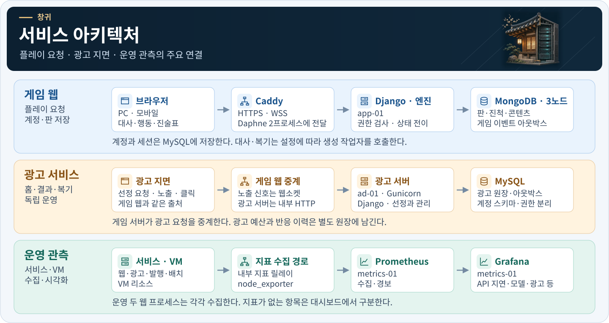
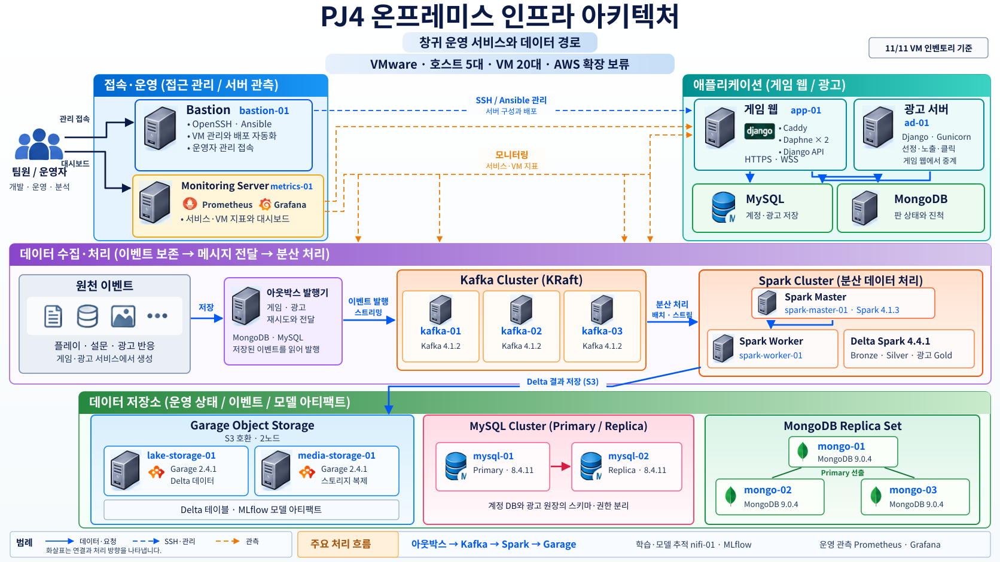
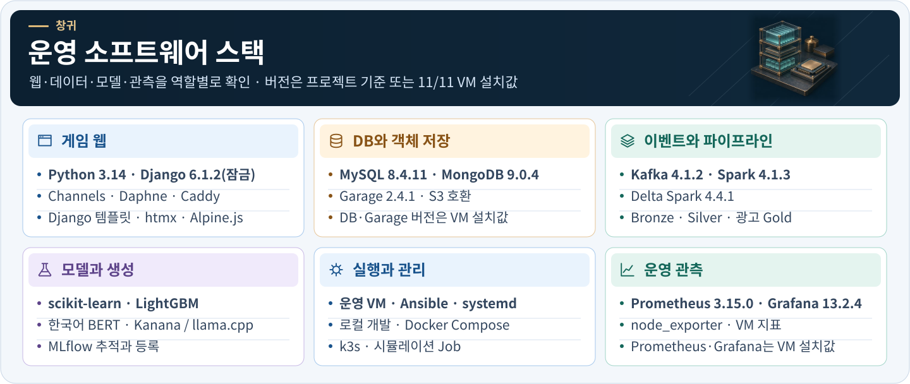
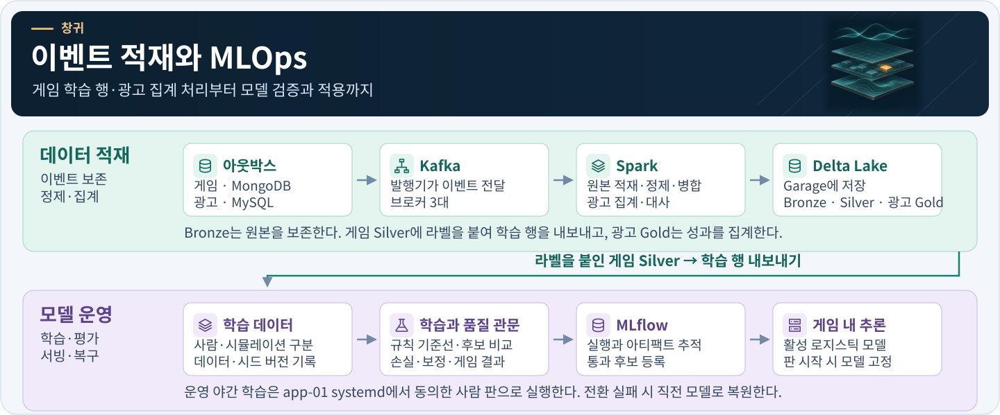

# 창귀: 귀신이 숨어든 마을

## 목차

1. [프로젝트 소개](#프로젝트-소개)
2. [팀원 소개](#팀원-소개)
3. [구현 현황](#구현-현황)
4. [실행](#실행)
5. [시스템 아키텍처](#시스템-아키텍처)
6. [기술 스택](#기술-스택)
7. [MLOps 구현과 검증 범위](#mlops-구현과-검증-범위)
8. [부하 측정 결과](#부하-측정-결과)
9. [코드와 문서 찾기](#코드와-문서-찾기)
10. [변경 제출과 병합](#변경-제출과-병합)
11. [발표 자료](#발표-자료)
12. [한 줄 회고](#한-줄-회고)

## 프로젝트 소개

한국의 창귀 전승을 소재로 한 싱글플레이 웹 추리 게임이다. 플레이어는 무당이 되어 주민의 행적을 대조하고, 점괘와 추궁으로 얻은 단서로 마을 회의에서 주민들을 설득한다.

[게임 소개와 플레이 화면](products.md)

## 팀원 소개

| 이름 | 역할 | 주요 담당 범위 | GitHub |
| --- | --- | --- | --- |
| **이여찬** | A·E 엔진·PM | 게임 규칙, 콘텐츠와 LLM, 통합 및 사용자 테스트 | [Ducks-Lee](https://github.com/Ducks-Lee) |
| **신성민** | C 인프라 | 서버 배포, 데이터 수집과 처리, 운영 관측 | [gururr-lab](https://github.com/gururr-lab) |
| **김영주** | B 웹·API | 게임 UI 디자인, 판 진행 API, 광고 지면 연동 | [escape<wbr>daily99](https://github.com/escapedaily99) |
| **이형인** | D ML·광고 | 의도 해석, NPC 의심 모델, 광고 선정과 과금 | [LEE<wbr>HYUNGIN](https://github.com/LEEHYUNGIN) |

## 구현 현황

- **플레이** — 가입·로그인, 족제비 튜토리얼, 일반 판과 배정 회차, 진행 중인 판 이어 하기. [웹 모듈](docs/modules/web.md), [튜토리얼 증빙](docs/evidence/E-11-14.md)
- **추리** — 회의·진술표·행적표·수첩·투표·밤 점치기, 주민 대사와 표정 연출. [웹 라우팅](web/ROUTING.md), [웹 디자인](web/DESIGN.md)
- **결과와 진척** — 결과·복기·원한 단서·공개 기록·설문 5개 탭, 단서 수집과 퇴마·한풀이 결말. [웹·게임 검증](docs/evidence/B-11-01.md)
- **모델과 데이터** — NPC의 의심 판단과 의도 해석, 이벤트 수집·집계, 모델 평가·승격·롤백 경로. [ML](docs/modules/ml.md), [데이터 파이프라인](docs/modules/pipeline.md), [모델 운영](docs/modules/ml_ops.md)
- **광고와 운영** — 홈·결과·복기 광고 지면, 별도 광고 관리자, Prometheus·Grafana 대시보드. [광고 연동 검증](docs/evidence/D-12-04.md), [운영 모듈](docs/modules/ops.md)

일반 로비의 공개 프리셋은 6인 기본 판(`base6`)이다. 8인 판 완주와 한풀이 결말은 별도의 로컬 검증 기록이 있다.

직접 입력은 기본 꺼짐이며, 복기 해설 생성과 NPC 대사 LLM도 환경과 모드 설정에 따라 동작한다.

[공개 프리셋](server/app/presets_enabled.json) · [서버 라우팅](server/ROUTING.md)

## 실행

화면을 확인하려면 Python 3.14 가상환경에서 [웹 의존성](requirements/web.txt)을 설치하고, 저장소 루트에서 아래 명령을 실행한다.

```powershell
python -B -m server.preview --port 8766
```

터미널에 출력된 주소를 브라우저에서 열고 미리보기 계정으로 로그인한다. 미리보기는 임시 SQLite와 녹화 판을 사용한다.

- 실제 저장소를 연결하는 개발 환경은 [로컬 Compose 안내](ops/compose/README.md)를 따른다.
- 서비스 시작과 복구는 [운영 런북](ops/runbook/README.md)을 따른다.
- 웹 기능 검증은 [서버 시험 안내](server/tests/README.md)를 따른다.

## 시스템 아키텍처

내부망 가상 서버에서 웹·광고·데이터 처리와 운영 지표 수집을 검증했다.

[인프라 검증 결과](docs/presentation/C.md) · [서버별 설치 목록](ops/inventory_check.md)

[](docs/presentation/changgui-infrastructure.svg)

- **게임 요청**은 Caddy가 HTTPS·WSS로 받아 웹에 전달한다. Django는 소유권과 입력을 확인한 뒤 엔진을 호출한다. 판 상태·명령 결과·발행할 게임 이벤트는 MongoDB 문서에 원자적으로 기록한다.\
  [VM 역할](ops/runbook/vm_roles.md) · [통합 계약](docs/contracts/integration.md) · [서버 디자인](server/DESIGN.md)
- **운영 관측**은 웹·광고·발행·처리 작업과 VM 지표를 Prometheus로 수집하고 Grafana에서 본다. 운영 광고 관리 화면과 Grafana의 광고 지표는 별도 기능이다.\
  [운영 모듈](docs/modules/ops.md) · [관측 구성](ops/prometheus/README.md)

### 온프레미스 인프라 구성

[](docs/presentation/changgui-vm-layout.svg)

- [가상 서버별 역할과 배치](ops/runbook/vm_roles.md)
- [서버별 설치 목록과 버전](ops/inventory_check.md)

## 기술 스택

[](docs/presentation/changgui-technology-stack.svg)

- **게임 엔진** — Python 3.14, 표준 라이브러리. 규칙·상태 전이·NPC 관측과 판단·시드 기반 재현
- **웹과 통신** — Django 6.1.2, Django 템플릿, htmx, Alpine.js, Channels 4.3.2·Daphne 4.2.3, Caddy.\
  계정·게임 API, PC/모바일 비주얼 노벨 UI, HTTPS·광고 신호 웹소켓. Django·Channels·Daphne 버전은 저장소 잠금값이다.
- **광고 서비스** — Django, Gunicorn. 내부 광고 선정·비콘·클릭 처리와 관리자 화면. 게임 웹이 브라우저 요청을 중계한다.
- **데이터 저장** — MongoDB Replica Set, MySQL 8.4.11. 판·진척·콘텐츠와 계정·광고 원장. 계정과 광고는 별도 스키마·계정
- **이벤트와 배치** — Kafka, Spark, Delta Lake, Garage. 이벤트 수집, 데이터 정제·집계, 학습 데이터와 아티팩트 저장. Garage는 S3 호환 객체 저장소
- **모델과 평가** — scikit-learn, LightGBM, 한국어 BERT, MLflow. 로지스틱 의심 모델·비교 모델, 의도 해석, 광고 CTR 학습, 평가·모델 기록
- **대사·복기** — Kanana, llama.cpp, Django 작업 프로세스.\
  코드의 NPC 생성 기본값은 `off`다. 운영 런북의 설정은 `polish`이며, 캐묻기 답 실시간 생성(`live`)은 별도 설정이다. 지연·실패 때 템플릿을 사용한다.\
  [생성 서버 운영 절차](ops/runbook/llm_gen.md)
- **개발·운영** — Docker Compose, Ansible, systemd, k3s, Prometheus·Grafana, node_exporter. 로컬 개발 환경, VM 배포·관측, 운영 야간 재학습, k3s 시뮬레이션 Job

### 운영 서버와 로컬 개발 환경

| 구성 요소 | 운영·로컬 환경 |
| --- | --- |
| **MongoDB** | 운영 9.0.4 · Replica Set 3노드<br>로컬 8.0.34 · Replica Set 1노드 |
| **Kafka** | 운영 4.1.2 · 브로커 3대<br>로컬 4.3.2 · KRaft 브로커 1대 |
| **Garage** | 운영 2.4.1 · 객체 저장소 2노드<br>로컬 2.5.0 · 개발 컨테이너 1대 |
| **MySQL** | 운영 8.4.11 · Primary와 Replica 각 1대<br>로컬 8.4.11 · 개발 컨테이너 1대 |
| **관측** | 운영·로컬 공통<br>Prometheus 3.15.0 · Grafana 13.2.4 |

운영 버전은 가상 서버에서 확인했고, 로컬 버전은 Compose 설정에서 확인할 수 있다. Spark 4.1.3과 Delta Spark 4.4.1 조합은 가상 서버에서 쓰기·읽기와 재처리를 검증했다.

[서버별 설치 목록](ops/inventory_check.md) · [Compose 설정](ops/compose/dev.yml) · [웹 의존성](requirements/web.txt) · [Spark·Delta 검증](docs/evidence/C-07-01.md)

## MLOps 구현과 검증 범위

[](docs/presentation/changgui-data-flow.svg)

게임과 광고 서비스는 아웃박스에 이벤트를 기록한 뒤 Kafka로 발행한다.

Spark는 Delta Bronze에 원본을 보존하고, 게임 Silver에 종료 라벨을 붙여 마을 관찰자의 학습 행을 JSON으로 내보낸다. 광고 Gold는 성과와 CTR을 집계하고 MySQL 원장과 대조한다.

[파이프라인](docs/modules/pipeline.md) · [학습 내보내기와 광고 집계](pipeline/README.md)

- **데이터와 재현** — 게임·선택·설문 이벤트를 적재한다. 학습용 사람 판과 시뮬레이션을 구분하고, 시드·데이터 버전·특징 버전을 기록한다. [데이터 흐름](docs/modules/pipeline.md)
- **학습과 관문** — 규칙 기준선·후보 모델을 비교한다. 의심 모델은 로그 손실·보정·게임 결과 등의 관문을 거치며, 실행과 아티팩트는 MLflow와 Garage에 남긴다. [모델 모듈](docs/modules/ml.md) · [수명주기 계약](docs/contracts/ml_lifecycle.md)
- **적용과 복구** — 로지스틱 의심 모델을 활성화한 웹 프로세스에서 직접 추론한다. 판 시작 시 모델 버전을 고정하고, 응답 지연이나 실패 때 규칙 판단으로 돌아간다. 판 단위 카나리아 배정과 롤백 경로를 갖추고 있다. [추론 검증](docs/evidence/D-08-01.md) · [롤백 런북](ops/runbook/rollback.md)
- **운영 야간 재학습** — `app-01`의 systemd 타이머로 동의한 사람 판을 학습한다. 관문을 통과한 후보를 등록한 뒤 설치·전환·상태 확인을 수행하고, 실패하면 직전 모델로 복원한다.\
  정기 재학습에서는 품질 기준에 못 미친 후보를 적용하지 않았다. 별도 진단 시험에서는 전환 뒤 직전 모델로 복원했다.\
  카나리아·대조 각 30판의 운영 증빙은 후속 범위다. [야간 실측](docs/evidence/D-10-01.md#1112-운영-야간-경로-반영)
- **추가 모델과 관측** — 씐 자 전략 밴딧의 판 단위 버전 고정과 일일 갱신을 로컬에서 검증했다. 운영 실행 증빙은 후속 범위다. LLM 작업자의 대기·생성·처리량 지표를 내보내는 기능도 로컬에서 검증했다. [밴딧](docs/evidence/D-12-05.md) · [LLM 작업자 지표](docs/evidence/E-12-01.md)

## 부하 측정 결과

p95는 요청의 95%가 이 시간 안에 응답했다는 뜻이다.

- **11/11 모델 직접 추론, 동시 30명·회차별 약 3분, Caddy·Daphne 2프로세스·격리 Mongo**\
  모델 켬 2회에서 클라이언트 API p95 **423.290 / 425.066ms**, Django p95 **392.956 / 381.988ms**.\
  추론 p95 버킷 상한 **50ms**, 엔진 폴백 **0.112% / 0.262%**, HTTP 오류 각 **0건**. 해당 시험 기준 2회 모두 충족.\
  [D-08-01 결과](docs/evidence/D-08-01.md#1111-직접-추론-공식-묶음-04-결과)
- **11/10 웹 프로세스 비교, 격리 Daphne·Caddy와 스크립트 엔진, 30명·3분**\
  1개 프로세스 API p95 **400.064ms**, 2개 **218.762ms**. 각 HTTP **5,400건**, HTTP·웹소켓 비콘 오류 **0건**.\
  [C-08-04 결과](docs/evidence/C-08-04.md)
- **활성 게임 30판 관측, 테스트 VM, HTTP 동시 실행 상한 12**\
  **30판 완료**, HTTP **303건 중 오류 0건**. 클라이언트 p95 **4,048.847ms**, Django 내부 p95 **1,152.402ms**. 이 실행의 서버 p95는 1초 기준 초과.\
  [C-08-01 결과](docs/evidence/C-08-01.md)

발표용 요약은 [발표 자료](#발표-자료)에서 확인할 수 있다.

## 코드와 문서 찾기

### 라우팅을 두 단계로 둔 이유

README에는 각 영역의 문서로 가는 링크를 모아 둔다. 세부 파일 위치는 영역별 라우팅 문서에서 관리한다.

같은 경로를 여러 문서에 반복해서 적으면 코드가 바뀔 때 설명이 어긋나기 쉽다. 영역별로 경로를 관리하면 여러 PR이 같은 문서에서 충돌하는 일도 줄일 수 있다.

[문서화 기준 10절](docs/tasks/README.md)

- **코드 위치** — 아래 [영역 안내](#영역-안내) → `docs/routing/<흐름>.md`.\
  B의 URL·API는 [서버 라우팅](server/ROUTING.md), 화면·템플릿·스크립트는 [웹 라우팅](web/ROUTING.md)으로 이어진다.
- **기획과 설계** — [기획서](docs/paldo_design_v1.md) · [결정 기록](docs/design_notes.md) · [제품 요구](docs/prd.md) · [업무 요구](docs/brd.md)
- **공통 계약** — [계약 색인](docs/contracts/README.md) → [폴더 구조](docs/contracts/structure.md) · [영역 간 통합](docs/contracts/integration.md)
- **실행과 검증** — [모듈 문서](docs/modules/README.md) · [태스크·완료 기준](docs/tasks/README.md) · [증빙](docs/evidence/) · [트러블 기록](docs/troubles/)
- **팀 일정과 리포트** — [팀 일정과 역할](docs/team_plan.md) · [리포트](docs/reports/)

### 계층과 의존 방향

```
server/api (표현) → server/app (응용) → engine (도메인)
server/infra (인프라) → engine (포트 구현)
```

- `engine/`은 표준 라이브러리만 쓴다. Django, Mongo, Kafka, ML, LLM 라이브러리를 import하지 않는다.
- `server/app`은 게임 유스케이스와 입출력 모델을 관리한다. Django 요청과 화면은 표현 계층이, 저장소와 외부 서비스 연결은 인프라 계층이 담당한다.\
  [구조 계약](docs/contracts/structure.md)
- `contracts/`(데이터셋 계약)는 `engine/`이 import하지 않는다.
- 광고: `ads/web → ads/app → ads/domain`, `ads/infra → ads/domain`. `ads/domain`은 표준 라이브러리만 쓴다. `engine/`과 `ads/`는 서로 import하지 않는다. 게임 서버는 `server/app/ads_port.py`(AdProvider)로만 광고를 부른다.

이 의존 방향 덕분에 Django·DB 없이 같은 시드로 규칙을 재현할 수 있다. 웹과 인프라는 계약에 정의된 입출력과 가짜 저장소로 각자 구현·검증한 뒤 실제 서비스에 연결한다.

[구조 계약](docs/contracts/structure.md) · [병렬 개발 계약](docs/contracts/parallel_dev.md)

### 영역 안내

저장소의 라우팅 기준(P-27)에 따라 공용 경로와 영역별 진입점은 이 README에서, 영역 안의 폴더와 작업 위치는 해당 흐름의 라우팅 문서에서 관리한다.

[문서화 기준](docs/tasks/README.md)

- **A · 엔진** — `engine/`(`engine/sim/`은 D) · [`docs/routing/A.md`](docs/routing/A.md)
- **B · 웹** — `server/api/`, `server/app/`, `web/templates/`, `web/static/` · [`docs/routing/B.md`](docs/routing/B.md)
- **C · 인프라·파이프라인·운영** — `server/infra/`, `pipeline/`, `ops/` · [`docs/routing/C.md`](docs/routing/C.md)
- **D · ML·광고** — `engine/sim/`, `intent/`, `ml/`, `ads/` · [`docs/routing/D.md`](docs/routing/D.md)
- **E · 콘텐츠·LLM·에셋 규격·저장소 운영** — `content/`, `llm/`, `.github/`, `.githooks/`, `docs/ops/`, `docs/assets/` · [`docs/routing/E.md`](docs/routing/E.md)
- **S · 발표 트랙** — `docs/presentation/` · [`docs/tasks/P_presentation.md`](docs/tasks/P_presentation.md)

### 공용 폴더 안내

여러 흐름이 함께 쓰는 폴더다. 영역 폴더는 위 "영역 안내"의 문서를 본다.

- `engine/testing/` — 모든 포트의 가짜 구현
- `requirements/` — 영역별 Python 패키지(`web`·`ml`·`llm`·`pipeline`, Python 3.14)
- `contracts/` — 학습 행, 의도 예시, 시나리오 스키마
- `fixtures/` — 계약 예시. `tools/build_fixtures.py`가 만든다
- `tools/` — 픽스처 생성, 합성 데이터 생성, 태스크 문서 파서(`tasks_md.py`)·이슈 동기화(`tasks_to_issues.py`),\
  저장소 배정 전 임시 운영(`interim.py` 표현·응용, `interim_rules.py` 도메인), 엔진 판 실행·인수 검사(`run_engine_games.py`, `check_handoff_a06.py`)
- `tools/perf/` — 측정 스크립트. 결과 JSON은 `tools/evidence_result.py`로 `docs/evidence/perf/<ID>/`에 쓴다(엔진 `engine_bench.py`)
- `tests/contract/` — 계약 테스트(unittest)
- `tests/tools/` — 도구 테스트(태스크 파서·이슈 동기화·임시 운영 흐름은 임시 git 저장소와 임시 폴더로)
- `docs/evidence/` — 태스크 증빙 `<ID>.md`, 측정 결과 JSON `perf/<ID>/<이름>.json`(`tools/evidence_result.py`로만 쓴다)
- `docs/modules/`, `docs/troubles/` — 모듈 문서, 흐름별 트러블 기록(양식 `_template.md`)
- `ops/privacy/` — 보존 대상 목록을 생성하는 systemd 단위

"예정"인 폴더는 담당 흐름이 처음 코드를 넣을 때 만든다.

### 공용 작업별 위치

- **이벤트나 학습 데이터 형식 변경** — `engine/domain/events.py`, `contracts/datasets.py`, `docs/contracts/events.md`
- **개인정보 처리** — `docs/contracts/privacy.md`
- **삭제·보존 운영** — `ops/runbook/privacy.md`, `ops/privacy/`, `tools/privacy_delete.py`, `tools/privacy_retention.py`
- **서버와 버전** — `docs/contracts/tech_stack.md`, `ops/runbook/vm_roles.md`
- **모델 추적과 등록 관문** — `ops/mlflow/`, `tools/ml_gate.py`, `docs/modules/ml_ops.md`
- **다른 흐름 없이 개발 시작** — `docs/contracts/parallel_dev.md`
- **새 파일·폴더를 어디에 만들지** — `docs/contracts/structure.md`(1절 트리, 6절 허용 폴더 목록)
- **새 폴더 만들기(허용 목록 밖)** — PM 승인 → `docs/contracts/structure.md` 6절·1절 먼저 고침 → 로컬 검사 `python -m tools.check_structure --diff <base>`
- **다른 영역을 어떻게 부르는지(포트·HTTP·토픽·주소 변수·가짜·통합 시점)** — `docs/contracts/integration.md`
- **오늘 내가 할 일과 완료 조건** — `docs/tasks/<흐름>.md`(A_engine, B_web, C_infra, D_ml_ads, E_pm), 발표 작업은 발표 트랙 `docs/tasks/P_presentation.md`(S-xx, 담당 P-24)
- **태스크 완료 증빙 쓰기** — `docs/tasks/README.md` 4절 양식 → `docs/evidence/`
- **태스크 문서화(트러블·docstring은 태스크마다, 모듈 문서는 흐름별 하루 1회 일괄 갱신)** — `docs/tasks/README.md` 10절 → `docs/modules/`, `docs/troubles/`
- **이슈 만들기·동기화, 오늘 열린 태스크 보기** — `python -m tools.tasks_to_issues --dry-run`, `docs/tasks/README.md` 11절
- **dev 받기·충돌 풀기, 여럿이 고치는 파일(README 표 등)에 행 넣기** — `docs/tasks/README.md` 3절 "브랜치 모델"
- **로컬 검사(precheck)·증빙·문서화·비밀정보 검사 규칙 바꾸기**\
  표현 `.githooks/pre-push`, 응용 `tools/precheck.py`(테스트 대상 고르기·무거운 테스트 목록 도메인 `tools/precheck_scope.py`, 테스트 빼고 실행 `tools/run_tests.py`),\
  규칙 `tools/check_evidence.py`·`check_docs.py`·`check_secrets.py`·`check_structure.py`,\
  예외 `tools/secrets_allowlist.txt`, 설명 `docs/modules/ci.md`
- **저장소 배정 전 제출·병합(NAS 번들, 로컬 CI, 원장, 진행표)** — 표현·응용 `tools/interim.py`, 규칙(도메인) `tools/interim_rules.py`, 기록 `docs/ops/interim_ledger.md`, 절차 `docs/tasks/README.md` 10-1절
- **태스크 조건 바꾸기** — `docs/tasks/<흐름>.md`를 고치는 PR(이슈 본문은 직접 고치지 않음)
- **로그·지표 이름 정하기** — `docs/tasks/README.md` 5절
- **사용자 테스트 지표·회차 등록 가명 ID·`test_human` 동결** — 인프라(읽기 전용 내보내기) `server/infra/ut_export.py` → 도메인·CLI `tools/ut_metrics.py`·`tools/ut_freeze.py`, 지표 정의 변경은 `tools/ut_metrics.py` `DEFINITIONS`, 설명 `docs/modules/user_test.md`

## 변경 제출과 병합

### 작업 브랜치에서 PR까지

1. **작업 시작** — 처음 받은 저장소에서 `git config core.hooksPath .githooks`를 한 번 실행한다. `git fetch origin`으로 최신 통합 브랜치를 받고 `origin/dev`에서 `task/<ID>`를 만든다.
2. **변경과 검증** — 관련 코드·문서·증빙을 함께 준비한다. 작업 중에는 `python -m tools.precheck --quick`으로 확인한다.\
   PR을 올리기 직전에 `git fetch origin` 후 `git merge origin/dev`로 통합 변경을 받아 검증 기준을 맞춘다.
3. **PR 본문 검사** — [저장소 템플릿](.github/pull_request_template.md)에 태스크 ID, 이슈 연결, 변경 내용과 증빙을 적고 본문을 파일로 저장한다.\
   `python -m tools.precheck --pr-body pr.md`를 실행해 마지막 통과 줄을 본문에 붙인다. 에셋 변경에 해당하면 `--with-assets`를 추가한다.
4. **푸시와 리뷰** — 작업 브랜치를 푸시하고 `dev` 대상 PR을 연다. 작성자 외 1명의 승인과 `precheck: 통과`를 확인한 뒤 PM이 merge commit으로 병합한다. 배포용 `main`은 PM이 별도 승격 PR로 갱신한다.\
   [브랜치와 공통 완료 정의](docs/tasks/README.md#3-공통-완료-정의-모든-태스크) · [이슈 연결 규칙](docs/tasks/README.md#11-github-issues로-관리하기)

### 이 규칙을 사용하는 이유

- **로컬 검사와 pre-push 훅** — 조직 공용 GitHub Actions 사용량을 아끼면서 구조·비밀정보·관련 테스트·문서·증빙을 푸시 전에 검사한다. 훅은 코드와 파일을 검사하고, PR 본문 검사는 작성자가 별도로 실행한다.
- **PR 하나에 태스크 하나** — 이슈 완료 조건을 해당 변경과 증빙에 연결한다. 모두 충족했으면 본문의 `Closes #<번호>`, 일부 검증이 남아 있으면 `Refs #<번호>`로 상태를 전달한다.
- **리뷰 후 merge commit** — 변경 책임과 검증 시점을 확인하고, 증빙이 참조하는 커밋 SHA를 통합 브랜치 이력에 보존한다.
- **통합과 배포 브랜치** — `dev`에서 여러 영역의 변경을 먼저 검증한다. `main`은 PM이 검증을 마친 배포 후보를 승격할 때 갱신한다.

### 공용 도구

```powershell
python -m tools.precheck --full-tests                     # PM이 배포 후보 전 dev에서 전체 검사
python -m unittest discover -s tests -t .                 # 계약 테스트
python -m tools.build_fixtures                            # 픽스처 재생성(계약 변경 후)
python -m tools.gen_synthetic --games 50 --seed 7 --ads 20000 --out out/synthetic
python -m tools.tasks_to_issues --dry-run                 # 태스크 → 이슈 계획(실제 생성은 --apply --repo)
python -m tools.tasks_to_issues --hours                   # 흐름별 일별 시간(문서화·일괄 갱신 포함, 흐름별 한도, 발표 트랙은 별도 줄)
```

텍스트 파일은 UTF-8(BOM 없음), 줄바꿈 LF다(`.gitattributes`가 고정, Windows 스크립트 `.ps1`·`.bat`·`.cmd`만 CRLF).

접속 정보(IP, 계정, 비밀번호)는 이 저장소에 넣지 않는다.

<!-- 구성도 머리글 일러스트 · Codex 내장 이미지 생성 도구
Use case: productivity-visual. Create a premium editorial technical illustration atlas for a Korean mystery game’s engineering README. Square canvas, precisely four equal rectangular image tiles as a 2×2 contact sheet without gutters, exact separation at the vertical and horizontal midpoints. All tiles use the same clean midnight navy background (#10263a), antique brass accents and restrained icy teal light. Top left: a small Korean hanok village eave and warm lantern integrated with a precise architectural section of a modern server rack. Top right: five compact abstract server rack units arranged in a clean, orthogonal isometric composition. Bottom left: an organized stack of glass-and-metal modules and a processor on a dark workbench. Bottom right: a set of data layers beneath a few restrained, smooth teal signal traces, with a single amber highlight. Focus each motif in the middle of its own quadrant, with comfortable dark negative space around its edges. High quality refined isometric editorial rendering, sharp geometry, softly lit materials, cohesive restrained palette, legible silhouettes even at small sizes. Decorative only: absolutely no text, numbers, letters, emblems, labels, arrows, connectors between tiles, pseudo UI or legending. This artwork will sit beside real diagram headings; keep it clean and understated.
-->

## 발표 자료

<p align="center">
  <a href="https://docs.google.com/presentation/d/1Pyb255HfLd-p7O-wabPb-6uGhEn58MEwjWVI77puqrE/edit?slide=id.p1#slide=id.p1">
    
  </a>
</p>

## 한 줄 회고

**이여찬**

> 게임 진행은 정해진 규칙으로 보장하고, AI는 늦거나 틀려도 게임이 멈추지 않는 자리에만 둔 설계가 실제 운영에서 가장 큰 안전장치가 됐습니다.

**신성민**

> 인프라 구성은 전체 연결의 가장 큰 핵심이라는 걸 깨달았다.

**김영주**

> 안정적인 웹·API 구현과 연동 작업의 완성도가 시스템의 신뢰성을 포함해 사용자 경험을 높이는 데 있어서 필수적이라는 걸 다시 한번 깨달았습니다.

**이형인**

> 많은 걸 배울 수 있는 프로젝트였습니다. 다만 발표자료 준비가 미흡했던 점과 팀원 이슈가 많이 아쉬웠습니다.
