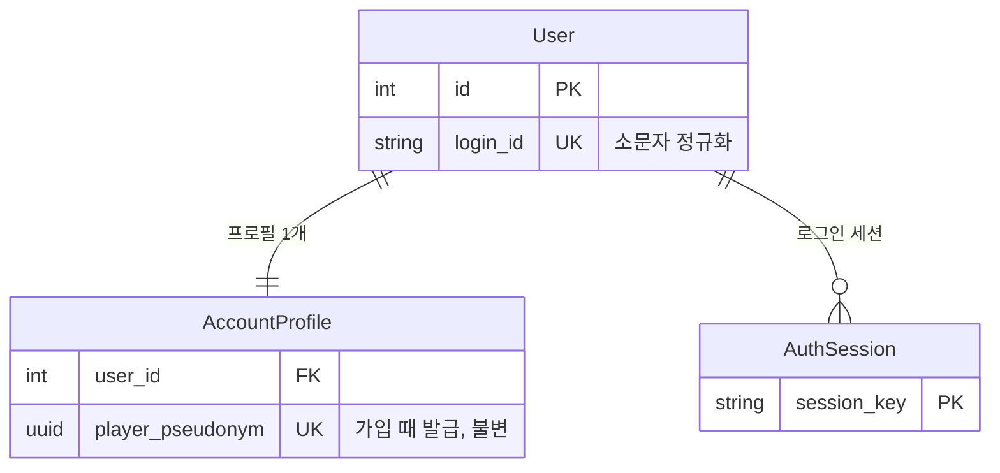
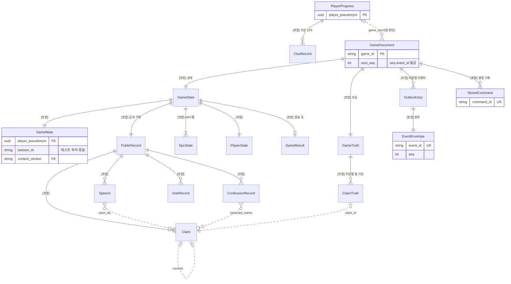
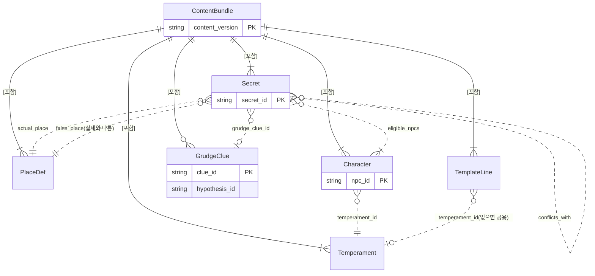
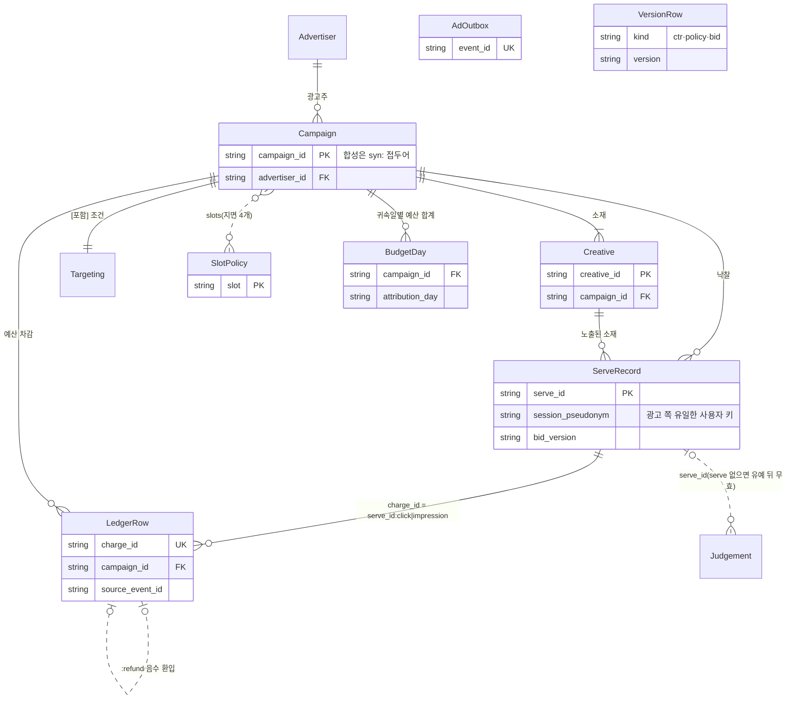
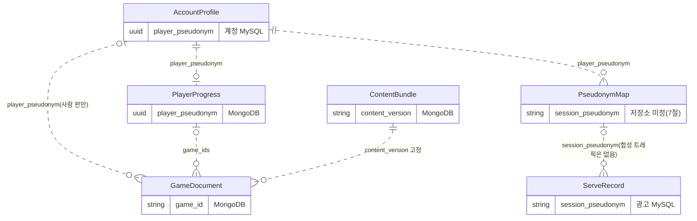
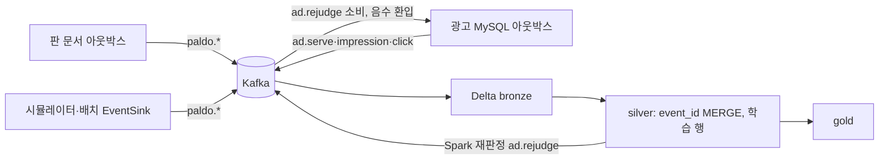

# 데이터 모델 개요 (개념 ERD)

저장소별로 어떤 엔터티가 있고 서로 어떻게 이어지는지를 한눈에 보는 **안내 문서**다. 계약이 아니다. 컬럼, 인덱스, 실제 테이블·컬렉션 이름은 적지 않는다. 원본은 각 저장소를 만드는 태스크의 산출물과 아래 근거 문서다([README](README.md) 2절 표). 이 문서와 원본이 다르면 원본이 맞다.

- 엔터티 이름은 코드의 클래스 이름(`engine/domain/`, `engine/ports.py`, `ads/domain/`)을 따른다. 코드에 클래스가 없는 개념은 계약 문구에서 가져온 **설명용 이름**을 쓰고, 실제 이름은 저장소를 만드는 태스크가 정한다(7절). 설명용 이름: `User`·`AuthSession`(Django 기본), `GameDocument`, `AdOutbox`, `BudgetDay`, `VersionRow`, `Advertiser`, `PseudonymMap`.
- 다이어그램 안에는 식별 키만 적는다(PK = 식별자, FK = 다른 엔터티를 가리키는 값, UK = 유일).
- 관계 선은 개념상 관계만 뜻하고 DB 외래 키 제약 유무와는 무관하다. 실선(`--`)은 상위가 하위를 소유·포함하는 관계, 점선(`..`)은 ID 값으로 가리키기만 하는 관계다. 이벤트 발행·적재 같은 흐름은 ERD에 넣지 않고 5절의 흐름도로 따로 그린다.

## 1. 계정 MySQL

- Django 기본 사용자 모델(`User`)에 `accounts` 프로필(가명 ID, 동의 시각, 잠금 상태)을 붙인다. 인증·세션·admin 테이블도 같은 `default` DB에 둔다([privacy.md](privacy.md) 5절, B-06-04).
- **로그인 ID와 비밀번호 해시는 이 저장소에만 있다.** 게임 쪽 저장소는 `player_pseudonym`만, 광고 저장소는 `session_pseudonym`만 쓴다(privacy.md 1절, ads.md).
- 가입 남용 카운터도 이 저장소에 10분 동안만 두며, 계정·가명 ID와 연결하지 않는다(그래서 그리지 않았다).

## 2. 게임 MongoDB: 판 문서와 진행 상태

판 하나가 문서 하나다. 아래에서 `GameDocument` 안의 엔터티는 별도 컬렉션이 아니라 **문서 안에 들어 있는(embedded) 부분**이다. 실선은 "문서 안에 포함", 관계 이름 앞의 `[포함]`으로 한 번 더 표시했다.

- 상태·진실·아웃박스·명령 기록은 `GameRepository.commit` 한 번에 **같은 문서에 원자적으로** 쓴다. 상태를 바꾸지 않는 이벤트(해석 시도, 카드 반응, 수첩, 설문, 렌더 결과)는 `append_events`로 같은 아웃박스에 `dedup_key` 멱등으로 넣는다. `seq`·`event_id`는 저장소가 `next_seq`로 매긴다([ports.md](ports.md) 1절, [기획서](../paldo_design_v1.md) v1.2 4.3).
- `PublicRecord`에는 그림의 네 가지 외에 `LockRecord`, `DisappearanceRecord`, `TellRecord`도 들어 있다(그림을 줄이려고 뺐다). `NpcState`는 다시 비공개 지식(`PrivateKnowledge`, 목격 `Sighting`), 믿음(`Beliefs`), 런타임(`NpcRuntime`)을 품는다([domain.md](domain.md), `engine/domain/model.py`).
- `GameTruth`는 브라우저 응답·관측에 섞이지 않는다. 진실 이벤트(`paldo.truth`)는 판이 끝난 뒤에만 나간다([events.md](events.md) 3절).
- `GameMeta.player_pseudonym`은 사람 판에만 있다(시뮬레이션 판은 없음). `PlayerProgress`는 가명 ID별 진행 상태(단서, 결말 해금, 본 고백)로 판 문서와 별도로 저장하고, 원천 이벤트 ID(`source_event_id`)로 멱등하게 갱신한다(`ProgressRepository`).

## 3. 콘텐츠 묶음

- 묶음 하나가 `content_version` 하나다. 판 시작 때 그 버전을 `GameMeta`에 고정하고, 이전 버전도 계속 제공한다([content.md](content.md), [integration.md](integration.md) G6).
- 판 문서는 콘텐츠를 복사하지 않고 ID로 가리킨다: `NpcState.npc_id` → `Character`, 비밀 배정 → `Secret`, `ClueRecord.clue_id` → `GrudgeClue`.
- 원본 파일은 `content/*.json`이고, `tools/load_content.py`가 MongoDB에 새 버전으로 적재한다(C-06-01). 엔진은 `ContentSource.load(content_version)`로만 읽는다.

## 4. 광고 MySQL

- 구조는 광고주 → `Campaign` → `Creative`, 지면은 4개이고 지면별 정책은 `SlotPolicy`다([ads.md](ads.md) 2절).
- 원장은 예약 → 확정 → 해제로 상태가 바뀌고, 확정 뒤 무효 재판정은 원래 행을 두고 음수 환입 행(`:refund`)을 추가한다. 판정 결과 저장·예약 확정·아웃박스 행은 **같은 MySQL 트랜잭션**이다([ads.md](ads.md) 5절).
- `Judgement`는 수신한 노출·클릭 이벤트마다 남는 판정이다. 서명 오류여도 판정이 남고, serve 기록이 안 보이면 최초 수신부터 2분 동안 `pending`, 그 뒤 `no_serve` 무효가 되므로 serve는 선택 참조다(ads.md 6절 판정 순서). 예산은 (캠페인, 귀속일) 예산 행을 잠그고 원장 행과 함께 쓴다(`ads/domain/rules.py` `BudgetBook`).
- `AdOutbox`(`ad.serve`·`ad.impression`·`ad.click` 발행 대기 행)와 `VersionRow`는 특정 엔터티에 매이지 않아 선 없이 두었다. `VersionRow`는 CTR·페이싱·자동 입찰가 갱신 값(`ctr_version`, `policy_version`, `bid_version`)으로, 광고 서버가 60초마다 다시 읽는다.
- **광고 저장소에는 `player_pseudonym`도 게임 내용도 없다.** 사용자 키는 `session_pseudonym`뿐이다.

## 5. 저장소 사이 전체 그림

- 저장소 사이는 모두 **ID 값으로만** 이어진다(점선). 계정 → 게임은 `player_pseudonym`, 게임 → 콘텐츠는 `content_version`, 게임 → 광고는 `session_pseudonym`이다.
- 광고는 `player_pseudonym`을 모른다. 둘을 잇는 대응표(`PseudonymMap`)는 게임 서버 쪽에 있고, 개인정보 삭제 요청(C-09-02)이 광고 기록을 찾을 때만 쓴다(B-06-03 4-1).
- 시뮬레이션 판과 합성 광고 트래픽에는 계정이 없다. 그래서 계정·대응표 쪽은 "0 또는 1"이다.

이벤트 흐름(ERD가 아니라 방향이 있는 흐름이다):

- 웹 게임과 광고 서버의 이벤트는 아웃박스 → Kafka → Delta로 흐른다. 아웃박스가 없는 시뮬레이터·배치는 `EventSink.append`로 Kafka에 바로 보낸다([ports.md](ports.md) 1절). Delta는 `event_id`로 MERGE해 중복을 없앤다. 광고 재판정 결과는 Spark가 `ad.rejudge`로 보내고 환입 소비자가 원장에 음수 행을 쓴다([events.md](events.md), [ads.md](ads.md) 5·7절).
- 학습 입력은 진실이 빠진 `ObservationSnapshot`이고, 정답은 판이 끝난 뒤 `game_id`로 붙인다(events.md 3절).

## 6. 이 문서를 고칠 때

- 엔터티나 관계가 바뀌는 태스크(저장소 스키마, 계약 변경)를 병합할 때 같은 PR에서 해당 다이어그램을 고친다. 컬럼이 바뀌는 것만으로는 고치지 않는다.
- 새 엔터티를 그리기 전에 코드나 계약 문서에 이름이 있는지 확인한다. 없으면 7절에 먼저 올린다.

## 7. 확인 필요

| 항목 | 지금 아는 것 | 정해질 곳 |
|---|---|---|
| `PseudonymMap`(세션 가명 ↔ 플레이어 가명 대응표)의 저장소와 이름 | "서버에 저장"만 정해졌다 | B-06-03 4-1, C-09-02 |
| 계정 프로필 실제 모델 이름과 잠금 상태 저장 방식 | `server/accounts/models.py`가 아직 없다 | B-06-04 |
| 광고 MySQL 실제 테이블 구성(광고주·캠페인·지면 정책·버전 행을 각각 테이블로 둘지) | `ads/infra/schema.sql`이 아직 없다. 4절은 `ads/domain/model.py`·`rules.py` 클래스 기준 | D-06-02 |
| `PlayerProgress`를 어떤 컬렉션에 둘지 | 기획서 v1.2 4.4에 mongo-01~03이 "플레이어 상태"를 맡는다고만 있다 | C-06-01 |
| 테스트 세션(`session_id`)과 고정 시드 판 목록의 저장 위치 | 운영자가 만들고 지정한다(B-06-03 3) | B-06-03 |
| 설문·복기, LLM 작업(`job_id`)·의도 해석 시도(`attempt_id`)의 조회용 저장 구조 | 이벤트는 판 아웃박스(`append_events`)에 들어간다. 따로 조회용 저장 구조를 둘지는 미정 | B·C 해당 태스크 |
| 멱등 기록의 배치: `append_events`의 `dedup_key`, `PlayerProgress`가 반영한 `source_event_id` | 멱등 동작은 정해졌다(`engine/ports.py`). 판 문서·진행 문서 안에 둘지 따로 둘지는 미정 | C-06-01 |
| 삭제한 가명 ID 목록의 저장소와 보존 방식 | 삭제 뒤 목록에 남겨 재학습 입력에서 뺀다(C-09-02 2, D-10-01 7) | C-09-02 |
| 귀속일별 예산 행(`BudgetDay`), 판정 결과, 광고 아웃박스의 실제 테이블 | (캠페인, 귀속일) 예산 행을 잠그고 원장·아웃박스와 한 트랜잭션(`BudgetBook` 설명) | D-06-02 |
| Delta 테이블 이름과 silver 학습 행 구성 | bronze → silver → gold, `event_id` MERGE | C-07-01 등 |
