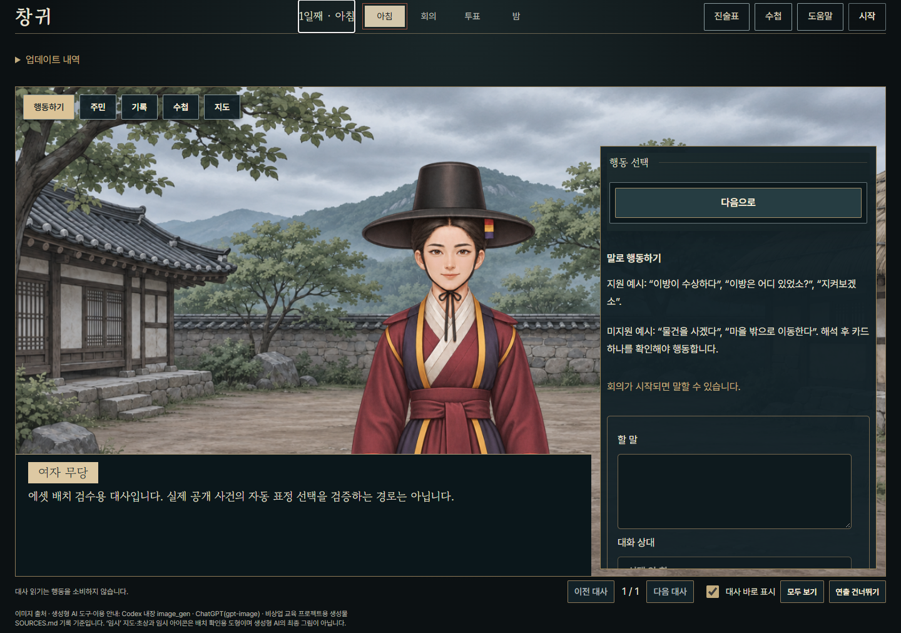
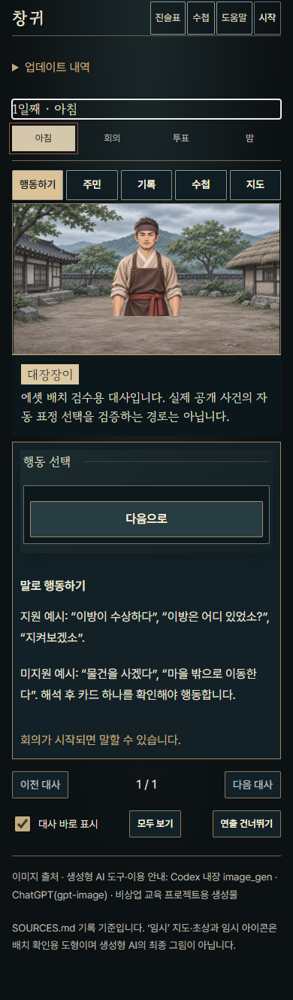

# A-10-06 확정 기쁨·당황 16종 적용·생성 기록 복구
- 상태: 산출물 검증 통과 · 커밋 후 최종 SHA 갱신 전
- 커밋: 559a3c4dec5748c5ac89b9823f68630afa9c94c6
- 작성자(흐름): A
- 담당: B
- 환경: Windows, Python 3.14.6·Django 6.1.2 기존 B-05-01 가상환경 및 기존 ws·mongo·kafka 추가 패키지 경로
- 작성일: 2026-11-10

위 SHA는 반영 dev 기준이다. 에셋 파일 변경의 커밋·푸시는 사용자 확인 전이며, 구현 커밋이 생기면 증빙 SHA를 갱신해 최종 재검사한다. 기본 sprite 입력 커밋은 9d4b8dbe5f82b148bebe73ee0117ef0102ac2f63이고 두 기준 사이 기본 8명은 동일하다.

## 명령

python -m tools.assets.make_placeholders --check
python -m tools.assets.check_assets --placeholder
python out/handoff/expression-preview-current/apply-preparation/verify_recovered_history.py
python -m tools.check_evidence A-10-06 --complete
python -m tools.precheck --with-assets

## 출력

- 선택된 결과 16장과 생성 단계 19개의 원문·모델 표기·생성 시각·입력 및 조립 관계를 복구했다.
- 최종 결과와 확정본 SHA 일치, 기본 파일 SHA 일치, 얼굴 밖 위반 0.
- 브랜치별 check_assets --placeholder 종료 0, 파일·manifest 103개 일치, 에셋2~4 위반 0. 임시 허용 모드에서도 실제 파일 규격·출처 칸은 검사한다.
- 이전 최종 precheck 1,314개 통과(base 00fa457). 이번에는 이미지 픽셀을 바꾸지 않고 복구 기록·증빙만 갱신했다.

## 수치

| 조건 | 기준 | 측정값 | 측정 방법 | 결과 파일 | 통과 |
|---|---|---|---|---|---|
| 1 | == 16 개 | 16 개 | 기쁨·당황 8명씩 전신·초상 등록 | docs/evidence/perf/A-10-06/source_recovery.json#selected_outputs | 예 |
| 2 | == 0 건 | 0 건 | 원본 SHA·얼굴 밖 동일성 및 초상 파생 검사 | docs/evidence/perf/A-10-06/source_recovery.json#outside_face_violations | 예 |
| 3 | == 0 건 | 0 건 | 선택 생성 단계 원문·모델·생성 시각 및 edited_from 연결 | docs/evidence/perf/A-10-06/source_recovery.json#missing_generation_fields | 예 |
| 4 | - | 고정 공개 인물 ID·표정 ID의 그림만 교체, 역할·거짓 여부·숨은 상태 입력이나 사건 선택 코드 변경 없음 | 변경 파일·원문 프롬프트 대조 | - | 예 |
| 5 | == 0 건 | 0 건 | 에셋3 규격·make_placeholders --check | docs/evidence/perf/A-10-06/assets.json#spec_violation_count | 예 |
| 5 | == 0 건 | 0 건 | 에셋2 생성 기록 칸 | docs/evidence/perf/A-10-06/assets.json#record_missing_count | 예 |
| 5 | == 0 건 | 0 건 | 에셋4 누락 | docs/evidence/perf/A-10-06/assets.json#missing_count | 예 |
| 5 | == 0 건 | 0 건 | 에셋4 초과 | docs/evidence/perf/A-10-06/assets.json#extra_count | 예 |

## 로그

docs/evidence/perf/A-10-06/assets.json, source_recovery.json에 계측값을 보관했다. 전체 precheck 상세는 로컬 out/handoff/precheck-final.log에 있다.

## 트러블

[A-10-06](../troubles/A.md#A-10-06): 처음에는 정리된 미리보기만 확인해 생성 원문·시각이 없다고 판단했다. 과거 도구 호출·반환 PNG와 보존 스크립트를 대조해 선택된 기록을 복구했다. 버린 모든 시안의 전체 이력을 별도 완료 조건으로 추가하지 않는다.

## 문서

- 출처 표: content/images/SOURCES.md
- [선택 생성 단계·입력·결과 SHA·조립 스크립트 전문](A-10-06-sources.json)
- [assets 모듈](../modules/assets.md), [E 라우팅](../routing/E.md)
- server·web DESIGN.md와 ROUTING.md
- 계약·기획·태스크 문서 수정 없음.
- C2PA는 내부 생성 정보만 읽었으며 서명 유효성 검증은 하지 않았다. 시드·별도 부정 프롬프트 필드는 도구 미지원으로 그대로 기록했다.
- 에셋1·5의 E-11-10 일괄 검수는 별도 태스크이며 이번 개별 자동 검사 완료 조건에 추가하지 않는다.

## 출처 복구 후 최종 검사

precheck: 통과 (구조·비밀·테스트·문서·증빙, 테스트 1314개, base 00fa457, 208초)

완료용 PR 본문(Closes #17)을 포함한 검사다. 출처 기록 때문에 남아 있던 보완 대기는 해소됐다. 구현 커밋 생성 후에는 증빙 SHA를 해당 커밋으로 갱신하고 최종 확인한다.

## PC·모바일 UI 검수 (2026-11-10)

Chrome 156.0.8078.48·Playwright에서 1440×1000, 390×844, 360×800으로 확인했다. 이 세션에는 Browser 플러그인이 없어 Playwright로 로컬 Chrome을 실행했다. 기존 Django 6.1.2 시험 서버·임시 SQLite·메모리 게임 대역을 사용했고 운영 DB·환경 설정은 바꾸지 않았다. 두 작업 브랜치는 병합하지 않고 무시되는 `out/handoff/ui-asset-qa/runtime`에 에셋을 함께 읽는 시험 전용 구성을 만들었다.

- 기본·기쁨·당황·슬픔 8명 × 일반/전신 모드 × 화면 3개 = 192개. 이번 태스크 표정은 96개, 기본 표정 비교는 48개다. 얼굴 가림·가로 넘침·이미지 로드 실패·브라우저 예외·콘솔 오류·관련 HTTP 오류는 각 0건이다.
- 홈·인물 목록·아침·회의·추궁·투표·밤·종료 등 27개 화면을 확인했다. PC·모바일 각각 대사 이동, 기록창 열기/닫기, 실제 명령 제출로 아침→첫 회의 전환을 확인했다. 모바일 투표의 마지막 대상과 결과의 홈 링크도 내부 스크롤로 접근된다.
- 일반 모드는 대사창 위 상반신, 전신 모드는 전체 인물을 표시한다. 모바일은 무대를 축소하므로 PC보다 얼굴 감정이 작게 보인다. 그림 깨짐이나 얼굴 가림은 재현되지 않았다.

### 별도 발견: 공개 사건별 자동 표정 연결 누락

에셋을 지정한 192개 검수는 **파일과 배치 검사**다. 실제 사건 선택 검사를 대신하지 않는다. 수정하지 않은 게임 대사의 아침 첫 주민(대장장이)은 희생자 발표 뒤에도 `sprite/blacksmith.png`를 사용했다. `docs/assets/spec.md` 7절의 그날 첫 대사 `sad` 기대와 다르다. `server/api/vn_script.py`는 아침 진술·감금 전신을 기본 `sprite:<id>`로 만들고, `web/static/js/ui-vn.js`는 전달받은 그림을 그대로 읽는다. 공개 사건별 표정 선택 연결은 현재 빠져 있다. 현재 문서상 E 담당 `B-10-07`의 전환 작업과 연계해 별도 수정·재검증해야 한다. 이번에는 이미지·운영 선택 코드를 추가 변경하지 않았다.

이 결과로 게임 자동 표정 전환이나 B-10-07 전체를 완료 처리하지 않는다. VM·실제 DB·실기기/Safari·모든 게임 사건 조합은 이번 검수 범위가 아니다. 이전 1,314개 테스트 결과와 이번 브라우저 검수는 별개이며, 검수 뒤에는 증빙·문서만 변경했다.

계측: `docs/evidence/perf/A-10-06/ui_qa.json`. 아래 스크린샷은 시험 전용 에셋 지정 경로로 캡처했다.

## PR 준비: 최신 dev 대조 (2026-11-10)

최신 dev `559a3c4`를 두 브랜치에 각각 반영했다. 의심·모순 지적 즉시 반응과 Kanana 생성 수단 관련 기존 변경을 보존했다. 이 PR의 dev 대비 차이는 확정 에셋·manifest·출처·증빙·관련 문서뿐이다. 실행 코드(.py·.js·.html·.css) 변경 0개, 기존 확정 PNG SHA 변경 0개, 생성 기록·얼굴 밖 보존·에셋 규격 재검사 통과. 표정 자동 선택·복귀 구현은 B-10-07에서 따로 한다.

앞 절의 PC·모바일 192개 캡처는 `00fa457` 기준의 시험 전용 조합 결과다. 이번 dev 반영 후 같은 캡처를 새로 측정한 것으로 표기하지 않는다. 최신 코드 통합 검사는 별도 precheck 결과를 따른다. 구현 커밋 생성 전이므로 현재 증빙의 커밋 값은 최신 dev 기준이며, 커밋 후 SHA와 최종 검사를 갱신해야 한다.

### 최신 dev 반영 후 검사 결과

precheck: 통과 (구조·비밀·테스트·문서·증빙, 테스트 1314개, base 559a3c4, 230초)

`python -m tools.precheck --with-assets --pr-body out/handoff/pr-draft.md` 결과다. 커밋·푸시·PR은 생성하지 않았으며 사용자 초안 확인을 기다린다.
