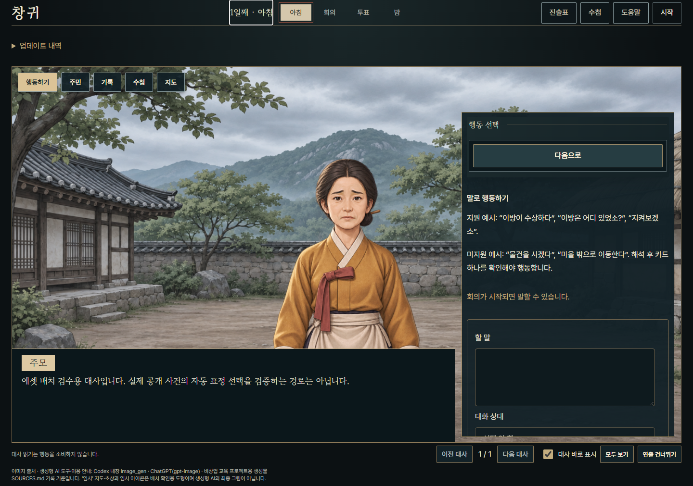
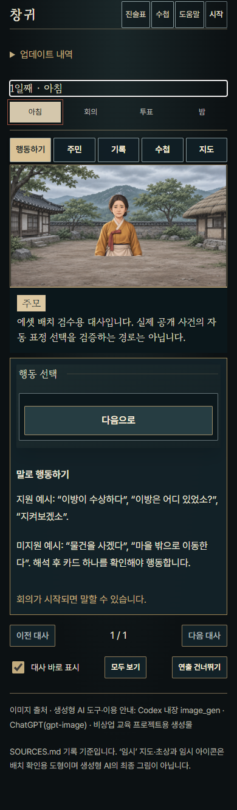

# A-11-04 추가 주민 2명 기본 그림 및 확정 슬픔 8종
- 상태: 실패 (추가 주민·슬픔 에셋 등록 완료, 전체 실제 에셋 모드는 기존 임시 항목으로 미통과)
- 커밋: 4f2b8f2d2feef0a65ba5a83c56b68a60c2b35df4
- 작성자(흐름): A
- 담당: B
- 환경: Windows, Python 3.14.6·Django 6.1.2 기존 B-05-01 가상환경 및 기존 ws·mongo·kafka 추가 패키지 경로
- 작성일: 2026-11-10

위 SHA와 11/10 기록은 PR #363이 반영된 dev와 슬픔 에셋을 통합한 검증 이력이다. assets.json은 이 통합 커밋에서 재측정했다. source_recovery.json은 에셋 구현 acfe833, UI 캡처는 실제 검수 당시 00fa457 기록을 보존한다. 기본 sprite 입력 커밋은 9d4b8dbe5f82b148bebe73ee0117ef0102ac2f63이고 두 기준 사이 기본 8명은 동일하다. 11/11 추가 주민 검증은 마지막 절에 있다.

## 명령

python -m tools.assets.make_placeholders --check
python -m tools.assets.check_assets --placeholder
python out/handoff/expression-preview-current/apply-preparation/verify_recovered_history.py
python -m tools.check_evidence A-11-04 --format
python -m tools.precheck --with-assets

## 출력

- 선택된 결과 8장과 생성 단계 20개의 원문·모델 표기·생성 시각·입력 및 조립 관계를 복구했다.
- 최종 결과와 확정본 SHA 일치, 기본 파일 SHA 일치, 얼굴 밖 위반 0.
- 브랜치별 check_assets --placeholder 종료 0, 파일·manifest 103개 일치, 에셋2~4 위반 0. 임시 허용 모드에서도 실제 파일 규격·출처 칸은 검사한다.
- 이전 최종 precheck 1,314개 통과(base 00fa457). 이번에는 이미지 픽셀을 바꾸지 않고 복구 기록·증빙만 갱신했다.

## 수치

| 조건 | 기준 | 측정값 | 측정 방법 | 결과 파일 | 통과 |
|---|---|---|---|---|---|
| 1 | - | 추가 주민 2명 기본 전신·초상은 이번 제출에 없음 | 범위 대조 | - | 아니오 |
| 2 | == 8 개 | 8 개 | 슬픔 8명 전신·초상 등록 | docs/evidence/perf/A-11-04/source_recovery.json#selected_outputs | 예 |
| 2 | == 0 건 | 0 건 | 선택 생성 단계 기록 필수 정보 | docs/evidence/perf/A-11-04/source_recovery.json#missing_generation_fields | 예 |
| 2 | == 0 건 | 0 건 | 얼굴 밖 원본 보존 | docs/evidence/perf/A-11-04/source_recovery.json#outside_face_violations | 예 |
| 2 | == 0 건 | 0 건 | 에셋2~4 규격 | docs/evidence/perf/A-11-04/assets.json#spec_violation_count | 예 |

## 로그

docs/evidence/perf/A-11-04/assets.json, source_recovery.json에 계측값을 보관했다. 전체 precheck 상세는 로컬 out/handoff/precheck-final.log에 있다.

## 트러블

[A-11-04](../troubles/A.md#A-11-04): 처음에는 정리된 미리보기만 확인해 생성 원문·시각이 없다고 판단했다. 과거 도구 호출·반환 PNG와 보존 스크립트를 대조해 선택된 기록을 복구했다. 버린 모든 시안의 전체 이력을 별도 완료 조건으로 추가하지 않는다.

## 문서

- 출처 표: content/images/SOURCES.md
- [선택 생성 단계·입력·결과 SHA·조립 스크립트 전문](A-11-04-sources.json)
- [assets 모듈](../modules/assets.md), [E 라우팅](../routing/E.md)
- server·web DESIGN.md와 ROUTING.md
- 계약·기획·태스크 문서 수정 없음.
- C2PA는 내부 생성 정보만 읽었으며 서명 유효성 검증은 하지 않았다. 시드·별도 부정 프롬프트 필드는 도구 미지원으로 그대로 기록했다.
- 에셋1·5의 E-11-10 일괄 검수는 별도 태스크이며 이번 개별 자동 검사 완료 조건에 추가하지 않는다.

## PC·모바일 UI 검수 (2026-11-10)

Chrome 156.0.8078.48·Playwright에서 1440×1000, 390×844, 360×800으로 확인했다. 이 세션에는 Browser 플러그인이 없어 Playwright로 로컬 Chrome을 실행했다. 기존 Django 6.1.2 시험 서버·임시 SQLite·메모리 게임 대역을 사용했고 운영 DB·환경 설정은 바꾸지 않았다. 두 작업 브랜치는 병합하지 않고 무시되는 `out/handoff/ui-asset-qa/runtime`에 에셋을 함께 읽는 시험 전용 구성을 만들었다.

- 기본·기쁨·당황·슬픔 8명 × 일반/전신 모드 × 화면 3개 = 192개. 이번 태스크 표정은 48개, 기본 표정 비교는 48개다. 얼굴 가림·가로 넘침·이미지 로드 실패·브라우저 예외·콘솔 오류·관련 HTTP 오류는 각 0건이다.
- 홈·인물 목록·아침·회의·추궁·투표·밤·종료 등 27개 화면을 확인했다. PC·모바일 각각 대사 이동, 기록창 열기/닫기, 실제 명령 제출로 아침→첫 회의 전환을 확인했다. 모바일 투표의 마지막 대상과 결과의 홈 링크도 내부 스크롤로 접근된다.
- 일반 모드는 대사창 위 상반신, 전신 모드는 전체 인물을 표시한다. 모바일은 무대를 축소하므로 PC보다 얼굴 감정이 작게 보인다. 그림 깨짐이나 얼굴 가림은 재현되지 않았다.

### 별도 발견: 공개 사건별 자동 표정 연결 누락

에셋을 지정한 192개 검수는 **파일과 배치 검사**다. 실제 사건 선택 검사를 대신하지 않는다. 수정하지 않은 게임 대사의 아침 첫 주민(대장장이)은 희생자 발표 뒤에도 `sprite/blacksmith.png`를 사용했다. `docs/assets/spec.md` 7절의 그날 첫 대사 `sad` 기대와 다르다. `server/api/vn_script.py`는 아침 진술·감금 전신을 기본 `sprite:<id>`로 만들고, `web/static/js/ui-vn.js`는 전달받은 그림을 그대로 읽는다. 공개 사건별 표정 선택 연결은 현재 빠져 있다. 현재 문서상 E 담당 `B-10-07`의 전환 작업과 연계해 별도 수정·재검증해야 한다. 이번에는 이미지·운영 선택 코드를 추가 변경하지 않았다.

이 결과로 게임 자동 표정 전환이나 B-10-07 전체를 완료 처리하지 않는다. VM·실제 DB·실기기/Safari·모든 게임 사건 조합은 이번 검수 범위가 아니다. 이전 1,314개 테스트 결과와 이번 브라우저 검수는 별개이며, 검수 뒤에는 증빙·문서만 변경했다.

계측: `docs/evidence/perf/A-11-04/ui_qa.json`. 아래 스크린샷은 시험 전용 에셋 지정 경로로 캡처했다.

## PR 준비: 최신 dev 대조 (2026-11-10)

최신 dev `559a3c4`를 두 브랜치에 각각 반영했다. 의심·모순 지적 즉시 반응과 Kanana 생성 수단 관련 기존 변경을 보존했다. 이 PR의 dev 대비 차이는 확정 에셋·manifest·출처·증빙·관련 문서뿐이다. 실행 코드(.py·.js·.html·.css) 변경 0개, 기존 확정 PNG SHA 변경 0개, 생성 기록·얼굴 밖 보존·에셋 규격 재검사 통과. 표정 자동 선택·복귀 구현은 B-10-07에서 따로 한다.

앞 절의 PC·모바일 192개 캡처는 `00fa457` 기준의 시험 전용 조합 결과다. 이번 dev 반영 후 같은 캡처를 새로 측정한 것으로 표기하지 않는다. 최신 코드 통합 검사는 별도 precheck 결과를 따른다. 이 절은 커밋 전 준비 기록이며 현재 증빙의 커밋 값·에셋 및 출처 계측은 아래 최종 제출 절에서 구현 SHA로 갱신했다.

### 최신 dev 반영 후 검사 결과

precheck: 통과 (구조·비밀·테스트·문서·증빙, 테스트 1314개, base 559a3c4, 227초)

`python -m tools.precheck --with-assets --pr-body out/handoff/pr-draft.md` 결과이며 커밋 전 초안 검수 기록이다. 이후 사용자가 커밋·증빙 SHA 갱신·최종 검사·푸시·PR 생성을 승인했다.

## 최종 제출 SHA

- 에셋 구현 커밋: `acfe8337c79452a76e1523425dbcc880efe4b5be`
- 반영 dev: `559a3c4dec5748c5ac89b9823f68630afa9c94c6`
- `assets.json`·`source_recovery.json`을 구현 커밋에서 다시 계측했다. 얼굴 밖 변경·출처 누락·에셋 규격 위반은 0건이다.
- `ui_qa.json`과 스크린샷은 실제 캡처 당시 `00fa457` 기록을 보존했다. 새 커밋으로 재캡처한 것처럼 SHA를 바꾸지 않았다.
- 후속 커밋은 이 SHA·계측·설명만 갱신한다. 최종 커밋에서 실행한 precheck 요약은 PR 본문에 첨부한다.
- 표정 자동 전환·복귀 코드와 계약·기획·태스크·루트 README는 제출 차이에 없다.

## PR #364 병합 충돌 해결 (2026-11-10)

- 원인: #363 병합 뒤 출처·모듈·트러블·라우팅·디자인 문서 8개가 양쪽에서 같은 위치에 추가돼 충돌했다.
- 반영 dev: `4e528d4ba1fb5a7701abbc1230264988b5416e50`. 충돌 해결 병합 커밋: `4f2b8f2d2feef0a65ba5a83c56b68a60c2b35df4`.
- 두 태스크의 출처와 이력을 각각 보존하고 동일한 UI 검수 문장만 합쳤다. 표정 PNG 48개는 각 원래 커밋과 SHA가 같다.
- manifest는 dev의 기쁨·당황과 A-11-04의 슬픔을 모두 보존했다. 파일·등록 103개 일치, 실제 69·임시 34, 에셋2~4 위반 0건이다.
- 표정 자동 선택 코드·계약·기획·태스크·루트 README 변경은 없다. `Refs #20` 부분 제출과 기존 리뷰어·담당자를 유지한다. 최종 precheck 결과는 PR 본문에 갱신한다.

## 7·8인 판 추가 주민 적용 (2026-11-11)

최신 dev `2a79c3f`에서 사냥꾼(`hunter`)과 떠돌이 스님(`monk`)의 임시 기본 그림을 전신·파생 초상으로 교체했다. 기존 ID와 URL을 사용한다. 규격 9절의 배포 범위는 추가 주민 기본 그림이다. 첫 플레이 8명의 기존 표정 파일은 유지했다.

| 인물 | 512×1280 RGBA 전신 | 512×512 RGB 초상 |
|---|---:|---:|
| 사냥꾼 | 749,346바이트 | 262,099바이트 |
| 떠돌이 스님 | 759,733바이트 | 189,333바이트 |

두 전신의 512,000바이트 초과 적용은 사용자가 확인했다. 파일은 각각 유형별 상한 이내다. 생성 원문과 최종 파일 SHA-256은 [추가 주민 출처 기록](A-11-04-extra-resident-sources.json)에 있다. 에셋1·5의 외부 검수는 E-11-10 범위다.

- `python -B -m tools.assets.check_assets --placeholder`: 기대·manifest·실제 파일 103개 일치(실제 74, 임시 29). 누락, 규격·파생 쌍·출처 위반 모두 0건.
- `python -B -m tools.assets.make_placeholders --check`: 103개 일치, 쓰기 0건.
- 전체 실제 에셋 모드에는 다른 확장 인물과 임시 UI·광고·장소 항목이 남아 있어 `Refs #20`으로 제출한다.
