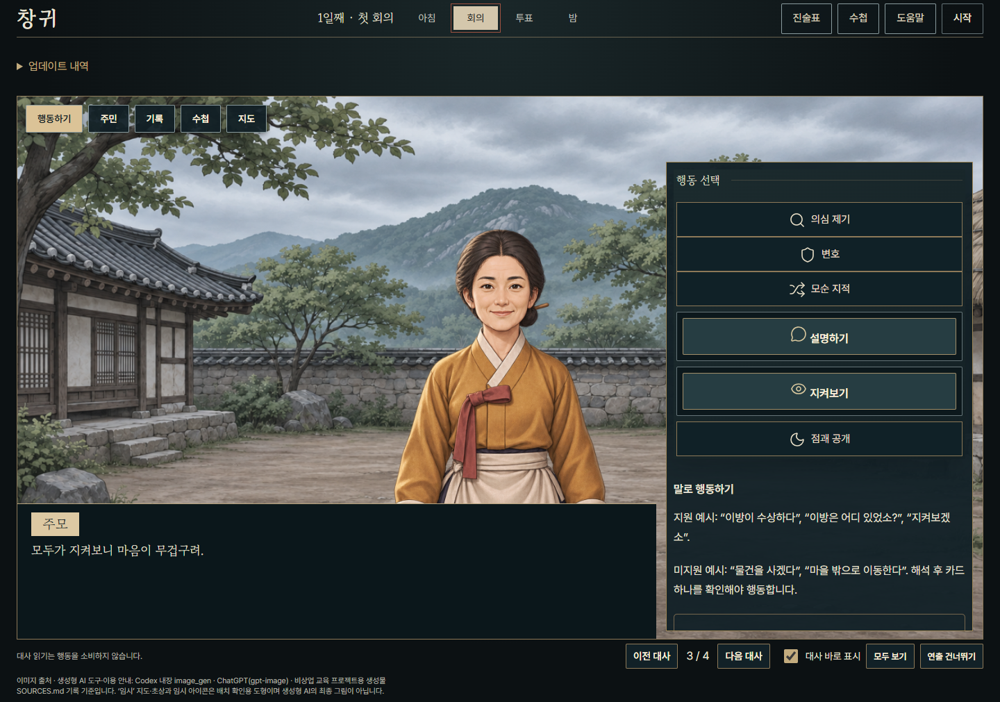
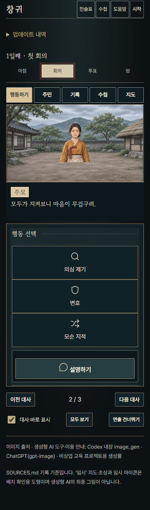

# B-10-07 VN UI 인계·공개 사건 표정 연결

- 커밋: bd59eec20922e67fa3ffc191560cfcdbd76c7bae
- 작성자(흐름): B
- 환경: Windows, Python 3.14.6·Django 6.1.2, 임시 SQLite·메모리 6/8인 녹화 엔진, Daphne·Chrome/Playwright
- 상태: 부분 완료 — Refs #43, E 태스크 전체 완료·VM 검증 아님

아래 기존 인계 기록의 검증 SHA는 aedf4de이며 구현 37392b9에 dev 9d822af(PR #305~#310)을 병합하고 문서 상태·공개 시험 값 예외를 정리한 검증 대상이다. UI 계약 기준은 PR #304(62e7525)이며 이후 변경은 모델 인수·운영 점검·진척 재처리이며 VN 계약·화면 코드는 바뀌지 않았다. PR #304의 확정 VN 기준으로 정리했다. 전체 창귀 시안은 로컬 backup/B-ui-apply-full-20261109(e22034e), B-ui-review-preserved worktree에 별도 보존하고 원본 B-ui-design·단일 HTML도 유지한다. 보존 브랜치는 push하지 않는다.

## 명령

~~~powershell
python -B server/manage.py test server.tests --settings=server.paldo_web.test_settings --noinput
python -B server/manage.py test server.tests.test_ui_review server.tests.test_phase_filter server.tests.test_meeting server.tests.test_assets server.tests.test_story_ui --settings=server.paldo_web.test_settings --noinput
python -B -m tools.assets.check_assets --placeholder
python -B -m tools.precheck --with-assets --pr-body out/handoff/ui-pr.md
~~~

## 출력

- PR #304 반영 후 서버 261건·47.447초 OK(skipped=4). 실제 MySQL·Mongo 환경 의존4건 미실행.
- Chrome 6인 실제 폼12명령·8인 녹화15화면, 1280/360px·CSS200%, 900px 기준 대사/선택지 부모 위치·16:9, 종료 탭·설문·수첩·진술 비교 통과. 가로 넘침·깨진 이미지·콘솔/페이지 오류·예상치 못한 HTTP 실패 0. Browser plugin not available로 기존 Chrome/Playwright 사용.
- v5 공식 전신·초상: 820482/164120 bytes, manifest ID와 나머지17개 유지. 기존 에셋 검사 등록18/임시84, 위반0. 원본은 보존 worktree에서만 읽었고 정식 PR에는 가공된 두 파일만 포함한다.
- 전체 시안에서 재현한 세 오류(132px 대사창·접힌 발언·남은 전신 컷)를 수정하고 저장소 차단 메모리 보존을 추가했다. 최신 정식 화면에서도 같은 읽기 코드를 사용한다.
- 기본 vn, classic 되돌림·모드별 캐시, meeting_classic.html·meeting_parts/records.html 공유 기록, theme.css 시스템 글꼴. 시안 이미지/글꼴·호랑이·창귀 제목은 PR에 없음.

- 최신 classic 회귀41건·5.714초 통과. 최종 읽기·899/900/360/1280px·resize 입력초점·시안/글꼴 요청0건도 확인했다. 브라우저 resize 이벤트 완료 전에 단언한 검수 스크립트는 완료 대기 후 재실행했다.
- 최종 전체 사전검사 결과는 PR 본문에 명령의 마지막 줄 그대로 기록한다. 위 구현 SHA 뒤 증빙 갱신만 별도 커밋한다.

## 수치

| 조건 | 기준 | 측정값 | 측정 방법 | 결과 파일 | 통과 |
|---|---|---|---|---|---|
| 1 | 기존 공개 정보·명령·밤 비노출 | 서버 회귀·6/8인 완주 | Django·Chrome | - | 예 |
| 2 | 최신 반응형 | 900px 기준 부모 위치·16:9·오류0 | Chrome | - | 예 |
| 3 | 여성 무당 v5 | 기존 ID의 전신·파생 초상·규격 확인 | asset 도구 | - | 예 |
| 4 | 전체 태스크·운영 | 아래 잔여·VM 미검증 | 범위 대조 | - | 아니오 |

## 로그

저장소 밖 backups/ui-asset-review/contract-server.log·contract-browser.log, backups/ui-contract-qa/result.json·PNG가 최신 정식 결과다. 시안 단계의 v5-server-vn.log·v5-server-classic.log·v5-browser.json은 이전 범위 검사로 구분한다. 원본 시안68파일 보존·작업 전114파일 ZIP 해시 검증을 했다.

초기 RGB 초상에 RGBA 인코더를 호출한 오류는 RGB 인코더로 수정했다. classic 검수의 제목/시작 버튼 선택자는 실제 기존 HTML에 맞춰 재검증했다. 제품 코드를 시험 기대값에 맞춰 되돌리지 않았다. 원본 생성/리터칭은 하지 않았으며 가공 과정·해시는 content/images/SOURCES.md에 남겼다.

전체 사전검사 첫 실행에서 공개 미리보기 비밀번호가 비밀정보 규칙에 걸렸다(434건 중 실패1). 운영 .env·DB와 분리된 루프백 임시 계정임을 확인하고 저장소의 공식 예외 목록에 정확한 파일·키·사유를 기록했다. 비밀정보 재검사는 877파일 통과했다. 검사 우회나 비밀값 이름 변경은 하지 않았으며 보완 후 aa60af6 기준 전체 사전검사 1,207개·176초 통과했다. PR 생성 직후 추가된 dev 9d822af도 충돌 없이 병합했으며 해당 최종 전체 검사 결과는 PR 본문에 기록한다.

## 트러블

[인계 기록](../troubles/E.md#b-10-07-ui-인계-보완). 작성자 B의 부분 인계로 담당 E의 완료 판정을 대신하지 않는다.

## 문서

server/web ROUTING·DESIGN, web/PM_UI_REVIEW·UI_ASSET_PLAN·UI_APPLY, docs/routing/B·modules/web·troubles/E, ops/proxy/README(설정·두 프로세스 재시작), content/images/SOURCES(v5). 루트 README·공통 계약·태스크는 직접 수정하지 않았다.

## 남은 인수

이전 인계 이후 dev에서 회의/밤 실제 배경과 첫 플레이 8명의 표정 24종이 병합됐다. 공개 사건 표정·기본 복귀와 기존 감금/피해자 컷의 표정 연결은 아래 11/10 검수에 포함한다. 첫 등장·엔딩 등 다른 전신 컷 조건 전체의 완료 판정은 이번 범위가 아니다. 까치·읽기·모바일은 PR #304로 확정됐고 반영했다. 호랑이·추가 브랜딩은 정식 범위 밖이다. 여성 v5는 사용자 확정으로 재선택 대기가 아니다. 전체 완료 Closes가 아닌 Refs로 제출한다. 실제 DB·VM·광고·LLM·부하 및 운영 배포는 이 검증이 아니다.

## 공개 사건 표정 연결 (2026-11-10)

검증 기준 dev는 `bd59eec`(#364 병합)이다. 위 커밋 필드는 시작 기준이며 현재 작업 트리의 표정 연결 변경을 포함해 시험했다. 아직 구현 커밋·푸시·PR을 만들지 않았다. 제출할 때 구현 SHA와 최종 검사를 갱신한다. 기존 UI 인계·라우팅·트러블 기록은 보존했다.

### 변경과 계약 대조

- B-10-07 1-3과 11/9 사용자 승인: 감싸진 대상 다음 대사 기쁨, 의심·모순 지적·공개된 탁한 점괘 대상 다음 대사 당황, 공개 기색 주장 당황, 희생자 발표 뒤 각 인물 첫 대사·고백·감금 당사자 슬픔. 한 줄 뒤 기본 복귀. 슬픔 > 당황 > 기쁨 우선순위와 투표 생존/아침 첫 대사 예외를 구현했다.
- `vn_expressions.expression_cues`는 공개 기록과 표시 줄만 받는다. 뒤 사건이 앞 줄을 바꾸지 않고, 새 dev의 즉시 반응 줄에도 같은 규칙을 적용한다. 역할·진위·믿음·비공개 점괘·현재 활동 상태로 표정을 고르지 않는다.
- `vn_sprite` 태그는 공식 manifest를 조회한다. 남녀 무당 선택 보존, 표정 미등록·임시·파일 유실 시 같은 인물 기본 그림. 마스코트·밤 인물 제한·기존 감금 컷 예외는 유지한다.
- 기색은 실제 공개 shown=True인 주장에만 문구·표정을 연결한다. 폴링 교체 대상 span 밖에 기색 표시를 보존하고 대사·기록·낭독에 포함한다.
- `docs/assets/spec.md` 7절의 이전 문구만 태스크가 요구한 11/9 승인 규칙으로 동기화했다. 계약·기획·결정·태스크·루트 README·엔진·DTO·이미지는 수정하지 않았다.
- 추가 발견: PC 안내 건너뛰기 버튼이 행동 패널에 가려져 클릭할 수 없었다. 기본 PC 배치에서 대사창 쪽으로 옮기고, 패널이 무대 밖인 1.95 이상 배치는 유지한다. 실제 버튼 클릭으로 검증했다.

### 검증 범위

Chrome 156·Playwright, 1440×1000·390×844·360×800. Browser plugin not available여서 기존 로컬 Chrome을 사용했다. 임시 SQLite·메모리 녹화 엔진에 공개 사건 스냅샷만 주입하고 **운영의 meeting_context·템플릿·표정 선택·클라이언트 읽기 코드**를 그대로 실행했다. 그림 URL·선택 표정을 시험 코드에서 덮어쓰지 않았다. 별도로 기존 녹화 판을 실제 HTML 폼 명령으로 아침→회의 진행했다.

93개 확인 항목에서 자동 표정·기본 복귀·이전 대사·새로고침, 공개 기색 본문 갱신 뒤 문구 유지, 남녀 무당, 투표 생존/아침 슬픔 예외, 추가 주민 기본 대체, 밤 감금 컷과 나머지 밤 인물 없음 확인. 이미지·페이지·콘솔·관련 HTTP 오류와 가로 넘침 0건. VM·실제 DB·실기기/Safari·부하 시험은 이번 판정이 아니다.

운영 URL·설정에 시험 스냅샷을 추가하지 않았다. 시험 서버/브라우저 스크립트와 원시 로그는 무시되는 `out/handoff`에 둔다. 계측은 `docs/evidence/perf/B-10-07/expressions.json`에 저장한다.

### 표정 연결 검증 결과

- 집중 회귀 86개 통과. 역할이 달라도 같은 공개 줄의 그림 URL이 같음, 공개된 기색만 표시, 다음 대사 한 줄 제한·우선순위·표정 누락 대체를 검사했다.
- PC·모바일 93개 확인 항목 통과. 피해자 한 박자 컷은 자기 대사로 세지 않아 기본 그림을 유지하고 다음 인물 첫 대사에 슬픔을 준다. 안내 버튼은 추가로 900×900·1600×800에서도 직접 클릭했다.
- 테스트 서버는 시험 스냅샷을 주입했으며 실제 엔진의 모든 사건 조합·운영 DB를 완주했다는 의미는 아니다. 정식 HTTP 녹화 판과 기존 명령 진행도 별도로 확인했다.

| 조건 | 기준 | 측정값 | 측정 방법 | 결과 파일 | 통과 |
|---|---|---|---|---|---|
| 1 | == 0 건 | 0 건 | 공개 사건 표정 집중 회귀 실패 | docs/evidence/perf/B-10-07/expressions.json#targeted_failures | 예 |
| 1 | == 93 건 | 93 건 | Chrome 3개 폭의 자동 전환·복귀·재생·밤 제한 | docs/evidence/perf/B-10-07/expressions.json#browser_checks | 예 |
| 1 | == 0 건 | 0 건 | 브라우저 예외 | docs/evidence/perf/B-10-07/expressions.json#page_errors | 예 |
| 1 | == 0 건 | 0 건 | 얼굴 가림·가로 넘침 | docs/evidence/perf/B-10-07/expressions.json#face_clipping_count | 예 |

### 표정 연결 최초 전체 회귀와 필수 검사

- 집중 회귀: 86개 통과(전체 서버 회귀에도 포함되며 합산하지 않는다).
- 서버 전체 회귀: 455개 발견, 441개 통과·14개 조건부 제외. BERT 실물 체크포인트·Mongo replica set·DB 기능 등과 Node PATH 조건이 있다. 이 중 Node PATH로 제외된 GameScriptSync 1개는 기존 Node 경로를 명시해 별도로 통과했다. 전체 회귀의 원래 skip 수를 임의로 13으로 고치지 않는다.
- 브라우저: 자동 표정·기본 복귀·역방향·새로고침 등 93개, 안내 버튼 PC 경계 2개 통과. 페이지·콘솔·관련 HTTP 오류 0건.
- precheck: 통과 (구조·비밀·테스트·문서·증빙, 테스트 652개(선택: tests/ads 전체·tests/assets 전체·tests/contract 2개·tests/engine 3개·tests/infra 전체·tests/llm 1개·tests/ops 2개·tests/tools 14개), base bd59eec, 182초)

선택 대상은 precheck 요약에 적힌 범위이며 저장소의 모든 느린 시험을 실행했다는 뜻은 아니다. 임시 SQLite와 메모리 시험이며 VM·실제 DB·D 실물 모델·실기기/Safari를 완료 처리하지 않는다. 운영 계정/DB·.env·공통 계약·기획·결정·태스크·루트 README·이미지 파일 변경은 없다. 미커밋 상태이며 PR 생성 전 구현 SHA 갱신과 제출 검사를 해야 한다.

### 역할별 동일성 보완 재검증 (2026-11-10)

검수에서 확인된 네 사건의 역할 비교 누락을 보완했다. `server/tests/test_vn_expressions.py`에 감싸기·모순 지적·공개 점괘·투표 생존별 HTTP 테스트 4개를 추가했다. 저장소의 대상 역할을 마을 사람과 씐 자로 각각 바꾸고, 같은 공개 사건에서 실제 `PaldoEngine.player_view` → 서비스 → `/games/{id}` HTML → 표정 이미지 URL·표정 속성까지 비교한다. 공개 사건은 메모리 저장소에 넣은 시험 스냅샷이며 실제 엔진 명령으로 모든 사건을 발생시킨 완주 시험은 아니다.

| 사건 | 역할별 기대 동작 | 결과 |
|---|---|---|
| 감싸기 | 사건 전 기본, 감싸진 대상 다음 대사 기쁨, 이후 기본 | 두 역할 동일 |
| 모순 지적 | 공개 근거로 대상 결정, 즉시 반응 줄 당황, 이후 기본 | 두 역할 동일 |
| 공개 점괘 탁함 | 공개 전 기본, 공개 뒤 대상 다음 대사 당황, 이후 기본 | 두 역할 동일 |
| 투표 생존 | 감금 결과 전 기본, 결과 뒤 첫 대사 기쁨(아침 슬픔 예외 포함), 이후 기본 | 두 역할 동일 |

네 테스트는 각 기대 이미지 경로와 표정 속성을 직접 확인하고, 두 역할의 전체 표시 줄 표정 사전도 비교한다. 조회 후 공개 기록이 바뀌지 않았는지도 확인한다. 실제 역할을 바꿔도 동일한 공개 점괘 결과를 유지하므로 사실과 다른 탁함 공개에서도 같은 표정을 검증한다.

서버·웹 DESIGN의 이전 “표정은 E 후속 구현” 설명 3곳을 고쳤다. 공개 사건 자동 전환·기존 감금 컷은 구현·검증된 범위로 쓰고, 첫 등장·엔딩 등 나머지 전신 컷 조건 전체의 인계는 유지했다. 라우팅·표정 선택 제품 코드는 이번 보완에서 변경하지 않았다. 계약·기획·결정·태스크 문서는 변경하지 않았다.

- 집중 회귀 재실행: **90개 통과, 실패 0개**(기존 86개 + 역할별 동일성 4개, 역할별 HTTP 비교 8회). 결과: `perf/B-10-07/role-invariance.json`. 원시 로그: `out/handoff/role-invariance-regression.log`(Git 제외).
- Django 6.1.2·임시 SQLite·메모리 게임 저장소로 시험했다. 이번 추가 테스트는 실제 엔진의 조회 함수를 사용한다.
- 위 최초 전체 회귀·precheck·PC/모바일 93개 검수는 이전 실행 결과로 보존한다. 이번 보완은 테스트와 문서만 바뀌어 화면 촬영·VM·실제 DB 검증을 새로 수행한 것으로 기록하지 않는다.
- 측정 HEAD는 시작 기준 `bd59eec`이며 현재 미커밋 작업 트리를 시험했다. 구현 커밋·푸시·PR은 아직 없다.

| 조건 | 기준 | 측정값 | 측정 방법 | 결과 파일 | 통과 |
|---|---|---|---|---|---|
| 1 | == 4 건 | 4 건 | 사건별 역할 동일성 HTTP 테스트 | docs/evidence/perf/B-10-07/role-invariance.json#event_cases | 예 |
| 1 | == 0 건 | 0 건 | 표정·연관 회귀 실패 | docs/evidence/perf/B-10-07/role-invariance.json#targeted_failures | 예 |

### PR 준비 최종 확인 (2026-11-10)

원격 dev를 다시 가져와 확인했다. `origin/dev`와 작업 HEAD는 모두 `bd59eec20922e67fa3ffc191560cfcdbd76c7bae`로, 추가 반영·충돌 해결 대상은 없다. 네 역할별 테스트 보완 이후 현재 미커밋 작업 트리를 대상으로 PR 초안(`Task: B-10-07`, `Refs #43`)을 넣어 필수 검사를 재실행했다.

precheck: 통과 (구조·비밀·테스트·문서·증빙, 테스트 652개(선택: tests/ads 전체·tests/assets 전체·tests/contract 2개·tests/engine 3개·tests/infra 전체·tests/llm 1개·tests/ops 2개·tests/tools 14개), base bd59eec, 203초)

계약·기획·결정·태스크·루트 README는 변경하지 않았다. 측정은 현재 작업 트리 기준이며 구현 SHA 확정은 커밋 승인 이후다. PR 초안 확인 대기이며 커밋·푸시·PR 생성은 하지 않았다.
