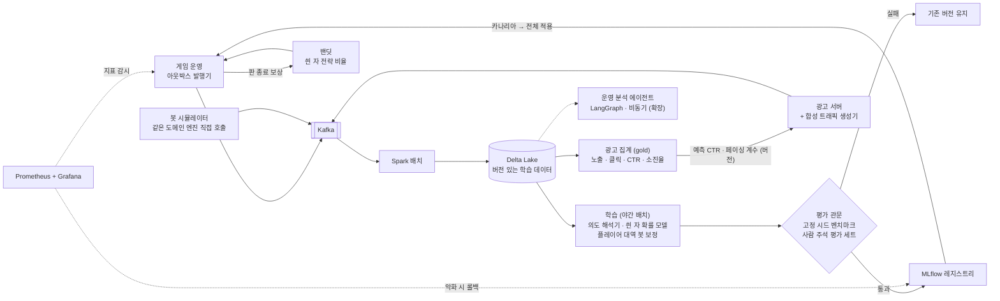
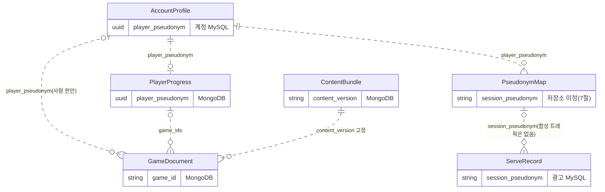

# 팔도무록: 귀신이 숨어든 마을 — 기획서

- 기간: 2026-11-05 ~ 2026-11-12(8일)
- 버전: v1.3(2026-11-06)
- 작성: 이여찬(PM)

## 1. 개요

### 1.1 프로젝트 개요
| 항목 | 내용 |
|---|---|
| 주제 | LLM·ML 기반 NPC가 등장하는 싱글플레이 사회적 추론(마피아류) 웹 게임 |
| 플레이 구성 | **사람 플레이어 1명**(무당 역 고정)과 **엔진이 조종하는 NPC 주민**이 한 판을 구성함. 기본 판은 무당 1명 + NPC 주민 5명(1일째 활동 기준, 0일째 실종 NPC 1명 별도). 인원 프리셋은 5~8인(창귀 1명)이 필수 범위, 9·11인(창귀 2명)은 확장 범위(3.1) |
| 플레이 내용 | 실종 사건이 일어난 산골 마을에서 주민들의 행적 진술을 대조하고, 점괘와 추궁으로 창귀가 씐 주민을 가려냄. 감금 대상은 마을 회의 투표로 정하므로 NPC 주민의 설득이 필요하며, 무당 자신이 의심받아 갇힐 수도 있음 |
| 규칙 처리 | 승패·진실·의심도·투표는 결정론적 도메인 엔진이 처리함. LLM은 게임 상태를 변경하지 않음 |
| LLM 활용 | MVP: 추궁 답변의 말투·감정 표현(엔진이 확정한 사실 문장에 표현만 덧붙임, 실패 시 템플릿으로 대체). 확장: 판 종료 복기, 운영 분석 에이전트, 템플릿 변형 사전 생성. 아침 진술·일반 회의 발언은 템플릿으로 처리함(6.1) |
| ML 활용 | ① 자유 입력 의도 해석: 플레이어가 입력한 문장을 엔진 명령으로 변환함(BERT 계열 분류 모델 + 규칙 매칭, 8.1) ② 씐 자 확률 추정: 마을 NPC가 후보마다 씐 자일 확률을 계산함(로지스틱 회귀로 시작해 LightGBM으로 교체, 8.2) ③ 씐 자 전략 비율 조정: 판 결과를 보상으로 삼아 전략별 사용 비율을 갱신함(밴딧, 8.4) ④ 광고 클릭률(CTR) 추정과 탐색(베타 분포로 시작해 LightGBM과 비교, 톰슨 샘플링, 9.5) |
| 데이터 기반 | 봇끼리 대전하는 시뮬레이션으로 학습 데이터를 대량 생성하고, 소수의 실제 플레이 데이터로 검증·보정함. 게임 이벤트는 Kafka(이벤트 전송) → Spark(배치 가공) → Delta Lake(버전 있는 학습 데이터 저장) 순으로 적재하고, 학습한 모델의 버전은 MLflow로 관리함(5.2) |
| 광고 | 가상 광고주의 입찰, 노출·클릭 분리 집계, 집계 결과를 입찰에 반영하는 루프를 구현함(9장) |
| 배포 | 개발은 Docker Compose, 통합·내부 사용자 테스트는 노트북 VM, 시연과 이후 외부 공개는 AWS(5.3) |

### 1.2 팀 구성
팀원 4명이 다섯 개 작업 흐름(A~E)을 나누어 맡음. 흐름별 태스크와 일정은 `team_plan.md`, `tasks/`에 있음.

| 흐름 | 담당 | 담당 영역 |
|---|---|---|
| A. 게임 엔진 | 이여찬(PM 겸임) | 도메인 엔진(상태 전이, 규칙, 관측 투영, 종료 판정), NPC 상태와 결정 규칙, 행적·목격 생성, 배정 검증기. A 흐름의 실제 이미지 에셋 제작은 이형인 |
| B. 웹·API | 김영주 | 판 진행 유스케이스, 전체 화면(회의·진술표·투표·밤·자유 입력·수첩·복기 등), API, 사용자 모집·세션 |
| C. 인프라·파이프라인 | 신성민 | MongoDB 저장소(상태 + 아웃박스), 이벤트 발행·Kafka·Spark·Delta Lake, MLflow, 배치 실행 기반, Prometheus·Grafana, VM 운영 |
| D. ML·광고·이미지 에셋 | 이형인 | 의도 해석기, 씐 자 확률 모델, 봇 정책·시뮬레이션 실험, 밴딧·재학습 코드, 광고 서버, 실제 이미지 에셋 제작 |
| E. 콘텐츠·LLM·테스트 | 이여찬(PM) | 일정·조율, 콘텐츠(인물·비밀·원한 단서·템플릿 대사), LLM 추궁 답변, 사용자 테스트, 이미지 에셋 규격과 검수 |

### 1.3 재미의 핵심
1. **두 종류의 거짓말**: 씐 자와 비밀 있는 주민이 모두 거짓 진술을 함. 모순을 찾은 뒤에도 "귀신이라서 숨기는가, 개인 사정으로 숨기는가"를 가려야 함.
2. **추리와 설득의 결합**: 정답을 알아도 주민들이 투표에 동참해야 승리함. 무당에 대한 신뢰와 설득이 필요함.
3. **판을 넘어 쌓이는 이야기**: 고백받은 비밀과 원한의 단서가 누적되어 이야기와 결말이 열림.

### 1.4 세계관
- 배경: 강원도 산골 마을 "솔뫼골".
- **창귀**: 호랑이에게 잡아먹혀 죽은 사람의 혼. 호랑이에게 매여 다음 희생자를 꾀어내는 앞잡이 노릇을 한다고 전해짐("위호작창"의 유래). 전승마다 세부가 다르므로 원전과 게임 설정을 구분해 기록함.
- 게임 설정: 창귀가 주민 한 명에게 씌어 밤마다 사람을 산으로 홀려 냄. 호랑이는 화면에 등장하지 않음.
- 창귀의 한으로 인해 마을은 같은 사흘을 되풀이하며, 무당만 그 기억을 이어 감. 판마다 숙주, 비밀, 행적을 새로 정함.
- 창귀 역시 피해자임. 결말은 쫓아내는 **퇴마**와 원한을 밝혀 푸는 **한풀이**로 나뉨.

| 마피아 게임 | 본 게임 |
|---|---|
| 마피아 | 창귀가 씐 주민("씐 자") |
| 밤의 제거 | 홀림(실종) |
| 경찰 | 무당(플레이어) |
| 처형 투표 | 금줄 친 광에 가두기 |

### 1.5 문서 안내
본 기획서는 "무엇을, 왜 그렇게 설계했는가"를 다룸. 아래 내용은 각 문서가 원본이며 기획서에 다시 적지 않음.

| 찾는 내용 | 문서 |
|---|---|
| 요구사항과 합격선(밸런스 승률, 응답 지연, 모델 지표, 광고 검증 기준 등) | `prd.md`(태스크 기준표는 `tasks/README.md` 6절) |
| 사업 배경, 팀·기간·서버 등 전제와 제약, 업무 위험 | `brd.md` |
| 상태·주장·비밀·이벤트·API·광고 원장 등 계약 세부 | `contracts/`(색인 `contracts/README.md`) |
| 저장소별 엔터티와 관계(개념 ERD) | `contracts/erd.md`(전체 그림은 5.4) |
| 일정, 담당, 태스크와 완료 조건 | `team_plan.md`, `tasks/` |
| VM 배치, 노트북 사양, LLM 자원 운영, 디스크 | `../ops/runbook/vm_roles.md` |
| LLM 벤치마크 결과, 기술 스택 버전 | `reports/llm_bench.md`, `contracts/tech_stack.md` |

---

## 2. 게임 흐름

### 2.1 판 진행
1. 판 시작 전: 플레이어가 인원 프리셋을 선택함(3.1). 엔진이 주민 풀에서 등장 주민을 뽑고 역할과 비밀을 배정함.
2. 0일째 밤: 주민 1명이 실종된 상태로 판이 시작됨.
3. 하루 반복: 아침 → 회의 → 추궁 → 투표 → 밤 순서를 승패가 정해질 때까지 반복함(2.2).
4. 판 종료: 승패와 종료 사유를 표시하고, 판 종료 설문(1~2문항)을 받음(7.4).
5. 판 이후: 판 안의 NPC 기억은 폐기하고, 고백·추궁으로 얻은 원한의 단서만 다음 판으로 이어짐(3.6).

### 2.2 하루 흐름
1. 아침: 실종자 발표(피해 장소·시간대 공개) → 주민 진술
2. 회의 1라운드: 무작위 순서로 활동 인원이 1행동씩 수행
3. 추궁: 플레이어가 캐묻기 사용(낮마다 2회, 라운드 행동과 별개)
4. 회의 2라운드
5. 투표
   - 활동 인원(갇히거나 실종되지 않은 사람) 전원이 1표씩 행사함. 자기 자신에게는 투표할 수 없음.
   - 모두 동시에 비공개로 투표한 뒤 한꺼번에 공개함. 앞사람의 표를 보고 따라가는 쏠림을 막기 위함이며, 표를 모으는 설득은 회의 발언으로 함.
   - 최다 득표자를 금줄 친 광에 가둠(감금). 갇힌 사람이 씐 자였는지는 금줄 반응으로 공개하고, 비밀 보유 여부는 공개하지 않음(3.3).
   - 최다 득표자가 여럿(동점)이면 동점자만 후보로 전원이 결선 투표를 함. 결선에서도 동점이면 그날은 아무도 가두지 않음(무감금).
6. 승패 판정
7. 밤
   1. 씐 자는 홀릴 대상을, 무당은 점칠 대상을 각각 비공개로 정함.
   2. 엔진이 두 행동을 한꺼번에 처리하고 승패를 판정함.
   3. 무당에게 점 결과를 알려 줌.
   - 대상은 활동 인원으로 한정함. 홀림 대상은 활동 중인 마을 주민 NPC만 가능함(씐 자 자신, 창귀 2명 판의 짝, 무당 제외). 무당은 자신을 점칠 수 없음.

---

## 3. 규칙 (MVP)

### 3.1 인원과 역할
판은 0일째 밤에 주민 1명이 실종된 아침에 시작함. 아래 "인원"은 **1일째 활동 인원(무당 포함)**을 뜻함. 엔진은 인원 N과 창귀 수 K를 파라미터로 받음.

**인원 프리셋** (플레이어가 판 시작 전에 선택. 시뮬레이션으로 검증한 프리셋만 공개)
| 프리셋 | 인원 | 창귀(씐 자) | 비밀 있는 주민(고정) | 범위 |
|---|---|---|---|---|
| 짧은 판 | 5 | 1 | 1 | 필수 |
| 기본 | 6 | 1 | 2 | 필수, **첫 사용자 테스트 구성** |
| 기본+ | 7 | 1 | 2 | 필수 |
| 큰 판 | 8 | 1 | 3 | 필수 |
| 창귀 둘 | 9 | 2 | 3 | 확장 |
| 창귀 둘+ | 11 | 2 | 4 | 확장. 회의 발언 축약 규칙 필수 |

- 비밀 수는 프리셋마다 고정함(무작위 범위 아님). 비교 실험에서는 인원·창귀 수·비밀 수를 따로 바꾸어 효과를 분리함.
- 진행 일수는 프리셋마다 두 값을 따로 측정해 표기함.
  - 예상 범위: 보통의 판이 끝나는 일수.
  - 가능한 상한: 결선까지 동점이 되어 아무도 갇히지 않는 날(무감금, 2.2)이 끼면 판이 길어지므로, 이 경우까지 포함한 최대 일수.
- **간이 모형 승률(프리셋 후보 선별용 참고치)**
  - 가정: 매일 낮 무당을 제외한 생존자 중 1명을 같은 확률로 무작위 감금함(근거 없는 제비뽑기와 같음). 밤마다 씐 자가 마을 사람 1명을 홀림. 씐 자를 모두 감금하면 마을 승리, 씐 자 수가 나머지 인원 이상이 되면 패배. 개별 투표, 동점 결선, 무당 감금은 반영하지 않음.
  - 산출 방식: 위 가정에서 확률을 끝까지 계산한 정확값임(반복 시뮬레이션의 근사치가 아님).
  - 계산 예(5인·씐 자 1명): 1일째 무당 외 4명 중 씐 자를 맞힐 확률 1/4. 실패하면 밤을 지나 3명(마을 사람 1, 씐 자, 무당)이 남고, 2일째 2명 중 맞힐 확률 1/2. 다시 실패하면 패배. 마을 승률 = 1/4 + 3/4 × 1/2 = 62.5%.

    | 인원/씐 자 | 5/1 | 6/1 | 7/1 | 8/1 | 7/2 | 8/2 | 9/2 | 10/2 | 11/2 |
    |---|---|---|---|---|---|---|---|---|---|
    | 마을 승률 | 62.5% | 46.7% | 68.8% | 54.3% | 37.5% | 22.9% | 45.3% | 29.8% | 50.8% |

  - 인원이 늘수록 단순히 어려워지지 않음. 인원의 홀짝에 따라 마을의 감금 기회 수가 달라지기 때문임(홀짝 효과). 예: 5인과 6인은 모두 감금 기회가 2회이나 6인은 후보가 1명 많아 승률이 낮고, 7인은 기회가 3회로 늘어 다시 높아짐.
  - 활용 범위: 실제 NPC는 근거를 따져 투표하므로 실제 승률은 이 값과 다름. 따라서 이 값은 프리셋 후보를 고르는 데만 쓰며 게임 균형의 근거로 쓰지 않음.
  - 실제 검증: 각 프리셋은 도메인 엔진으로 NPC 투표까지 재현한 시뮬레이션으로 승률을 확인한 뒤 공개함.
  - 난이도 표기: 인원과 난이도가 비례하지 않으므로 인원 수로 정하지 않고, 실제 검증 결과에 따라 부여함.
- 무당 외 등장 주민은 판마다 **주민 풀**(등장 후보 인물 전체 목록)에서 추첨함.
  - 필요한 주민 수 = 1일째 활동 주민(인원 − 무당 1명) + 0일째 실종자 1명 = **인원과 같은 수**. 예: 6인 판은 활동 주민 5명 + 실종자 1명 = 6명.
  - 판마다 등장인물이 달라져 반복 플레이의 다양성이 커짐.

**역할** (기본 6인 판 기준 수)
| 역할 | 수(1일째) | 진영 | 특징 |
|---|---|---|---|
| 무당(플레이어 고정) | 1 | 마을 | 밤마다 1명을 점침. 밤에 홀리지 않음. 투표로 갇힐 수 있음 |
| 씐 자 | 1 | 창귀 | 밤마다 주민 1명을 홀림. 홀린 시간대 행적은 거짓으로 진술해야 함 |
| 비밀 있는 주민 | 2 | 마을 | 개인 사정으로 행적 한 구간을 거짓으로 진술함 |
| 평범한 주민 | 2 | 마을 | 사실대로 진술함 |

- 공개 정보: 역할별 인원, 무당이 유일한 점술가라는 사실.
- **창귀가 2명인 경우**:
  - 용어: 두 씐 자는 서로의 **짝**임. 그날 밤 실제로 피해자를 홀리러 가는 쪽을 **실행자**, 나머지를 **비실행자**라 함.
  - 공유 지식: 짝이 누구인지, 밤마다 함께 정한 실행자와 피해자, 함께 맞춘 알리바이. 짝이 본 것(목격)과 짝의 생각(의심도)은 자동으로 공유하지 않음. 두 씐 자의 팀 전략은 이 허용 정보만 읽음.
  - 밤 처리 순서:
    1. 낮 감금 직후 종료 판정을 함.
    2. 활동 중인 씐 자 중 실행자를 정함. 한 명만 남았으면 그 사람이 실행자임.
    3. 실행자와 피해자를 **하나의 공동 명령**으로 확정함(두 씐 자가 따로 명령하지 않음).
    4. 이에 맞추어 그날 밤의 실제 행적과 목격을 생성함.
    - 0일째 실종 사건도 같은 규칙을 따름.
  - 홀림 대상: 활동 마을 주민 NPC만(자신, 짝, 무당 제외).
  - 거짓말 의무는 실행자에게만 있음. 비실행자는 사실대로 말하거나 짝의 알리바이를 보강하는 거짓 주장("그 시각 나랑 우물가에 있었소")을 선택할 수 있음.
- 주민들은 무당이 씌지 않았다는 사실을 **모름**(외지에서 온 무당이 귀신을 데려왔을 수도 있다고 봄). 규칙상 무당은 씐 자가 될 수 없으나, NPC는 무당을 의심하고 가둘 수 있음.
- NPC의 이름과 성격은 고정이며, 역할만 판마다 바뀜.

### 3.2 정보 체계
**장소와 시간**
- 장소 5곳: 우물가, 서낭당, 주막, 마을 어귀(산길 입구), 각자 집. 판정은 이 5곳 단위로만 함("주막 뒷방"은 주막, "서낭당 뒤"는 서낭당으로 간주).
- 밤 시간대 2개: 초저녁, 한밤.

**행적과 목격**
- 엔진이 밤마다 실제 행적을 정함(성격별 동선 + 무작위). 씐 자는 한밤에 피해자가 있는 장소로 이동함.
- 같은 공공장소(집 제외), 같은 시간대에 있던 사람끼리는 일정 확률로 서로를 목격함.
- **피해 장소 공개**: 아침 실종 발표 때 피해 장소(집이면 피해자의 집)와 시간대(한밤)를 모두에게 공개함("실종자의 짚신이 우물가에서 발견됐다"). 이 공개 기록과 자기 목격을 합쳐 알리바이 명제를 만듦(4.1).
- 아침마다 모든 주민이 행적과 목격 일부를 진술함. 진술은 구조화된 주장(4.1)으로 저장하며, 주장 간 모순을 대조할 수 있음.

**점괘**
- 결과는 **맑음/탁함** 두 가지. 탁함 = 씐 자이거나, 아직 털어놓지 않은 비밀이 있는 사람.
- 고백한 주민은 다음 점부터 맑게 나옴.
- 결과는 무당만 앎. 공개할 수도, 거짓으로 말할 수도 있음(신뢰도에 영향).

**기색**
- 사실 주장(행적, 목격)이 거짓일 때만 판정함. 추측("A가 수상하다")은 틀려도 거짓으로 보지 않음.
- 판정 결과는 주장 ID에 묶어 1회로 고정함. 반복 질문으로 재판정하지 않음.
- 비밀 있는 주민이나 압박받은 무고한 주민에게도 기색이 나타날 수 있음. 확정 정보가 아님.

### 3.3 승패
갇히거나 실종된 사람은 모든 계산에서 제외함.
종료 판정은 감금 직후와 밤 처리 직후에 같은 함수로, 아래 순서대로 확인하고 **종료 사유**를 기록함. G = 활동 씐 자 수, V = 활동 마을 주민 NPC 수, M = 무당 활동 여부(1 또는 0).
1. G = 0 → 마을 승리
2. 무당이 갇힘 → 창귀 승리(인원 조건과 무관한 별도 패배 조건)
3. G ≥ V + M → 창귀 승리. 즉 활동 중인 씐 자 수가 나머지 활동 인원(마을 주민 NPC + 무당) 이상이 되면 창귀가 이김. 창귀 1명 판에서는 무당 외에 마을 주민 NPC가 한 명도 남지 않은 경우와 같음.
- 마지막 씐 자가 갇히면 밤을 실행하지 않음.
- **감금 공개**: 모든 프리셋에서 같은 원리로, 갇힌 사람이 씐 자였는지를 금줄 반응으로 공개함(창귀 1명 판에서는 판 종료 여부로 어차피 드러남). 창귀 2명 판에서는 이것이 남은 공범을 찾는 확정 정보가 되므로, 시뮬레이션에서 **공개형과 비공개형을 비교**하고 공개형이면 다른 단서량을 함께 조정함.
- 기본 6인 판에서 마을이 계속 틀리는 경우의 진행(활동 인원 수):

  | 시점 | 사건 | 활동 인원 |
  |---|---|---|
  | 1일째 낮 | 시작 | 6명 |
  | 1일째 투표 | 무고한 주민 감금 | 5명 |
  | 1일째 밤 | 주민 1명 홀림 | 4명 |
  | 2일째 투표 | 무고한 주민 감금 | 3명 |
  | 2일째 밤 | 주민 1명 홀림 | 2명(무당 + 씐 자) → 종료 조건 3에 따라 창귀 승리 |

  - 따라서 마을의 투표 기회는 보통 2번임. 무감금 날이 생기면 인원이 줄지 않아 3번째 낮이 올 수 있음.

### 3.4 행동
| 행동 | 대상 | 효과 |
|---|---|---|
| 의심하기 | 1명 + 근거(모순, 기색, 점괘, 투표 기록) | 듣는 이의 대상 의심도 상승. 같은 발언자·대상·근거의 반복은 효과 없음 |
| 감싸기 | 1명 + 근거 | 대상 의심도 하락. 감싼 사람과 대상이 공개 기록상 묶임 |
| 모순 지적 | 주장 2개 | 모순이 사실이면 관련자 의심도가 크게 오르고, 아니면 지적한 사람의 신뢰도가 하락 |
| 해명하기 | 자신 | 자기 의심도 하락. 반복 시 효과 감소 |
| 침묵 | - | 효과 없음 |
| (무당) 점괘 공개 | 1명 + 결과 | 낮마다 1회. 거짓 공개 가능 |
| (무당) 캐묻기 | 1명 + 질문 유형 | 행적 확인 / 모순 추궁 / 의심·투표 이유. 반응(해명, 회피, 역공, 고백)은 엔진이 결정 |

**입력 방식**: 플레이어는 자유 문장 입력 또는 버튼(행동 → 대상 → 근거 카드) 선택으로 행동함. 어느 쪽이든 엔진에는 같은 구조화된 명령이 전달됨.
- MVP 범위: **자유 문장을 위 표의 정해진 행동·캐묻기 유형으로 해석함.** 임의 질문에 답하는 기능이 아님. 지원 예시와 미지원 예시를 입력창 옆에 표시함.
- 자유 문장은 해석기(8.1)가 **발언 카드**(행동, 수신자, 대상, 근거)로 변환해 미리 보여 주고, 플레이어가 확인하면 실행함. 필수 정보가 빠지면 추가 선택을 받으며, 이때 행동 횟수를 소비하지 않음.
- 무당이 자유 문장으로 할 수 있는 사실 주장은 점괘 공개(대상, 밤, 공개할 결과)로 한정함. 무당의 임의 행적·목격 주장은 MVP에서 지원하지 않음.
- 투표와 밤의 점 대상은 버튼으로만 선택함.
- 단계별 합법 명령과 횟수 소비 시점은 `contracts/domain.md` 3·4절, 해석 입출력은 `contracts/intent.md`.

### 3.5 비밀
귀신과 관계없이 주민이 숨기고 싶은 개인 사정. 판마다 프리셋에 정한 수의 주민에게 무작위로 배정함.

| 예시 비밀 | 실제 행적 | 거짓 진술 |
|---|---|---|
| 몰래 노름을 했다 | 한밤, 주막 | "일찍 자서 집에 있었다" |
| 이웃과 몰래 만났다 | 한밤, 서낭당 | "우물가에 물 길러 갔다" |
| 빚을 숨기려 곡식을 빼돌렸다 | 초저녁, 마을 어귀 | "주막에 있었다" |
| 금기를 어기고 산에 약초를 캐러 갔다 | 초저녁, 마을 어귀 | "서낭당에 빌러 갔다" |

- 배정 수는 인원 프리셋(3.1)에 정한 수를 따름.
- 역할: 씐 자를 가리는 연막이 되고, 추궁으로 풀 수 있으며, 고백하면 이야기가 쌓임.
- 비밀 있는 주민은 추궁 압박이 "고백 문턱값"을 넘으면 고백함. 고백하면 용의자에서 제외됨.
- 씐 자는 고백하지 않고 가짜 사연이나 역공으로 대응함.
- 비밀 하나는 실제 행적과 거짓 진술, 고백 대사, 성격별 고백 문턱값, 다른 비밀·동선과의 충돌 제약, 연결된 원한 단서를 가짐. 데이터 형식은 `contracts/content.md`, 배정 검증은 `contracts/domain.md` 10절.

### 3.6 반복 플레이 보상
- 플레이어 능력치 성장은 두지 않음.
- **원한의 단서**: 승패와 관계없이 고백과 추궁 중 나온 물증으로 창귀의 생전 신원, 죽음의 진상, 원한의 대상을 단계적으로 밝힘.
- 가설이 완성되면 이후 판에서 "퇴마" 외에 "한풀이" 결말을 선택할 수 있음. 퇴마 결말은 기본 난이도로도 볼 수 있음.
- 판 안의 NPC 기억은 판 종료 시 폐기하고, 판을 넘어 남는 것은 플레이어의 단서 수집 상태로 한정함.
- 선택형 도전(확장 범위): 점 1회 제한, 비밀 있는 주민 3명, 목격 정보 축소 등. 시뮬레이션으로 검증한 프리셋만 제공함.
- 플레이어 모르게 난이도를 조절하는 방식은 채택하지 않음. 도전은 플레이어가 선택하고 보상을 받음.

---

## 4. NPC 설계

### 4.1 상태: 네 층 분리
| 층 | 열람 주체 | 내용 |
|---|---|---|
| ① 전체 진실 | 엔진만 | 역할, 비밀, 실제 행적 |
| ② 공개 기록 | 모두 | 실종·감금, 주장(진술), 발언, 투표, 공개된 점괘, 고백 사실 |
| ③ 개인 지식 | 해당 NPC만 | ①에서 그 NPC에게 투영한 것: 자기 역할·비밀, 자기 실제 행적, 직접 목격한 것 |
| ④ 믿음 | 해당 NPC만 | 대상별 의심도와 근거, 무당 신뢰도, 확정 명제 목록 |

- NPC가 행동할 때마다 다음 순서로 처리함.
  1. 관측 생성: ① 전체 진실에서 그 NPC가 알 수 있는 부분만 잘라 ③ 개인 지식을 만들고(투영), ② 공개 기록과 함께 넘김.
  2. 믿음 갱신: 관측한 내용으로 ④ 믿음(의심도 등)을 고침.
  3. 행동 선택: ②·③·④만 보고 행동을 고름.
  - 행동 선택 함수는 ① 전체 진실을 읽지 못하게 만들고, 이 경계를 테스트로 검증함. NPC가 정답을 몰래 알고 행동하는 일을 막기 위함임.
- **주장**: 진술은 자기 행적 / 목격 / 비목격 / 점괘 공개 중 하나인 구조화된 주장으로 저장함. 누가, 누구에 대해, 어느 밤·시간대·장소에서, 있었다/없었다 중 무엇을 말했는지를 담고, 정정·철회는 원래 주장을 가리킴. 주장의 참·거짓은 ①에만 둠.
- 점괘 공개는 실제 점괘(①·무당 개인 지식)와 공개한 내용(②)을 구분해 저장함.
- **확정 명제**: "X는 밤1 한밤에 주막에 있었다(출처: 내 목격)"처럼 구조화된 명제와 출처를 저장함. 행적 명제와 역할 판단은 구분함.
  - 증거 출처 구분: **직접 목격**(자기 눈) / **타인의 목격 주장**(공개 주장일 뿐) / **상호 보증**(서로의 알리바이를 서 줌. 공범 담합 가능성 있음). 확정 명제는 직접 목격으로만 성립함.
  - "못 봤다"는 부재 증명이 아님(목격은 확률적임).
  - 알리바이의 전제는 **공개된 피해 장소 + 자기 목격**. 타인의 공개 목격 주장으로 같은 판단을 하면 확정 명제가 아닌 근거로만 사용함. 피해 시각에 다른 장소에서 직접 목격된 사람은 "그날 밤 **실행자가 아님**"까지만 확정함. 창귀 1명 판에서는 이것이 곧 "씐 자가 아님"이나, **창귀 2명 판에서는 역할 후보에서 제거하지 않음**(비실행 공범 가능성).
- 규칙 처리에 필요한 상태를 따로 둠.
  - 공통: 캐묻기 남은 횟수, 추궁 압박 누적치, 고백 여부, 반복 의심 키(같은 발언자·대상·근거의 의심이 반복되었는지 판별, 3.4), 해명 횟수, 주장별 기색 판정 결과, 판 상태 버전(오래된 명령을 거르는 번호, 5.3).
  - 씐 자: 자신이 한 거짓 주장 목록.
  - 비밀 있는 주민: 숨길 행적, 고백 문턱값.
- 주장·상태·관측 스냅샷의 필드는 코드 `engine/domain/model.py`가 기준이며, 공개 범위와 규칙은 `contracts/domain.md`(특히 6·6-1·7절)에 있음.

### 4.2 결정
- **공통**: 합법 행동 필터(활동 인원, 자기 투표 금지 등).
- **마을 NPC 투표 (세 층)**:
  1. 추정: 후보마다 씐 자일 확률과, 그 확률에 각 증거 묶음(모순, 목격, 기색 등)이 얼마나 기여했는지를 계산함. 처음에는 규칙으로 계산한 의심도(규칙 v0: 첫 규칙 기반 버전)를 쓰고, 이후 8.2 모델로 교체함.
  2. 결정: 아래 세 항을 더한 값을 후보별 투표 점수로 삼아 투표 대상을 정함.

     | 항 | 의미 |
     |---|---|
     | 성향 가중 확률 | 1층의 확률에 NPC 성향(4.3, 어떤 증거에 강하게 반응하는가)을 반영한 값 |
     | 동조 가중치 × 예상 득표 | 표가 몰릴 것으로 보이는 후보에 맞추는 정도. 예상 득표는 회의에서 공개된 의심 발언으로 추정함. 표가 갈려 동점이 되면 창귀에게 유리하기 때문임 |
     | 잡음 | 무작위 요소. 성향 가중치와 함께 NPC가 지나치게 정확하지 않게 조절함(8.2 유의 사항) |

     - 가중치 등 파라미터 일부는 학습이 아니라 시뮬레이션을 반복하며 값을 찾는 최적화(그리드 탐색·베이지안 최적화)로 정함. 목표는 승률이 목표 범위에 들고 추론 위반(확정 명제와 충돌하는 투표, 8.3)이 적은 것임.
  3. 안전: 규칙상 투표할 수 없는 대상과 확정 명제로 제외된 후보를 걸러 냄. 후보가 모두 걸러지면 의심도가 가장 높은 대상에게 투표함(대체 처리).
  - 모델이 투표 대상을 직접 출력하지 않는 이유: 투표에는 직접 정답 라벨이 없음(진실이 주는 라벨은 "누가 씐 자인가"). 반드시 지켜야 할 제약은 학습이 아닌 규칙으로 보장함.
  - 확장: 결정 층을 강화학습(자기 대전) 정책과 비교함.
- **씐 자 전략(규칙 v0)**: 마을 추론 절차를 쓰지 않고 생존과 누명을 목표로 함.
  - 거짓 행적: 자기가 아는 목격 정보로 보아 반박당하기 어려운 장소를 선택함.
  - 누명: 공개 진술에 모순이 드러난 주민(비밀 보유 여부는 모름)이나 의심도가 높아 보이는 주민을 선택함.
  - 밤 대상: 자신을 지목한 사람, 자신의 거짓을 목격했을 수 있는 사람, 무당을 신뢰하는 사람 중에서 섞어 선택함. 고정 규칙으로 두지 않음.
  - 무당을 의심하게 만드는 발언으로 무당 감금을 노림.
  - 창귀 2명일 때 팀 전략: 짝 감싸기, 의도적 거리 두기(관계 단서 은폐), 짝이 몰리면 버리고 자기 신뢰 확보, 짝의 거짓 알리바이 보강. 전략별 사용 비율은 밴딧(8.4 ③)으로 조정함.
- 모든 행동에 **선택 이유 코드**와 근거 ID를 남김(복기와 학습에 사용).

### 4.3 인물과 성향 ("어떤 증거에 반응하는가")
| 인물 | 강하게 반응 | 약하게 반응 | 행동 경향 |
|---|---|---|---|
| 훈장 | 진술 일관성, 모순 | 무당의 점괘 | 신중, 고집이 셈 |
| 주모 | 목격 정보 | 다수 의견 | 감싸기를 자주 함 |
| 대장장이 | 다수 의견, 기색 | 세세한 모순 | 공격적, 의심을 자주 함 |
| 머슴 | 무당의 점괘 | 모순 | 겁이 많아 해명을 자주 함 |

- 인물 6명, 성향 4종. 나머지 두 명(예: 약초꾼, 과부)은 같은 성향에 다른 동선과 비밀을 부여함.

---

## 5. 시스템 아키텍처

### 5.1 런타임 구성 (게임 요청 경로)

### 5.2 데이터 · 학습 흐름

- 자동화는 단계적으로 추진함(8.4). 초기에는 학습과 레지스트리 승격을 사람이 실행함.

### 5.3 설계 원칙
- **계층 원칙**: 게임 엔진(도메인)은 Django, MongoDB, LLM을 import하지 않음. 시뮬레이터와 웹이 같은 엔진을 사용함.
- **상태와 로그의 일치**: 판 상태와 미발행 이벤트를 **같은 판 문서에 함께 쓰는 아웃박스**로 저장함. 발행기가 아웃박스를 Kafka로 보내고, 소비 단계에서 이벤트 ID로 중복을 제거함. 게임 요청 경로는 Kafka 장애와 무관하게 진행됨.
- **명령 보호**: 중복 클릭·재시도와 이미 지난 단계에 대한 명령을 거부함. LLM 생성은 DB 잠금 없이 작업 ID로 비동기 처리하고, 결과를 붙일 때 판 버전을 확인함. 브라우저 응답은 플레이어에게 허용된 정보만 직렬화함. 상세는 `contracts/api.md`, `contracts/ports.md`.
- **배포**: 개발은 각자 PC의 Docker Compose 축소 구성, 통합·내부 사용자 테스트는 노트북 VM, 시연과 이후 외부 공개는 AWS. VM 배치는 `../ops/runbook/vm_roles.md`, 기술 스택 버전은 `contracts/tech_stack.md`에 고정함.
- **계측**: 성능 수치는 계측값으로만 보고하며, 동작하는 모든 구성 요소는 구조화 로그를 남김. 합격선은 PRD.

### 5.4 데이터 모델 (개념 ERD)
저장소 간 엔터티와 관계만 나타낸 전체 그림. 저장소별 그림(계정 MySQL, 판 문서와 진행 상태, 콘텐츠 묶음, 광고 MySQL)과 확인 항목은 `contracts/erd.md`가 원본이며, 컬럼은 각 저장소를 구축하는 태스크의 산출물임.

- 저장소 간 연결은 ID 값으로만 이루어짐(점선). 로그인 ID는 계정 MySQL에만 두고, 게임 데이터는 `player_pseudonym`만, 광고는 `session_pseudonym`만 사용함.
- 두 가명을 잇는 대응표는 개인정보 삭제 요청 처리에만 사용함. 시뮬레이션 판과 합성 광고 트래픽에는 계정이 없음. 이벤트가 Kafka를 거쳐 Delta로 가는 흐름은 5.2와 `contracts/erd.md` 5절.
- `PseudonymMap`의 "7절"은 `contracts/erd.md` 7절(확인 필요 항목)을 가리킴.

---

## 6. LLM 설계

### 6.1 적용 범위
| 적용 영역 | 단계 | 이유 |
|---|---|---|
| 추궁 답변 표현 | MVP | 플레이어가 직접 묻고 기다리는 장면이므로 지연을 감수할 가치가 있음 |
| 판 종료 복기 | 확장 | 비동기. 행동 시점의 이유 코드와 근거 ID를 설명함(사후 합리화 금지) |
| 운영 분석 에이전트 | 확장 | 비동기. 지표를 읽고 밸런스·콘텐츠 개선안을 제시함 |
| 템플릿 변형 사전 생성 | 확장 | 오프라인 생성, 사람 검수 후 사용 |

| 적용 제외 영역 | 이유 |
|---|---|
| 아침 진술, 일반 회의 행동 | 매 턴 NPC 여러 명이 발언하므로 누적 지연이 큼. 템플릿으로 처리 |
| 승패, 진실, 의심도 계산 | 결정론적 엔진의 역할. LLM은 상태를 변경할 수 없음 |
| 사실 주장 문장 생성 | 엔진이 완성함(6.2) |
| 자유 입력 의도 해석 | 분류 모델이 담당함(8.1). 빠르고 결과가 정해진 라벨 안에 있음 |

### 6.2 추궁 답변 흐름 (LangGraph)
1. 플레이어가 캐묻기를 버튼으로 선택하거나 자유 문장으로 입력함. 자유 문장은 8.1 해석기가 정해진 캐묻기 유형으로 변환함.
2. 엔진이 반응 의도(해명/회피/역공/고백)와 **사실 주장 문장**을 확정함. 예: "그날 한밤엔 집에 있었소."
3. LLM은 **사실을 더하지 않는** 말투·감정 표현만 덧붙임. 예: 머뭇거림, 화냄, 하소연.
4. 검증: LLM이 만든 문장이 다음 기준을 지키는지 자동으로 검사함.
   - 형식과 길이
   - 허용되지 않은 인물·장소·역할어가 들어가지 않았는가
   - 엔진 문장에 없던 부정·단정 표현("가지 않았다", "틀림없이 무고하다")이 추가되지 않았는가
5. 검증 실패 또는 시간 초과 시 미리 작성한 템플릿 표현으로 대체함(폴백). 생성 답변과 폴백은 **같은 정보량**을 가짐. LLM 문장은 게임상 증거가 되지 않음(증거는 엔진이 확정한 주장으로 한정).

### 6.3 모델 선정과 지연
- CPU 양자화 소형 모델(3~4B급 기본, 7~8B급은 대기 허용 작업용으로 시험)을 후보로 한국어 품질과 지연을 실측해 선정함.
- 실행 위치는 LLM 전용 노트북의 VM 또는 같은 노트북의 Windows 직접 실행 중에서, 두 방식과 모델 크기를 벤치마크로 비교해 정함. 자원 근거는 `../ops/runbook/vm_roles.md` "LLM 자원", 측정 결과는 `reports/llm_bench.md`.
- 측정 항목(실제 추궁 예시 프롬프트 기준):
  - 전체 지연: 생성 큐 대기 + 프롬프트 처리 + 문장 생성 + 검증을 합한 시간. p50(중앙값)과 p95(전체 요청의 95%가 이 시간 안에 끝나는 값)로 보고함. 이후 문서의 p50/p95도 같은 뜻임.
  - 메모리: 모델 가중치 + KV 캐시(생성 중 앞 문맥을 보관하는 메모리) + 기타 버퍼.
  - 동시 요청 시 지연, 말투 유지(사람 평가), 폴백 비율.
- 운영: 입력 길이·출력 토큰·동시 생성 수를 제한하고, 추궁 요청을 다른 LLM 작업보다 우선 처리함. 타임아웃 시 생성이 실제로 취소되는지 확인함.

---

## 7. 데이터 전략

### 7.1 데이터 종류 (상호 혼용 금지)
| 종류 | 출처 | 용도 | 유의 사항 |
|---|---|---|---|
| 콘텐츠 | 직접 작성한 인물·비밀·원한 설정(설화는 참고만, 원문 인용 없음) | 게임 내용, 템플릿, LLM 페르소나 | 행동 학습의 정답이 아님 |
| 봇 시뮬레이션 | 규칙·ML 봇 간 판 | 밸런스 실험, NPC 모델 학습 | 사람의 행동을 대변하지 않음 |
| 실제 플레이 | 사용자 판 로그, 수첩, 설문 | 재미·이해도 평가, NPC 검증, 상대 모델 보정(설문은 평가와 밴딧 보상에만 사용) | 표본이 작음. 사용자 단위로 분할 |
| 부하 테스트 | 합성 이벤트 | 파이프라인 처리량·장애 복구 | 사용자 수나 재미의 근거가 아님 |
| 광고 합성 트래픽 | 숨겨 둔 실제 CTR을 따르는 가상 사용자 클릭 모델 | 광고 입찰 반영 루프 검증(9.6) | 실제 광고 성과가 아님. `source=synthetic` |

### 7.2 이벤트 설계 원칙
- 모든 이벤트는 판 조건(시드, 프리셋, 콘텐츠·엔진·규칙·정책 버전)과 출처(봇/사람/합성)를 함께 기록함. 판 재현과 데이터 종류(7.1) 분리를 위함.
- 행동 이벤트는 행동 직전 해당 행위자의 관측 스냅샷(②+③+④)과 선택 이유 코드·근거 ID를 함께 기록함. 자유 입력은 원문, 문맥, 후보와 점수, 플레이어 반응, 최종 실행 명령, 해석기 구성 요소 버전을 기록하고, LLM은 모델·프롬프트 버전, 지연, 폴백 여부를 기록함.
- 최종 실행 명령은 원문의 정답과 같지 않음(귀찮아서 그대로 확인하거나, 도중에 전략을 바꿀 수 있음). 학습 라벨은 8.1의 라벨 출처 규칙을 따름.
- 전체 진실(①)은 평가용 영역에 별도 저장함. 학습 **입력**에는 넣지 않고, 학습 **라벨**로만 판 종료 후 조인함.
- 사람 플레이어의 믿음은 직접 관측할 수 없음. 수첩·확신도는 "자기 보고", 엔진 추정치는 "추정"으로 출처를 구분함.
- 원문 입력에는 개인정보가 포함될 수 있으므로 마스킹하고 보관 기간을 둠(`contracts/privacy.md`).
- 필드 목록: 봉투·토픽·학습 행은 `contracts/events.md`, 자유 입력 시도는 `contracts/intent.md` 4절, LLM 작업 기록은 `contracts/ports.md`.

### 7.3 시뮬레이션 계획
- 상대 봇 유형: 무작위, 논리 우선, 반복 의심형, 거짓말 공략형.
- 측정 항목: 진영 승률, 판 길이, 무감금 빈도, 비밀 고백률, 플레이어 대역 봇의 의미 있는 선택 횟수.
- 밸런스 목표: 6인·창귀 1 판에서 플레이어 대역 "논리 우선 봇"의 승률을 40~60% 범위로 맞춤(판 수와 판정 방법은 PRD). 피해 장소 공개로 마을이 유리해질 수 있으므로 **피해 장소 공개 상태에서** 목격 확률과 동선 무작위성을 조정해 맞춤.

### 7.4 사람 데이터의 활용 범위
- 규모 추정(가정)
  - 플레이어가 한 판에서 내리는 결정(행동·투표 선택)은 10~15개로 가정함.
  - 참가자 30명이 평균 4판씩 하면 약 120판, 결정은 1,200~1,800개(약 1,500개 안팎)임.
  - 같은 사람의 결정끼리는 서로 독립이 아니므로, 통계적으로 독립인 표본 수는 결정 수가 아니라 사람 수(5~30명)로 봄. 따라서 사람 데이터만으로 모델을 학습하거나 우열을 결론 내기에는 부족함.
- 원칙: **봇 시뮬레이션으로 학습하고, 사람 데이터로 검증·보정함.** 사람 행동 예측 모델(이탈 예측, 사람 모방 봇)은 MVP 목표로 두지 않음.
- 가능한 분석: 판 번호별 승률 변화, 판 길이와 이탈 지점, 의심·투표 근거 분포, 캐묻기 사용과 고백 유도율, 패배 패턴과 "억울함" 설문, 정책 간 비교(효과가 클 때만 결론).
- 데이터 가치 제고 장치:
  - **무당의 수첩**: 플레이어가 인물별 의심 정도를 표시하는 게임 내 메모 기능. 투표 직전 확신도도 수집함.
  - **판 종료 설문 1~2문항**: 재미, 억울함, NPC의 그럴듯함(5점 척도). 밴딧 보상(8.4 ③)과 재미 대리 지표에 사용함.
  - **고정 시드 판**: 일부 판 구성을 여러 사용자에게 동일하게 제공해 사람 간 비교를 가능하게 함.

### 7.5 실제 사용자 모집과 개인정보 (가정)
- 모집 경로: 부트캠프 동기, 지인, 커뮤니티 테스트 공지.
- 개인정보는 최소한으로 수집함. 사용자는 직접 만든 로그인 ID·비밀번호로 로그인하며(이름·연락처·이메일 미수집), 게임 데이터에는 계정마다 발급한 가명 사용자 ID만 사용함. 로그인 ID와 비밀번호 해시는 계정 저장소에만 둠. 수집 항목은 계정(로그인 ID·비밀번호 해시), 플레이 로그, 마스킹한 입력 문장, 설문으로 한정함. 프로젝트 종료 후 30일(2026-12-12)에 삭제하며, 가명 ID로 삭제 요청을 받음(`contracts/privacy.md`).
- 참가자는 내부망 대상(목표 30명 × 4판). 외부 공개는 이후 도메인을 연결해 AWS로 진행함.
- 적은 인원이라도 같은 사람을 여러 번 관찰하는 테스트 일정을 우선 확보함.
- 사용자 수가 적으므로 A/B 우열보다 "규칙을 이해했는가, 어떤 선택이 억울했는가, 다시 하고 싶은가"를 중심으로 판단함.

---

## 8. ML 계획

### 8.1 MVP 과제 A: 자유 입력 의도 해석 (게임 동작에 필수)
자유 문장을 실행 가능한 엔진 명령으로 변환함. 성공 기준은 의도 하나의 적중이 아니라 **명령 전체(행동, 수신자, 대상, 근거, 필수 슬롯)가 맞고 합법인 것**.

**해석 단계**
| 단계 | 처리 내용 | 방식 |
|---|---|---|
| ① 의도 분류 | 문장 → 의도 후보(복수 가능) + 발화 형태 | BERT 계열 한국어 인코더 미세조정(후보: KoELECTRA, KLUE-RoBERTa 등. 라이선스 확인). 기준선 TF-IDF + 로지스틱 회귀. 발화 형태(질문 / 주장 / 인용 / 요청)는 별도 출력 |
| ② 인물 인식 | 문장 속 인물 → NPC ID, 역할 구분 | 별칭 사전 + 조사 처리 + 최장 일치. 인물마다 **수신자 / 행동 대상 / 언급 인물** 역할을 정함("훈장님, 머슴을 왜 의심하세요?" → 수신자 훈장, 언급 인물 머슴) |
| ③ 근거 매칭 | 문장 → `근거 유형 + 기록 ID` 후보 | 주장, 투표, 기색, 점괘 기록을 인물·장소·시간대·극성 표현으로 점수 매칭. 원래 주장을 **찾는 일**과 그 주장을 부정하는지 지지하는지 **판단하는 일**을 분리 |
| ④ 문맥 해소 | 대명사·생략 처리 | "그 사람", "왜 갔어?" 등의 표현은 선택된 NPC·카드, 직전 대화 순서로 해소. 하나로 정해지지 않으면 직접 선택하게 함 |
| ⑤ 검증 | 필수 슬롯, 합법성, 단계·횟수 | 행동별 필수 슬롯 표로 검사. 누락·충돌·단계 위반이면 추가 선택을 받고 행동을 소비하지 않음 |

**의도 라벨 (행동표와 1:1 대응)**
| 라벨 | 대응 행동 | 필수 슬롯 | 경계 예시 |
|---|---|---|---|
| 의심하기 | 의심하기 | 대상, 근거(선택) | "훈장이 수상하다"(주장) ↔ "훈장이 수상하다고?"(질문 → 확인) |
| 감싸기 | 감싸기 | 대상, 근거(선택) | "머슴은 아니야" |
| 모순 지적 | 모순 지적 | 주장 2개 | "훈장과 머슴 말이 서로 안 맞는다"(모두에게 말함) |
| 해명하기 | 해명하기 | - | "나는 귀신과 상관없소" |
| 침묵 | 침묵 | - | "이번엔 지켜보겠다". 빈 입력·전송 실패는 침묵으로 처리하지 않음 |
| 점괘 공개 | 점괘 공개 | 대상, 밤, 공개 결과 | "머슴 점괘는 맑았다"(실제가 탁함이어도 합법적인 거짓 공개) |
| 캐묻기: 행적 확인 | 캐묻기 | 수신자, 밤·시간대 | "어젯밤 한밤에 어디 있었소?" |
| 캐묻기: 모순 추궁 | 캐묻기 | 수신자, 주장 2개 | "훈장님, 머슴 말과 왜 다르오?"(특정인에게 답을 요구) |
| 캐묻기: 의심 이유 | 캐묻기 | 수신자, 언급 인물(선택) | "왜 약초꾼을 의심하오?" |
| 미지원 | - | - | 지원하지 않는 질문, 잡담. 지원 예시를 다시 표시함 |

- 실패 상태는 "기타" 하나로 묶지 않고 구분함: 미지원 의도, 대상 누락, 근거 불명확, 해석 불가.
- 한 문장에 의도가 여럿이면("훈장은 수상하지만 머슴은 결백해") 후보 카드를 모두 보여 주고 **플레이어가 이번에 실행할 하나를 선택함.** 여러 행동을 자동 실행하지 않음.
- BART 등 생성 모델 대신 인코더 분류를 채택한 이유: 출력이 정해진 라벨 안에 있고 CPU 추론이 빠름. 인물·근거는 규칙 매칭으로 시작하되, 규칙의 우위는 로드맵 3단계(11장)에서 검증함.
- 라벨 ID와 입출력 형식은 `contracts/intent.md`.

**실행 정책**
- MVP 초기: 해석 결과를 항상 **발언 카드로 미리 보여 주고** 확인을 받음. 카드에서 대상·근거를 바로 수정할 수 있고, "해당 없음 / 다시 입력"도 선택할 수 있음.
- 확인 생략: 사람 평가로 명령 전체 정확도가 충분히 검증된 의도·조건에서만 허용함. 판단 기준은 분류 확률 하나가 아니라 의도 확률, 상위 후보 간 점수 차이, 슬롯 완성, 합법성 검증 통과를 모두 봄. 신경망 확률은 보정 후 사용함.

**초기 학습 데이터**
- 사람이 의도별 경계 예시와 **최소 대조쌍**을 먼저 작성함. 예: "훈장이 수상하다 / 훈장이 수상하다고? / 훈장이 수상하지 않다".
- 로컬 LLM으로 말투·어순·오타 변형을 생성하고, 검수 시 말투가 아니라 **의도·대상·극성·발화 형태의 보존 여부**를 확인함.
- 원본 예시와 그 파생 문장은 **반드시 같은 분할**(학습/검증/평가)에 배치함. 생성 계보를 기록함.
- 인물 이름은 학습과 운영에 같은 전처리를 적용하고, 필요시 `인물1·인물2`처럼 서로 구별되는 자리표시자를 사용함. 별칭·조사 결합·미등록 별칭 예시도 포함함.
- 소수 사용자의 실제 입력을 가능한 한 조기에 수집함(생성 문장은 실제 짧은 입력, 생략, 오타를 대변하지 못함).

**라벨 출처 규칙**
- 원문 의도 주석, 제시한 해석, 최종 실행 명령, 수정 내용, 라벨 출처·신뢰 수준을 분리해 저장함.
- 신뢰 수준: 사람 검수 주석(높음) > 플레이어의 카드 직접 수정(중간) > 그대로 확인(낮음) > 확인 생략 실행(학습 제외 또는 약한 라벨).
- 확신이 높아 확인을 생략한 입력도 일부를 무작위로 검수 대상에 포함함(쉬운 문장과 확신 높은 오답을 놓치지 않기 위함).
- 사람이 주석한 독립 평가 세트를 별도 유지하며, 학습 데이터로 사용하지 않음.
- 게임 진실(①)은 의도 해석기의 라벨 생성에 사용하지 않음. 무당의 거짓 점괘 공개도 "의도는 점괘 공개"가 정답임.

**평가**
- 의도별 F1, 매크로 F1, 미지원 입력 검출률(알려진 의도와 별도 평가).
- **명령 전체 일치율**, 대상·근거별 오류율, **잘못된 즉시 실행률**.
- 반례 세트: 부정, 대명사, 생략, 다중 의도, 질문·주장 구분, 별칭.
- 사용자 지표: 원하는 행동의 완료율, 추가 선택 횟수, 취소·버튼 전환 비율.
- CPU: 토큰화·규칙 매칭 포함 전체 지연 p50/p95, 메모리, 미세조정 소요 시간(실측).

### 8.2 MVP 과제 B: 마을 NPC의 "후보별 씐 자 확률" 추정 모델
의도 해석기가 게임 동작에 필수이므로 우선 구축함. 본 과제는 규칙 기반 의심도로 시작해 모델로 교체함.
- 입력: 해당 NPC가 행동 시점에 관측할 수 있는 후보별 특징(모순 수, 기색, 공개 점괘, 투표·감싸기 관계, 목격 명제, 압박 반응 등).
- 라벨: 판 종료 후 진실에서 조인한 "그 후보가 씐 자인가".
- 학습 데이터: 시뮬레이션(대량). 모델: 로지스틱 회귀 → LightGBM.
- 용도: 마을 NPC의 의심도 계산에 반영함. 투표는 4.2의 규칙 절차를 유지함. 행동 모방이 아니라 진실을 라벨로 쓰므로 규칙 봇보다 나은 추론을 학습할 수 있음.
- 학습 행: 판정 시점(진술 후, 라운드 후, 투표 직전)마다 관찰자 × 후보. 관찰자는 마을 진영 NPC만, 후보는 관찰자를 제외한 활동 주민 NPC.
- 확률 정규화:
  - 창귀 1명: 후보별 점수를 소프트맥스(점수를 합이 1인 확률로 바꾸는 함수)로 정규화함. 후보 확률의 합은 1임.
  - 창귀 2명: 후보 확률의 합이 2가 되어야 함. 1명 판의 확률에 단순히 2를 곱하면 한 후보의 확률이 1을 넘을 수 있으므로 쓰지 않음. 대신 다음과 같이 계산함.
    1. 남은 후보로 만들 수 있는 두 사람 조합(쌍)을 모두 나열함. 후보 10명이어도 10×9÷2 = 45쌍이므로 계산 부담이 작음.
    2. 각 쌍에 두 후보 점수의 합으로 확률을 부여함(쌍 확률의 합 1).
    3. 후보별 확률 = 그 후보가 들어 있는 쌍들의 확률 합(주변확률). 이렇게 하면 후보 확률이 항상 0~1이고 합은 남은 창귀 수와 같아짐.
    - 감금 공개로 씐 자 여부가 드러나면 해당 쌍을 즉시 제외하거나 확정해 반영함.
  - 보정 후 확률의 품질(보정도)을 평가함.
- 본 모델은 **"무당은 씐 자가 아니다"를 조건으로 한 주민 후보 추정**임. 무당에 대한 의심은 무당 신뢰도 규칙으로 별도 처리하고, 투표 결정 층(4.2)에서 둘을 결합함.
- 여러 프리셋 공동 학습: **초기에는 6인·창귀 1 모델만 검증**함. 이후 창귀 수별 모델과 공동 모델을 비교함.
  - 큰 판·긴 판이 학습 행을 과도하게 차지하지 않도록 게임·시점·프리셋별 가중치나 샘플링을 정함.
  - 같은 증거라도 창귀 수에 따라 의미가 달라짐(알리바이, 감싸기, 감금 공개). 인원·창귀 수·남은 후보 수를 특징에 포함하고, 프리셋별 로그 손실·보정도·승률을 별도로 확인함.
  - 창귀 2명 판의 쌍 관계 특징(누가 누구를 감쌌나, 투표가 늘 같은 쌍, 상호 보증)은 **공개 기록과 관찰자 자신의 믿음으로만** 구성함. 다른 NPC의 비공개 의심도는 사용하지 않음.
- **무당은 후보에서 제외**함. 정답 라벨에서 "무당은 항상 0"을 학습하고 점괘 공개 같은 무당 전용 행동이 식별 표시가 되어, NPC가 무당을 전혀 의심하지 않게 되기 때문임. 무당에 대한 의심은 무당 신뢰도 규칙으로 별도 처리함.
- 특징 묶음: 모순, 직접 목격(알리바이), 진술 성격(확인 불가 행적), 점괘(무당의 이전 공개 적중 포함), 기색, 추궁 반응(고백, 역공), 사회 관계(감싸기·의심·투표, 실종자가 의심했던 사람), 진행(일차, 후보 수).
- 성향 반영: 모델의 특징 묶음별 기여도(로지스틱 회귀 계수 또는 LightGBM SHAP 값)에 NPC 성향 가중치를 곱해 의심도를 산출함. 이 기여도는 복기 해설의 근거로도 사용함.
- 유의 사항:
  - 씐 자 봇의 습관 암기를 막기 위해 씐 자 전략을 섞어 학습하고, 학습에 쓰지 않은 전략으로 평가함.
  - 목표는 정확도 최대화가 아니라 승률 목표 범위 안의 "납득할 만하게 틀리는 NPC"임. 성향 가중치와 잡음으로 조절함.
  - 8.4 ③에서 씐 자 전략 비율이 바뀌면 재학습함.
- 부가 가치: 같은 시점의 사람 수첩 확신도, NPC 추정, 진실을 비교하는 분석이 가능함.
- 후순위: 판 진행 중 승리 확률 예측(대시보드·복기), 씐 자 전략 모델, 도전 프리셋 밸런스 평가.

### 8.3 검증 방식 (과제 B)
- 교체 대상 역할을 고정함(MVP는 마을 NPC의 추정 모델만 교체).
- 같은 시드·같은 상대 정책에서 기준(규칙 의심도)과 비교함.
- 지표: 추정 정확도(로그 손실, 상위 1 적중률), 보정도, 마을 진영 승률, **합법 행동 위반**과 **마을 추론 위반**(확정 명제와 충돌하는 투표)을 분리 집계. 합격선은 PRD.
- 일반화: 학습에 쓰지 않은 시드뿐 아니라 학습에 쓰지 않은 상대 전략·비밀 조합에서도 평가함.
- 데이터 분할은 게임 단위. 사람 데이터는 사용자·시간 기준으로도 분할함.
- 사람 평가: 실제 플레이에서 "NPC가 그럴듯했는가".

### 8.4 사용자 데이터 기반 자동 학습 루프
사람 데이터가 적으므로 게임 전략 모델은 사람 데이터로 직접 학습하지 않음. 예외는 의도 해석기로, 사람 문장과 확인 결과가 곧 정답 라벨이므로 직접 재학습함. 다음 네 갈래로 자동 반영함.

| 갈래 | 사람 데이터에서 학습하는 내용 | 방식 |
|---|---|---|
| ⓪ 의도 해석기 재학습 | 실제 플레이어의 말투와 질문 방식 | 라벨 출처 규칙(8.1)에 따른 신뢰 수준 높은 라벨로 재학습. 사람 주석 평가 세트에서 명령 전체 일치율이 기존보다 높을 때만 교체 |
| ① 플레이어 대역 봇 보정 | 사람이 어떤 근거를 얼마나 신뢰하고 투표하는지(수첩, 투표 기록) | 규칙 봇 파라미터 일부를 추정 |
| ② 시뮬레이션 재생성과 모델 재학습 | ①의 봇을 상대로 시뮬레이션을 다시 실행해 8.2 모델 재학습 | 학습 데이터는 시뮬레이션, 사람 데이터는 상대 보정에만 사용 |
| ③ 전략 비율 온라인 조정 | 씐 자의 거짓말 유형, 누명 대상, 대사 변형 중 좋은 판을 만드는 것 | 밴딧(톰슨 샘플링), 판 종료마다 갱신. 보상 = 승률 목표 범위 충족 + 재미·납득 설문 점수 |

**자동화 단계**: 초기에는 **검수한 데이터로 수동 배치 학습 + 수동 모델 승격**으로 시작함. 데이터 품질과 교체 기준이 검증된 뒤 야간 배치, 자동 평가 관문, 카나리아 순으로 자동화함.

자동화 완료 시 루프 순서:
1. 게임 로그를 Kafka로 보내고 Spark로 가공해 Delta Lake에 적재함.
2. 야간 배치로 위 표의 ⓪·①·② 학습을 실행함.
3. 자동 평가 관문에서 새 모델을 검사함(8.1·8.3 지표, 고정 시드 벤치마크). 통과하지 못하면 기존 버전을 유지함.
4. 통과한 모델을 MLflow 레지스트리에 등록함.
5. 일부 판에만 먼저 적용해(카나리아) 문제가 없는지 확인한 뒤 전체에 적용함.
6. Grafana로 지표를 감시하고, 악화되면 이전 버전으로 되돌림(롤백).
7. (확장) LLM 운영 분석 에이전트가 변경 리포트를 작성함.
- 등록·승격·롤백 절차는 `contracts/ml_lifecycle.md`.

안전장치:
- 업데이트는 사용자 전체에 같은 버전으로 적용함. 개인별 비공개 난이도 조정은 하지 않음.
- 업데이트 내역을 게임 안에 공개함(세계관상 "창귀가 무당들의 수법을 기억했다").
- 사용자 1명의 판이 학습 데이터에서 차지하는 가중치에 상한을 둠(의도적 패배 플레이로 인한 오염 완화).
- 새 데이터가 최소 판 수 미만이면 재학습하지 않음.

---

## 9. 광고 시스템

### 9.1 목적
- 게임 서비스에 광고 지면을 두고, **가상 광고주의 입찰(비딩) → 노출·클릭 분리 집계 → 집계 결과의 입찰 순위·예산 소진 반영** 루프를 구현함.
- 실제 광고주와 결제는 없음. 광고주·캠페인·소재는 모두 가상이며 화면에 "광고"로 표시함. 랜딩 페이지도 사이트 내 가상 페이지임.
- 광고는 게임 결과에 영향을 주지 않음(클릭해도 게임상 이득 없음).
- 실제 클릭이 적으므로 합성 트래픽으로 루프를 검증함(9.6).

### 9.2 지면 (몰입을 해치지 않는 위치로 한정)
| 지면 ID | 위치 | 비고 |
|---|---|---|
| `lobby_banner` | 로비·프리셋 선택 화면 | 판 시작 전 |
| `llm_wait` | 추궁 답변 대기 영역 | LLM 지연을 활용. 답변이 도착하면 광고를 접고 노출 시간을 기록 |
| `result_banner` | 판 종료 결과 화면 | 승패 맥락 타기팅 가능 |
| `review_side` | 복기 화면 옆 | |

- 회의·투표·밤 진행 화면에는 광고를 넣지 않음.
- 빈도 제한: 같은 사용자에게 같은 소재를 세션당 일정 횟수 이하로 노출함. 지면 규격과 값은 `contracts/ads.md` 2절.

### 9.3 캠페인과 입찰
- 광고주 → 캠페인 → 소재. 캠페인은 대상 지면, 과금 방식(CPC 또는 CPM), 최대 입찰가, 일 예산, 타기팅(프리셋, 판 결과 승/패, 신규/재방문, 시간대), 기간, 상태를 가짐. 캠페인 관리 화면은 Django admin을 사용함.
- 용어: CPC는 클릭당 과금, CPM은 노출 1,000회당 과금, CTR은 노출 대비 클릭 비율, eCPM은 노출 1,000회당 기대 수익임.
- 경매(광고 요청 1회마다):
  1. 지면·타기팅·예산·빈도·페이싱 조건으로 참여 후보를 거름.
  2. 후보를 eCPM 순으로 정렬함. CPC 캠페인의 eCPM은 입찰가 × 예측 CTR로, CPM 캠페인은 입찰가로 계산함.
  3. 1위가 낙찰되며, 청구 단가는 자기 입찰가가 아니라 2위 점수(또는 지면 최저 가격 중 높은 쪽)를 기준으로 정함(**단일 슬롯 2등 가격**). 광고 칸이 하나이므로 단일 슬롯임.
  4. 1위도 지면 최저 가격에 못 미치면 광고를 내지 않음.
- 과금: CPC는 **유효 클릭**마다, CPM은 **유효 노출**마다 청구함.
- 예산: 동시에 낙찰된 광고가 모두 클릭되면 잔액 확인만으로는 예산을 초과함. 따라서 serve 시점에 최대 청구액을 예약하고, 유효 이벤트 도착 시 확정하며, 기한 경과 시 해제함.
- 페이싱: **목표 소진 곡선을 추종하는 제어**. 목표보다 빨리 소진하는 캠페인은 경매 참여 확률을 낮추고, 느리면 높임. 트래픽이 없거나 낙찰 실패가 계속되면 목표대로 소진할 수 없으므로, 보장이 아닌 추종 오차로 평가함.
- 광고 DB(MySQL)는 캠페인·소재·예산 원장을 보유하며, 이벤트 발행은 게임 쪽과 같은 아웃박스 방식을 사용함.
- 순위·청구 단가 계산식, 금액 단위, 동점 처리, 예약·확정·해제·환입 규칙, 페이싱 범위는 `contracts/ads.md` 4·5절.

### 9.4 노출과 클릭의 분리 집계
| 이벤트 | 기록 시점 | 비고 |
|---|---|---|
| `ad.serve` | 경매 종료 후 광고 응답 시 | **노출이 아님** |
| `ad.impression` | 광고가 일정 면적·시간 이상 보였을 때 브라우저가 게임 웹으로 비콘을 보내고 게임 웹이 광고 서버로 전달 | `serve` 없는 노출, 중복 노출은 무효 |
| `ad.click` | 클릭 리다이렉트 엔드포인트 통과 시(서명된 serve 토큰 포함) | 위조·만료·재사용 토큰, 같은 serve의 중복 클릭은 무효. 비정상적으로 빠른 연속 클릭은 **의심**으로 표시만 함 |

- 클릭이 노출 비콘보다 먼저 도착하거나 노출 기준 시간 전에 클릭하는 경우가 있으므로 **클릭은 노출로도 인정**함(클릭 = 가시 노출 증거). 짝이 맞지 않는 이벤트는 유예 시간을 두고 무효로 확정함.
- `llm_wait` 지면은 답변이 빨리 도착하면 노출 기준에 못 미칠 수 있음. 이 경우 serve만 남으며, 지면별 노출률로 별도 보고함.
- 유효·무효를 구분해 집계하고, 과금은 유효 이벤트로만 함.
- 실시간 과금은 광고 DB 원장에서 수행하고, Kafka → Spark → Delta 집계와 **매일 건별로 대사**함(합계 비교만으로는 오류가 상쇄될 수 있음). 확정 후 무효로 재판정된 건은 원래 기록을 수정하지 않고 환입으로 기록함.
- Delta 계층: bronze(원본 serve·impression·click), silver(검증·유효 판정·조인), gold(캠페인 × 지면 × 시간대의 노출, 클릭, CTR, 비용, eCPM, 소진율, 무효율).
- 비콘 기준, 토큰 내용, 판정 순서·유예 시간, 대사 항목, 마감 규칙은 `contracts/ads.md` 3·6·7절, 이벤트 필드는 `contracts/events.md` 5절.

### 9.5 집계의 입찰 반영 루프
| 반영 대상 | 방식 | 주기 |
|---|---|---|
| 예측 CTR | 소재 × 지면별 베타 분포. 지면 평균 CTR을 사전분포로 두고, 확정된 유효 노출·클릭으로 갱신함(누적 집계를 다시 더하지 않고 확정분 전체로 재계산). 데이터가 쌓이면 LightGBM CTR 모델(지면, 소재, 판 결과, 판 수, 시간대)과 비교 | 베타: 집계 주기마다. LightGBM: 야간 |
| 탐색 | CPC 캠페인은 순위 점수에 쓰는 CTR을 베타 분포에서 샘플링(톰슨 샘플링)함. CPM 캠페인은 순위에 CTR이 없으므로, 낙찰된 캠페인 안에서 소재를 고를 때 톰슨 샘플링을 사용함. 페이싱에 막힌 신규 소재가 학습 기회를 잃지 않도록 캠페인별 탐색 노출 하한을 페이싱과 별도로 둠. LightGBM 도입 후에도 같은 탐색 규칙을 사용함 | 경매마다 |
| 페이싱 | 실제 소진과 목표 곡선의 차이로 참여 확률 조정 | 집계 주기마다 |
| 자동 입찰(선택 캠페인, CPC만) | 관측 평균 실현 CPC가 광고주 목표 CPC에 근접하도록 입찰가를 조정함(목표는 평균 목표이며, 입찰 상한은 별도로 둠) | 시간 단위 |

- 반영된 값(예측 CTR, 페이싱 계수)은 버전을 붙여 광고 서버에 배포하고, 경매 로그에 버전을 기록함.

### 9.6 데이터와 검증
- 사람 사용자가 5~30명이므로 실제 클릭이 매우 적음. 이에 따라:
  - **합성 트래픽 생성기**: 가상 사용자 클릭 모델(지면·소재별 실제 CTR을 숨겨 두고 그에 따라 클릭)로 대량 트래픽을 생성함. `source=synthetic`으로 구분함(7.1 데이터 종류).
  - 루프가 숨겨 둔 실제 CTR을 얼마나 빠르고 정확하게 찾는지(예측 CTR 오차, 누적 후회)와 예산 소진 정확도로 검증함. 합격선은 PRD.
  - 합성 검증의 결론은 **알고리즘·회계·제어 루프의 설계대로 동작 여부**로 한정함. 실제 광고 성과를 증명하지 않음.
  - 후회는 목적을 명시해 측정함(클릭 수 기준, 매출 기준 각각). 같은 예산·후보·빈도 제한을 가진 기준 정책(무작위, 고정 CTR 탐욕)과 비교함.
  - 학습용 생성기와 별도로 평가용 생성기를 둠. 평가용에는 시간에 따른 CTR 변화, 사용자 이질성, 반복 노출 피로, 지연 클릭, 비콘 손실을 넣고 여러 시드로 실행함.
  - `source=synthetic` 트래픽은 보고뿐 아니라 예산·사전분포·학습·페이싱 상태에서도 실제 트래픽과 격리함(합성 전용 캠페인 복제본 사용).
  - 실제 사용자(5~30명)의 노출·클릭은 사용성과 계측 확인용으로 집계해 보고함.
- 비딩 시나리오(시뮬레이션과 시연에 사용):
  1. 예산 경쟁: 일 예산이 다른 광고주 3곳이 같은 지면에서 경쟁 → 페이싱이 하루 동안 고르게 소진하는가
  2. 고CTR 저입찰 소재가 저CTR 고입찰 소재를 이기는가(eCPM 순위)
  3. 신규 소재 투입 → 탐색으로 노출을 얻고 CTR이 수렴하는가
  4. 예산 고갈 → 순위와 낙찰가가 바뀌는가
  5. 무효 클릭 공격(같은 serve 반복 클릭·토큰 재사용, 만료·위조 토큰, serve 없는 토큰) → 과금에서 제외되는가. 노출 비콘 없이 온 클릭은 노출 증거로 인정해 과금하고, 빠른 연속 클릭은 의심 표시만 함(`contracts/ads.md` 6절)
  6. 판 결과 타기팅(승리 화면 vs 패배 화면) → 맥락별 CTR 차이를 학습하는가

### 9.7 광고 아키텍처
- 광고 서버: 게임 서버와 분리된 Django 서비스. 경매는 메모리에 캐시한 캠페인으로 수행함.
- **게임 경로 보호**: 게임 화면은 광고 없이 먼저 그리고 저장도 먼저 완료함. 광고 칸은 페이지가 그려진 뒤 htmx가 별도 요청으로 채움(게임 상태 저장·응답이 광고를 기다리지 않음).
  - 게임 서버의 광고 호출에는 짧은 시간 제한, 동시 호출 상한, 재시도 없음, 회로 차단을 적용함. 실패 시 광고 칸을 비움. 값은 `contracts/ports.md` 5절.
  - 시험 범위는 광고 서버 중단뿐 아니라 무응답(연결은 받고 응답 없음), 느린 광고 DB, 광고 이벤트 폭주, 공유 노트북 자원 압박을 포함함. 광고 장애 중 게임 API 지연·오류율 허용치는 `contracts/ports.md` 5절과 PRD.
  - 광고와 게임은 Kafka·Spark와 일부 저장 노드를 공유함. 광고 토픽은 파티션·보존을 별도로 두고, 광고 Spark 작업은 게임 집계와 다른 시간대·자원 한도로 실행함.
- 광고 DB: MySQL Primary + Replica.
- 이벤트: Kafka 토픽 `ad.serve`, `ad.impression`, `ad.click` → Spark → Delta. Grafana 광고 대시보드.
- 지표: 노출, 클릭, CTR, eCPM, 낙찰률, 소진율, 페이싱 오차, 무효 클릭률, 광고 요청 지연 p95, 대사 불일치 건수.
- 서버별 배치는 `../ops/runbook/vm_roles.md`.

### 9.8 ML 과제와의 관계
- 광고 CTR 예측(베타 → LightGBM)과 톰슨 샘플링 탐색은 ML 과제 C로 둠. 학습·평가는 합성 트래픽으로 하고, 실제 사용자 데이터는 검증에 사용함.
- 8.4 자동 학습 루프와 같은 평가 관문·레지스트리·롤백 절차를 따름.

---

## 10. 콘텐츠 제작 범위

| 항목 | 첫 플레이 버전 | 확장 |
|---|---|---|
| 주민 인물 | 6명(6인 판: 무당 외 5명 + 0일째 실종자 1명, 성향 4종 공용 템플릿). 7·8인 판용 2명 추가(필수 범위는 8인 판까지) | 주민 풀 11명 이상(11인 판 지원), 인물별 고유 반응 |
| 배정 검증기 | 6인 판용: 비밀·동선·목격 조합이 모순 없이 배정되는지 검사 | 프리셋별 조합, 공범 알리바이 포함 |
| 비밀 | 4~6개 | 인원 프리셋에 맞춰 15~20개 |
| 원한 이야기 | 단서 3~4개, 간단한 해금 흐름 | 단서 8~10개, 한풀이 분기 |
| 템플릿 대사 | 행동 유형 × 성향 | 인물별 변형, LLM 사전 생성 변형 |
| 의도 학습 데이터 | 의도별 사람 작성 예시 + 검수한 변형 문장(규모는 기준선 성능을 보고 결정), 인물 별칭 사전 | 실제 플레이어 문장으로 지속 보강 |
| 화면 | 회의 화면, 진술표, 수첩, 결과 화면. 회의·밤 화면은 비주얼 노벨 연출(장면 배경 + 말하는 인물 + 대화창, 한 줄씩 넘김) | 마을 지도 |
| 이미지 에셋 | 임시 에셋 전체(실제와 같은 경로·이름·규격), 스타일 가이드. 실제 에셋은 무당(여·남)과 주민 6명의 전신 sprite·초상, 표정 변형(8명 × 3종), 마스코트 2종, 장면 배경 2장(회의·밤), 추가 주민 2명 sprite. 장소 아이콘·UI 아이콘·광고 소재·마을 지도는 임시 에셋으로 시연 | 주민 풀 전원 초상, 발표용 이미지 |

- 콘텐츠 수량을 늘리기 전에 스키마를 먼저 확정함: 장소 ID, 비밀 배정 조건과 인물·동선 제약, 단서 중복 처리, 결말 해금 상태 저장.
- 장면 배경은 회의·밤 공통 2장으로 한정함. 장소별 배경은 숨은 행적을 드러낼 수 있어 제작하지 않음.
- 이미지 에셋 원칙: 이미지 안에 실존 인물·상표·글자를 넣지 않고(글자는 화면이 표시), 새 게임 정보를 주지 않음(연출·안내만). 파일은 콘텐츠 ID와 1:1로 대응하고, 생성 기록(도구·모델·프롬프트·시드·생성일·이용 조건)을 남김. 다른 흐름은 같은 경로·이름·규격의 임시 이미지로 개발하고, 실제 이미지로 교체할 때 코드를 수정하지 않음. 규격은 `assets/spec.md`, 담당과 태스크는 `tasks/README.md`와 각 흐름 태스크 문서의 `[에셋]` 태스크.
- 인물 초상·지도는 생성형 AI로 사전 제작하며, 설화 원전은 인용하지 않고 창작 설정만 사용함.

---

## 11. 단계별 로드맵

| 단계 | 수행 내용 | 완료 기준 |
|---|---|---|
| 1. 제약 확정 | 팀·마감·필수 기술·실제 CPU/RAM·동시 접속 범위 확인 | 범위 축소 기준 합의 |
| 2. 최소 계약 | 상태·주장·명령·이벤트 스키마, 의도 라벨과 행동 대응표, 행동별 필수 슬롯, 질문·주장 구분, 무당의 거짓 공개 범위, 다중 의도·미지원·문맥 누락 처리, 8.2 학습 목표, 실제 추궁 예시 | 문서화된 계약 |
| 3. 엔진 검증 + 모델 예비 측정 | 도메인 엔진(인원 N·창귀 수 K 파라미터), 규칙 봇, 핵심 반례 테스트, 소수 판 확인 → 프리셋별 대량 시뮬레이션. 추궁 예시로 LLM 지연·품질 측정. 의도 데이터 초기본(경계 예시·대조쌍) 작성, 기준선(TF-IDF + LR)과 BERT 계열 미세조정 비교 | 승률·판 길이 리포트, LLM p95 지연, 의도 F1·명령 전체 일치율·반례 세트 결과, 실제 CPU 학습·추론 예산 |
| 4. 템플릿 웹 한 판 + 첫 사용자 테스트 | Django API, MongoDB(아웃박스 포함), 웹 UI(자유 입력 + 발언 카드 + 버튼), 의도 해석기, 템플릿 대사, 영속 로그 | LLM 없이 한 판 완주, 이해도·재미 피드백, 원하는 행동 완료율, 추가 선택 횟수, 취소·버튼 전환 이유 |
| 5. 추궁 LLM 통합 + 전체 자원 측정 | LangGraph 추궁 경로, 폴백, VM별 자원 측정 | 지연·폴백률, 메모리 사용량 |
| 6. 파이프라인 확장 + 씐 자 확률 모델 | Kafka→Spark→Delta Lake, 8.2 모델 학습·비교, Grafana | 기준 대비 지표 비교 |
| 7. 반복 사용자 테스트 + 자동 루프 + 시연 | 8.4 루프(의도 해석기 재학습 우선), 반복 테스트, 안정화 | 실제 플레이 지표, 재학습 전후 비교, 시연 시나리오 |

- 4단계에서 LLM 없이 재미가 성립하는지 먼저 확인함. 재미가 부족하면 LLM과 인프라 연결 전에 규칙을 수정함. 날짜별 일정은 `team_plan.md`.

---

## 12. 리스크와 축소안

| 리스크 | 확인 시점 | 축소안 |
|---|---|---|
| 6인 구성의 밸런스 쏠림 | 3단계 | 인원, 비밀 수, 목격 확률 조정. 그래도 해소되지 않으면 인원 구성 변경 |
| 프리셋별 밸런스 검증 부담, 창귀 2명 판의 긴 진행 | 3·6단계 | 검증된 프리셋만 공개. 큰 판은 반복 진술 접기·변경점만 표시·회의 축약을 규칙으로 정의하고 읽기 시간을 측정. 그래도 해소되지 않으면 창귀 1명 프리셋만 유지 |
| 소형 LLM의 한국어 품질 부족 | 3·5단계 | 사실 문장은 엔진 고정, LLM 표현 범위 축소. 그래도 부족하면 LLM의 적용 범위 자체를 재검토 |
| VM 기동 불안정(이전 프로젝트에서 일부 서버 중단 이력), VM당 자원 부족 | 1·5단계 | 전체 VM 기동 확인과 이전 데이터 정리. LLM VM 증설 또는 팀원 노트북 실행. 학습은 사용자 테스트 시간과 분리. 개발은 로컬 Compose로 지속 |
| 의도 오해석으로 인한 플레이어 불편 | 3·4단계 | 확인 화면 문턱값 상향, 버튼 입력 상시 제공, 지원 의도 수 축소 |
| ML 모델이 기준보다 우수하지 않음 | 6단계 | 기준 규칙을 유지하고, 비교 결과와 원인 분석을 보고 |
| 로그 유실·중복 | 4단계 | 아웃박스와 이벤트 ID 중복 제거, 판 상태와 로그 수 대조 점검 |
| 한 판이 길거나 반복 읽기가 지루함 | 4단계 | 반복 발언 축약, 행동 수 실측 후 라운드 수 조정 |
| 콘텐츠 작성량 과다 | 1단계 | 첫 플레이 버전 분량(10장)으로 고정 |
| 원작 그노시아와의 유사성 | 상시 | 플레이어 역할 고정, 행적 대조, 능력치 대결 없음, 원한 기반 결말 유지 |
| 실제 사용자 부족 | 4단계 | 소수 반복 관찰, 정성 설문 중심으로 판단 |

- 업무 관점의 위험과 대응 상태는 `brd.md` 7절.

---

## 부록. 문서 정보

- 작성일: 2026-11-04. 구성 정리: 2026-11-06(v1.2), 2026-11-06(v1.3)
- 관련 문서: `claude_code_4th_project_handoff.md`(기획 배경), `crosscheck.md`(검토 이력)
- 설계 결정 기록, 미확정 사항, 서버 배치 요약, 이전 판 절 번호 대응표(v1.1→v1.2, v1.2→v1.3): `design_notes.md`
