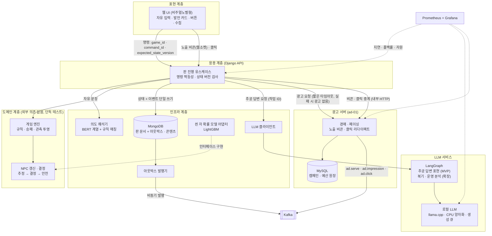
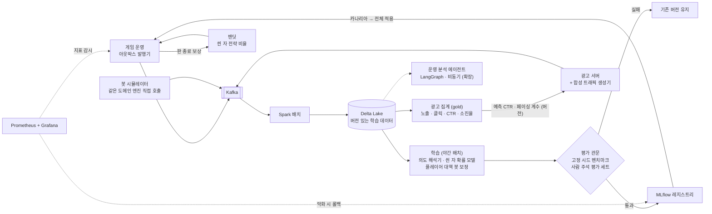

# 팔도무록: 귀신이 숨어든 마을 — 기획서 v1.1

- 작성일: 2026-11-04
- 상태: 방향 확정(v1), 세부 수치와 기술 선택은 측정 전 가정
- 관련 문서: `claude_code_4th_project_handoff.md`(기획 배경), `crosscheck.md`(검토 이력)

---

## 1. 결정 사항

| 날짜 | 결정 | 이유 |
|---|---|---|
| 2026-11-04 | 주제: 팔도무록 세계관 + 싱글플레이 사회적 추론 | 동시 접속자 없이 한 판이 성립하고, 봇 시뮬레이션으로 초기 데이터를 만들 수 있으며, LLM의 쓰임(NPC 대화)이 분명하다 |
| 2026-11-04 | v1 방향: 플레이어는 항상 무당(유일한 점술가), NPC끼리만 역할이 바뀐다 | 공개 역할 주장 구도에서 생기는 "사칭 = 확정 패배" 반례를 없애고, 원작 그노시아와 구조를 차별화한다 |
| 2026-11-04 | 정보는 행적 진술 대조 중심으로 얻는다 | 일반 주민도 비교할 정보가 생기고, 팔도무록 원안의 "사건 조사"와 이어진다 |
| 2026-11-04 | 몰래 하는 난이도 조절은 하지 않는다 | 실력을 숨기도록 유도하는 문제를 피한다. 도전은 플레이어가 고르고 보상을 준다 |
| 2026-11-04 | 사용자 데이터를 자동으로 학습에 반영하는 루프를 둔다 | 사람 데이터는 적으므로 직접 학습 대신 상대 모델 보정과 밴딧으로 반영한다(9.4) |
| 2026-11-04 | MVP부터 자유 입력을 받고, 의도 해석은 BERT 계열 분류 모델로 한다 | 직접 말하는 재미를 살린다. 분류 모델은 CPU에서 빠르고, 사람 입력과 확인 결과로 자동 재학습할 수 있다(9.1) |
| 2026-11-04 | 인원은 5명부터 프리셋으로 고르게 하고, 9명·11명 판에서 창귀 2명을 허용한다(후보) | 엔진은 인원 N·창귀 수 K를 파라미터로 만든다. 7~8명(그리고 10명)에 창귀 2명은 간이 모형에서 마을이 지나치게 불리하다. 첫 테스트와 첫 모델 검증은 6인·창귀 1로 하고, 다른 프리셋은 엔진 시뮬레이션으로 검증한 뒤 연다(4.1) |
| 2026-11-04 | 광고 시스템을 추가한다: 가상 광고주 입찰, 노출·클릭 분리 집계, 집계를 입찰에 반영하는 루프 | 광고 서버 VM(ad-01)을 3차 역할 그대로 쓴다. 실제 클릭이 적으므로 합성 트래픽으로 루프를 검증한다(14장) |
| 2026-11-04 | 피해 장소를 아침마다 공개한다: 실종 발표 때 "실종자의 짚신이 ○○에서 발견됐다"처럼 피해 장소(5곳 중 하나, 집이면 피해자의 집)와 시간대(한밤)를 모두에게 공개하고 공개 기록에 남긴다. 0일째 사건도 같다 | 알리바이("피해 시각에 다른 곳에서 목격됨")를 따지려면 피해 장소가 공개돼야 한다. 마을이 유리해질 수 있으므로 목격 확률·동선 무작위성으로 승률 40~60%를 맞춘다(8.3) |
| 2026-11-04 | 배포: 개발·내부 사용자 테스트는 노트북 VM, 시연과 이후 외부 공개는 AWS. AWS 비용은 계정별 1인 6만 원(각자 자기 계정) | VM은 무료이고 3차 자원을 그대로 쓴다. 시연·외부 공개에는 안정된 환경이 필요하다(6.3) |
| 2026-11-04 | 합격선과 계측: 1.1절 표. 성능 수치는 전부 계측값(Prometheus 지표 또는 측정 스크립트)으로만 쓰고, 동작하는 구성요소는 모두 구조화 로그를 남긴다 | 평가가 저장소 검토 방식이므로 수치와 근거가 저장소에 남아야 한다 |
| 2026-11-04 | 판 종료 설문(재미·억울함·NPC 그럴듯함, 5점 척도)을 유지한다 | 밴딧 보상(9.4 ③)과 재미 대리 지표에 쓴다 |
| 2026-11-04 | 개인정보는 최대한 수집하지 않는다(게임 데이터는 가명 ID만, 로그인 ID·비밀번호 해시는 계정 저장소에만). 보관은 프로젝트 종료 후 30일(2026-12-12)에 삭제 | 8.5 |
| 2026-11-04 | 인물 초상·지도는 생성형 AI로 미리 만든 이미지를 쓴다(도구·프롬프트·이용 조건 기록). 설화 원전은 인용하지 않고 창작 설정만 쓴다 | 아트 담당이 없고, 원전 라이선스 확인 부담을 없앤다 |
| 2026-11-04 | 이미지 에셋(초상·지도·장소/UI 아이콘·광고 소재·발표 이미지)은 PM(E)이 전담한다(같은 날 변경: 실제 제작은 B, 규격·임시 세트·검수는 E. `paldo/docs/tasks/README.md` 7절). 스타일 가이드 1장, 생성 기록, 파일 규격, 콘텐츠 ID 1:1 자동 검사를 둔다. 다른 흐름은 같은 경로·이름·규격의 임시 이미지로 개발하고, 교체 때 코드를 고치지 않는다 | 이미지가 늦어도 화면·광고 개발이 막히지 않게 한다 |
| 2026-11-04 | 일자별·담당자별 태스크와 완료 조건은 `paldo/docs/tasks/`에 둔다 | 태스크 완료만 감독해도 기획서 범위가 나오도록 조건을 태스크에 붙인다 |
| 2026-11-05 | 회의·밤 화면에 비주얼 노벨 연출을 입힌다: 장면 배경(회의 고정·밤 공통 2장) 위에 말하는 인물 초상과 대화창(한 줄씩 넘김). 진술표·수첩·투표·결과·복기는 기존 화면. 실제 이미지는 초상·장면 배경만 만들고 장소·UI 아이콘·지도·광고 소재는 임시 에셋으로 간다(`paldo/docs/tasks/README.md` 7절) | 6.1의 "웹 UI (비주얼노벨형)"을 화면 요구로 구체화한다. 표시 방식만 바꿔 엔진·API 계약은 그대로 두고, 장소별 배경은 숨은 행적을 드러낼 수 있어 만들지 않는다. 시간은 에셋 범위를 줄여 상쇄한다 |
| 2026-11-05 | 실제 이미지 에셋 제작을 B에서 A로 옮긴다(생성 도구 확정부터 검수 탈락분 재생성까지 한 묶음). 에셋 제출 검토는 B, 일괄 검수는 E. A의 프리셋 반례 테스트·최종 파라미터 재실행은 E로 옮긴다 | B에 일이 가장 많이 몰렸고, 실제 에셋은 manifest 경로가 고정이라 웹 코드와 독립이다. A가 에셋을 받아 11/9·11/11이 무거워져 테스트·재실행을 E로 넘긴다 |
| 2026-11-05 | A를 실제 에셋 주담당으로 둔다: 원한 단서 해금·복기용 이유 조회(엔진 코드)는 E가, VN 연출 규칙 문서·사용자 테스트 리허설 지원·버그 분류는 B가 맡는다. 에셋 도구 시험 생성을 11/7로 앞당기고 첫 초상은 E가 11/9에 화풍을 먼저 본다 | 에셋이 가장 큰 위험이라 A가 에셋 몰린 날 여유를 갖게 한다. E는 콘텐츠·복기 해설과 이어진 일, B는 에셋 이관으로 생긴 여유 |
| 2026-11-05 | 범위 축소: 프리셋은 5~8인(창귀 1명) 필수, 9·11인(창귀 2명)·큰 판 회의 축약·복기 해설 LLM·운영 분석 에이전트·템플릿 변형 사전 생성은 여유 되면 한다(`[확장]` 태스크) | PM 결정. 파일럿 필수 범위를 일정 안에 끝내기 위함 |
| 보류 | 플레이어가 씐 자를 맡는 모드 | MVP 이후 확장. 넣으려면 공개 정보 구조를 다시 설계해야 한다 |

### 1.1 합격선 (2026-11-04 확정)
| 항목 | 합격선 |
|---|---|
| 밸런스 | 6인·창귀 1 판에서 대역 "논리 우선 봇" 승률 40~60%(1,000판 이상, 95% 구간). 피해 장소 공개 상태에서 맞춘다 |
| 한 판 소요 시간 | 사람 판 중앙값 10분 이하 |
| 게임 API(LLM 제외) | p95 1초 이하(필수), 300ms(목표, 실측 보고) |
| LLM 추궁 전체 응답 | p95 15초 이하 |
| 의도 해석 | 사람 평가 세트 명령 전체 일치율 80% 이상이면서 기준선보다 높음 |
| 씐 자 확률 모델 | 로그 손실 < 규칙 v0, ECE ≤ 0.05 |
| 재학습 승격 | 비열등일 때만. 거부도 성공 경로 |
| 광고 합성 검증 | 예측 CTR 상대오차 20% 이내, 일 예산 소진 오차 10% 이내, 무효 과금 0건, 대사 불일치 0건 |
| 판 종료 설문 | 평균 3.5(5점 척도)는 목표. 조건은 구현·수집·리포트(미달 시 원인 분석). 주관 품질은 조건으로 보장할 수 없다 |

## 2. 전제와 가정 (확인 전)

- 팀: 5명(PM 포함, 전원 구현), 기간 2026-11-05~11-12, 1인 하루 9시간. 시나리오는 PM(E), 아트는 생성형 AI 사전 제작
- 서버: 3차 프로젝트의 **VMware VM 20대(Windows 노트북 5대에 분산)**를 다시 쓴다. 근거 자료는 3차 프로젝트 인계 자료(저장소 밖)다. VM 사양은 문서상 2 vCPU·RAM 4GB 후보값이고 다시 확인하지 않았다. 호스트 노트북 사양과 VM 증설 여유도 미확인이다. GPU는 없다. 2026-11-04 현재 Bastion에 접속되지 않으므로 11/5에 전체 VM 기동 상태부터 확인한다. 배치안은 6.3.
- 개발용 로컬 실행: 각자 PC에서는 Docker Compose로 축소 구성을 띄워 개발한다.
- 실제 사용자: 5~30명. 동시 플레이는 수 명 수준으로 가정한다.
- 외부 유료 API는 쓰지 않는다. LLM은 로컬 CPU에서 실행한다.
- 한 판 목표 시간: 5~10분(실측 전 가정).

---

## 3. 게임 개요

### 3.1 한 줄 요약
떠돌이 무당(플레이어)이 실종 사건이 난 산골 마을에서 주민들의 행적 진술을 대조하고, 모호한 점괘와 추궁을 이용해 창귀가 씐 사람을 찾아낸다. 가둘 사람은 마을 회의 투표로 정하므로 주민을 설득해야 한다. 거꾸로 무당이 의심받아 갇힐 수도 있다.

### 3.2 재미의 핵심
1. **거짓말이 두 종류다.** 씐 자도, 비밀 있는 주민도 거짓말을 한다. 모순을 찾은 뒤에도 "귀신이라서 숨기는가, 사정이 있어서 숨기는가"를 가려야 한다.
2. **추리만으로는 이길 수 없다.** 답을 알아도 주민들이 투표해 줘야 한다. 무당에 대한 신뢰와 설득이 필요하다.
3. **판이 끝나도 남는 것이 있다.** 고백받은 비밀과 원한의 단서가 쌓여 이야기와 결말이 열린다.

### 3.3 세계관
- 강원도 산골 마을 "솔뫼골".
- **창귀**: 호랑이에게 잡아먹혀 죽은 사람의 혼. 호랑이에게 매여 다음 희생자를 꾀어내는 앞잡이 노릇을 한다고 전해진다("위호작창"의 유래). 전승마다 세부가 다르므로 원전과 게임 설정을 구분해 기록한다.
- 게임 설정: 창귀가 주민 하나에게 씌어 밤마다 사람을 산으로 홀려 낸다. 호랑이는 화면에 나오지 않는다.
- 창귀의 한 때문에 마을은 같은 사흘을 되풀이하고, 무당만 그 기억을 이어 간다. 판마다 숙주, 비밀, 행적이 새로 정해진다.
- 창귀는 그 자신도 피해자다. 그래서 결말은 쫓아내는 **퇴마**와 원한을 밝혀 푸는 **한풀이**로 나뉜다.

| 마피아 게임 | 이 게임 |
|---|---|
| 마피아 | 창귀가 씐 주민("씐 자") |
| 밤의 제거 | 홀림(실종) |
| 경찰 | 무당(플레이어) |
| 처형 투표 | 금줄 친 광에 가두기 |

---

## 4. 규칙 (MVP)

### 4.1 인원과 역할
판은 0일째 밤에 주민 1명이 실종된 아침에 시작한다. 아래에서 "인원"은 **1일째 활동 인원(무당 포함)**이다. 엔진은 인원 N과 창귀 수 K를 파라미터로 받는다.

**인원 프리셋** (플레이어가 판 시작 전에 고름. 시뮬레이션으로 검증한 것만 연다)
| 프리셋 | 인원 | 창귀(씐 자) | 비밀 있는 주민(고정) | 상태 |
|---|---|---|---|---|
| 짧은 판 | 5 | 1 | 1 | 후보 |
| 기본 | 6 | 1 | 2 | **첫 사용자 테스트 구성** |
| 기본+ | 7 | 1 | 2 | 후보 |
| 큰 판 | 8 | 1 | 3 | 후보 |
| 창귀 둘 | 9 | 2 | 3 | 후보(확장) |
| 창귀 둘+ | 11 | 2 | 4 | 후보(확장). 회의 발언 축약 규칙 필수 |

- 비밀 수는 프리셋마다 고정한다(무작위 범위 아님). 비교 실험에서는 인원·창귀 수·비밀 수를 따로 바꿔 효과를 분리한다.
- 진행 일수는 프리셋마다 "예상 범위"와 "가능한 상한(무감금 경로 포함)"을 따로 측정해 표기한다.
- 간이 모형 참고치(정확 계산. NPC 균등 추첨 감금, 개별 투표·결선·무당 감금 미반영): 마을 승률 5/1 62.5%, 6/1 46.7%, 7/1 68.8%, 8/1 54.3%, 7/2 37.5%, 8/2 22.9%, 9/2 45.3%, 10/2 29.8%, 11/2 50.8%. 인원에 따라 단조롭게 어려워지지 않는다(홀짝 효과). **후보 선별용일 뿐 균형 근거가 아니며**, 프리셋은 도메인 엔진의 실제 투표 시뮬레이션으로 각각 검증한다. 난이도 표기는 인원과 분리해 검증 결과로 붙인다.
- 무당 외 등장 주민은 판마다 **주민 풀**에서 뽑는다. 필요한 수 = (인원 − 1) + 1(0일째 실종자) = **인원**. 판마다 등장인물이 달라져 반복 플레이 다양성이 커진다.

**역할** (기본 6인 기준 수)
| 역할 | 수(1일째) | 진영 | 특징 |
|---|---|---|---|
| 무당(플레이어 고정) | 1 | 마을 | 밤마다 1명을 점친다. 밤에 홀리지 않는다. 투표로 갇힐 수 있다 |
| 씐 자 | 1 | 창귀 | 밤마다 주민 1명을 홀린다. 홀린 시간대 행적은 거짓으로 진술해야 한다 |
| 비밀 있는 주민 | 2 | 마을 | 개인 사정 때문에 행적 한 구간을 거짓으로 진술한다 |
| 평범한 주민 | 2 | 마을 | 사실대로 진술한다 |

- 공개 정보: 역할별 인원, 무당이 유일한 점술가라는 사실.
- **창귀가 2명일 때**:
  - 공유 지식: 짝의 ID, 밤마다 함께 정한 (실행자, 피해자), 합의한 알리바이. 짝의 목격·믿음(의심도)은 자동 공유하지 않는다. 팀 전략은 이 허용 정보만 읽는다.
  - 밤 처리: 감금 후 종료 판정 → 활동 씐 자 중 실행자 선정 → (실행자, 피해자)를 **공동 명령 하나**로 확정 → 실제 행적·목격 생성. 한 명만 남으면 그 사람이 실행한다. 0일째 사건도 같은 규칙을 따른다.
  - 홀림 대상: 활동 마을 주민 NPC만(자신, 짝, 무당 제외).
  - 거짓말 의무는 실행자에게만 있다. 비실행자는 사실대로 말하거나 짝의 알리바이를 보강하는 거짓 주장("그 시각 나랑 우물가에 있었소")을 선택할 수 있다.
- 주민들은 무당이 씌지 않았다는 사실을 **모른다**(외지에서 온 무당이 귀신을 데려왔을 수도 있다고 본다). 규칙상 무당은 씐 자가 될 수 없지만, NPC는 무당을 의심하고 가둘 수 있다.
- NPC의 이름과 성격은 고정이고, 역할만 판마다 바뀐다.

### 4.2 정보 체계
**장소와 시간**
- 장소 5곳: 우물가, 서낭당, 주막, 마을 어귀(산길 입구), 각자 집. 판정은 이 5곳 단위로만 한다("주막 뒷방"은 주막, "서낭당 뒤"는 서낭당으로 본다).
- 밤 시간대 2개: 초저녁, 한밤.

**행적과 목격**
- 엔진이 밤마다 실제 행적을 정한다(성격별 동선 + 무작위). 씐 자는 한밤에 피해자가 있는 장소로 간다.
- 같은 공공장소(집 제외), 같은 시간대에 있던 사람끼리는 일정 확률로 서로를 목격한다.
- **피해 장소 공개**: 아침 실종 발표 때 피해 장소(집이면 피해자의 집)와 시간대(한밤)를 모두에게 공개한다("실종자의 짚신이 우물가에서 발견됐다"). 이 공개 기록과 자기 목격을 합쳐 알리바이 명제를 만든다(5.1).
- 아침마다 모든 주민이 행적과 목격 일부를 진술한다. 진술은 구조화된 주장(5.1)으로 저장하고, 주장끼리의 모순은 대조할 수 있다.

**점괘**
- 결과는 **맑음/탁함** 두 가지다. 탁함 = 씐 자이거나, 아직 털어놓지 않은 비밀이 있는 사람.
- 고백한 주민은 다음 점부터 맑게 나온다.
- 결과는 무당만 안다. 공개할 수도, 거짓으로 말할 수도 있다(신뢰도에 영향).

**기색**
- 사실 주장(행적, 목격)이 거짓일 때만 판정한다. 추측("A가 수상하다")은 틀려도 거짓이 아니다.
- 판정 결과는 주장 ID에 묶어 1회로 고정한다. 반복 질문으로 다시 판정하지 않는다.
- 비밀 있는 주민이나 압박받은 무고한 주민에게도 기색이 나올 수 있다. 확정 정보가 아니다.

### 4.3 하루 흐름
1. 아침: 실종자 발표(피해 장소·시간대 공개) → 주민 진술
2. 회의 1라운드: 무작위 순서로 활동 인원이 1행동씩
3. 추궁: 플레이어가 캐묻기 사용(낮마다 2회, 라운드 행동과 별개)
4. 회의 2라운드
5. 투표: 활동 인원 전원 1표, 자기 자신에게는 투표 불가. **동시 비공개 투표 후 한꺼번에 공개**한다(투표 순서에 따른 쏠림 방지. 표를 모으는 일은 회의 발언으로 한다). 최다 득표자를 가둔다. 갇힌 사람이 씐 자였는지는 금줄 반응으로 공개하고, 비밀 보유 여부는 공개하지 않는다(4.4).
   - 동점이면 동점자만 후보로 전원 결선 투표. 다시 동점이면 아무도 가두지 않는다.
6. 승패 판정
7. 밤: 홀림 대상과 점 대상을 비공개로 정함 → 일괄 처리 → 승패 판정 → 무당에게 점 결과 전달
   - 대상은 활동 인원만. 홀림 대상은 활동 마을 주민 NPC만(자신, 짝, 무당 제외), 무당은 자신을 점칠 수 없다.

### 4.4 승패
갇히거나 실종된 사람은 모든 계산에서 빠진다.
종료 판정은 감금 직후와 밤 처리 직후에 같은 함수로, 아래 순서대로 확인하고 **종료 사유**를 기록한다. G = 활동 씐 자 수, V = 활동 마을 주민 NPC 수, M = 무당 활동 여부(1 또는 0).
1. G = 0 → 마을 승리
2. 무당이 갇힘 → 창귀 승리(인원 조건과 무관한 별도 패배 조건)
3. G ≥ V + M → 창귀 승리. 창귀 1명이면 "씐 자를 제외한 활동 주민 NPC가 0명"과 같다.
- 마지막 씐 자가 갇히면 밤을 실행하지 않는다.
- **감금 공개**: 모든 프리셋에서 같은 원리로, 갇힌 사람이 씐 자였는지를 금줄 반응으로 공개한다(창귀 1명 판에서는 판이 끝나는지로 어차피 드러난다). 창귀 2명 판에서는 이것이 남은 공범을 찾는 확정 정보가 되므로, 시뮬레이션에서 **공개형과 비공개형을 비교**하고 공개형이면 다른 단서량을 함께 조정한다.
- 일반 흐름: 1일째 6명 → 오답 감금 5 → 밤 4 → 2일째 → 오답 감금 3 → 밤 2(무당 + 씐 자) → 창귀 승리. 투표 기회는 보통 2번이고, 무감금 날이 생기면 3번째 낮이 올 수 있다.

### 4.5 행동
| 행동 | 대상 | 효과 |
|---|---|---|
| 의심하기 | 1명 + 근거(모순, 기색, 점괘, 투표 기록) | 듣는 이의 대상 의심도 상승. 같은 발언자·대상·근거의 반복은 효과 없음 |
| 감싸기 | 1명 + 근거 | 대상 의심도 하락. 감싼 사람과 대상이 공개 기록상 묶인다 |
| 모순 지적 | 주장 2개 | 모순이 사실이면 관련자 의심도가 크게 오르고, 아니면 지적한 사람의 신뢰도가 떨어진다 |
| 해명하기 | 자신 | 자기 의심도 하락. 반복하면 효과 감소 |
| 침묵 | - | 효과 없음 |
| (무당) 점괘 공개 | 1명 + 결과 | 낮마다 1회. 거짓 공개 가능 |
| (무당) 캐묻기 | 1명 + 질문 유형 | 행적 확인 / 모순 추궁 / 의심·투표 이유. 반응(해명, 회피, 역공, 고백)은 엔진이 정한다 |

**입력 방식**: 플레이어는 자유 문장으로 말하거나, 버튼(행동 → 대상 → 근거 카드)으로 고를 수 있다. 어느 쪽이든 엔진에는 같은 구조화된 명령이 들어간다.
- MVP 계약: **자유 문장을 위 표의 정해진 행동·캐묻기 유형으로 해석한다.** 아무 질문에나 답하는 기능이 아니다. 지원 예시와 미지원 예시를 입력창 옆에 보여 준다.
- 자유 문장은 해석기(9.1)가 **발언 카드**(행동, 수신자, 대상, 근거)로 바꿔 미리 보여 주고, 플레이어가 확인하면 실행한다. 필수 정보가 빠지면 추가로 고르게 하며, 이때 행동 횟수를 소비하지 않는다.
- 무당이 자유 문장으로 할 수 있는 사실 주장은 점괘 공개(대상, 밤, 공개할 결과)뿐이다. 무당의 임의 행적·목격 주장은 MVP에서 지원하지 않는다.
- 투표와 밤의 점 대상은 버튼으로만 고른다.

### 4.6 비밀
귀신과 관계없지만 주민이 숨기고 싶은 개인 사정이다. 판마다 프리셋에 정한 수의 주민에게 무작위로 배정한다.

| 예시 비밀 | 실제 행적 | 거짓 진술 |
|---|---|---|
| 몰래 노름을 했다 | 한밤, 주막 | "일찍 자서 집에 있었다" |
| 이웃과 몰래 만났다 | 한밤, 서낭당 | "우물가에 물 길러 갔다" |
| 빚을 숨기려 곡식을 빼돌렸다 | 초저녁, 마을 어귀 | "주막에 있었다" |
| 금기를 어기고 산에 약초를 캐러 갔다 | 초저녁, 마을 어귀 | "서낭당에 빌러 갔다" |

- 배정 수는 인원 프리셋(4.1)에 정한 수를 따른다.
- 하는 일: 씐 자를 가리는 연막이 되고, 추궁으로 풀 수 있으며, 고백하면 이야기가 쌓인다.
- 비밀 있는 주민은 추궁 압박이 "고백 문턱값"을 넘으면 고백한다. 고백하면 용의자에서 빠진다.
- 씐 자는 고백하지 않고 가짜 사연이나 역공으로 대응한다.
- 비밀 데이터 스키마: 비밀 ID, 배정 가능한 인물, 실제 행적(장소 ID·시간대), 거짓 진술, 고백 대사, 성격별 고백 문턱값, 다른 비밀·동선과의 충돌 제약, 연결된 원한 단서 ID.

### 4.7 반복 플레이 보상
- 플레이어 능력치 성장은 없다.
- **원한의 단서**: 승패와 관계없이 고백과 추궁 중 나온 물증으로 창귀의 생전 신원, 죽음의 진상, 원한의 대상을 조금씩 밝힌다.
- 가설이 완성되면 이후 판에서 "퇴마" 외에 "한풀이" 결말을 고를 수 있다. 퇴마 결말은 기본 난이도로도 볼 수 있다.
- 판 안의 NPC 기억은 판이 끝나면 버리고, 판을 넘어 남는 것은 플레이어의 단서 수집 상태뿐이다.
- 선택형 도전(확장 범위): 점 1회 제한, 비밀 있는 주민 3명, 목격 정보 축소 등. 시뮬레이션으로 검증한 프리셋만 제공한다.

---

## 5. NPC 설계

### 5.1 상태: 네 층 분리
| 층 | 누가 보나 | 내용 |
|---|---|---|
| ① 전체 진실 | 엔진만 | 역할, 비밀, 실제 행적 |
| ② 공개 기록 | 모두 | 실종·감금, 주장(진술), 발언, 투표, 공개된 점괘, 고백 사실 |
| ③ 개인 지식 | 그 NPC만 | ①에서 그 NPC에게 투영한 것: 자기 역할·비밀, 자기 실제 행적, 직접 목격한 것 |
| ④ 믿음 | 그 NPC만 | 대상별 의심도와 근거, 무당 신뢰도, 확정 명제 목록 |

- 처리 순서: **관측 생성(①→③ 투영, ②) → 믿음 갱신(④) → 행동 선택**. 행동 선택 함수는 ①을 읽지 못한다. 테스트로 이 경계를 검증한다.
- **주장 스키마**: 주장 ID, 화자, 주장 유형(자기 행적 / 목격 / 비목격 / 점괘 공개), 주체(누구에 대한 주장인가), 밤, 시간대, 장소 ID, 극성(있었다·봤다 / 없었다·못 봤다), 목격 대상 목록, 정정·철회 대상 주장 ID, 진위(①에만 저장), 기색 판정 결과.
- 점괘 공개는 실제 점괘(①·무당 개인 지식)와 공개한 내용(②)을 따로 저장한다.
- **확정 명제**: "X는 밤1 한밤에 주막에 있었다(출처: 내 목격)"처럼 구조화된 명제와 출처를 저장한다. 행적 명제와 역할 판단은 구분한다.
  - 증거 출처를 구분한다: **직접 목격**(자기 눈) / **타인의 목격 주장**(공개 주장일 뿐) / **상호 보증**(서로의 알리바이를 서 줌. 공범 담합일 수 있음). 확정 명제는 직접 목격만 될 수 있다.
  - "못 봤다"는 부재 증명이 아니다(목격은 확률적이다).
  - 알리바이의 전제는 **공개된 피해 장소 + 자기 목격**이다. 타인의 공개 목격 주장으로 같은 판단을 하면 확정 명제가 아니라 근거로만 쓴다. 피해 시각에 다른 장소에서 직접 목격된 사람은 "그날 밤 **실행자가 아님**"까지만 확정한다. 창귀 1명 판에서는 이것이 곧 "씐 자가 아님"이지만, **창귀 2명 판에서는 역할 후보에서 제거하지 않는다**(비실행 공범일 수 있다).
- 규칙별 필수 상태: 캐묻기 남은 횟수, NPC별 추궁 압박 누적, 고백 여부와 시점, 반복 의심 키(발언자·대상·근거), 해명 횟수, 주장별 기색 결과, 판 상태 버전.
- 씐 자 추가 상태: 홀린 사람, 자신이 한 거짓 주장 목록, 공개 행동으로 추정한 "누가 나를 의심하는가".
- 비밀 있는 주민 추가 상태: 숨길 행적, 고백 문턱값.

```json
{
  "npc_id": "blacksmith",
  "private_knowledge": {
    "role": "villager", "secret": null,
    "my_whereabouts": {"night1": {"evening": "jumak", "midnight": "home"}},
    "witnessed": [{"night": 1, "slot": "evening", "place": "jumak", "saw": ["jumo", "meosum"]}]
  },
  "beliefs": {
    "suspicion": {"hunjang": 35, "jumo": 10, "meosum": 15, "yakcho": 70, "player": 40},
    "trust_in_mudang": 45,
    "propositions": [{"subject": "jumo", "night": 1, "slot": "evening", "place": "jumak", "source": "own_witness"}],
    "reasons": [{"target": "yakcho", "evidence": "contradiction:claim_12_vs_claim_15", "delta": 25}]
  },
  "memory": {"my_claims": ["claim_08"], "my_votes": [{"day": 1, "target": "hunjang"}]}
}
```

### 5.2 결정
- **공통**: 합법 행동 필터(활동 인원, 자기 투표 금지 등).
- **마을 NPC 투표 (세 층)**:
  1. 추정: 씐 자 확률(규칙 v0 의심도 → 9.2 모델)과 증거 묶음별 기여도.
  2. 결정: 투표 점수 = 성향 가중 확률 + 동조 가중치 × 예상 득표 + 잡음. 예상 득표는 회의에서 공개된 의심 발언으로 추정한다(표가 갈려 동점이 되면 창귀에게 유리하므로). 파라미터 몇 개는 학습이 아니라 시뮬레이션 최적화(그리드·베이지안 최적화)로 정한다. 목표는 승률 목표 범위와 낮은 추론 위반률이다.
  3. 안전: 합법 대상 필터, 확정 명제로 제거된 후보 제외. 후보가 모두 제거되면 의심도 최대로 폴백한다.
  - 모델이 투표 대상을 직접 출력하지 않는 이유: 투표에는 직접 정답 라벨이 없다(진실이 주는 라벨은 "누가 씐 자인가"). 반드시 지킬 제약은 학습이 아니라 규칙으로 보장해야 한다.
  - 확장: 결정 층을 강화학습(자기 대전) 정책과 비교한다.
- **씐 자 전략(규칙 v0)**: 마을 추론 절차를 쓰지 않고 생존과 누명을 목표로 한다.
  - 거짓 행적: 자기가 아는 목격 정보로 보아 반박당하기 어려운 장소를 고른다.
  - 누명: 공개 진술에 모순이 드러난 주민(비밀 보유 여부는 모른다)이나 의심도가 높아 보이는 주민을 고른다.
  - 밤 대상: 자신을 지목한 사람, 자신의 거짓을 목격했을 수 있는 사람, 무당을 신뢰하는 사람 중에서 섞어 고른다. 고정 규칙으로 두지 않는다.
  - 무당을 의심하게 만드는 발언으로 무당 감금을 노린다.
  - 창귀 2명일 때 팀 전략: 짝 감싸기, 일부러 거리 두기(관계 단서 숨기기), 짝이 몰리면 버리고 자기 신뢰 얻기, 짝의 거짓 알리바이 보강. 어느 전략을 쓸지는 밴딧(9.4 ③)으로 비율을 조정한다.
- 모든 행동에 **선택 이유 코드**와 근거 ID를 남긴다(복기와 학습에 쓴다).

### 5.3 인물과 성향 ("어떤 증거에 반응하는가")
| 인물 | 강하게 반응 | 약하게 반응 | 행동 경향 |
|---|---|---|---|
| 훈장 | 진술 일관성, 모순 | 무당의 점괘 | 신중, 고집이 셈 |
| 주모 | 목격 정보 | 다수 의견 | 감싸기를 자주 함 |
| 대장장이 | 다수 의견, 기색 | 세세한 모순 | 공격적, 의심을 자주 함 |
| 머슴 | 무당의 점괘 | 모순 | 겁이 많아 해명을 자주 함 |

인물 6명, 성향 4종. 나머지 두 명(예: 약초꾼, 과부)은 같은 성향에 다른 동선과 비밀을 준다.

---

## 6. 시스템 아키텍처

### 6.1 런타임 구성 (게임 요청 경로)



### 6.2 데이터 · 학습 흐름



- 자동화는 단계적으로 한다(9.4). 초기에는 학습과 레지스트리 승격을 사람이 실행한다.

- **계층 원칙**: 게임 엔진(도메인)은 Django, MongoDB, LLM을 import하지 않는다. 시뮬레이터와 웹이 같은 엔진을 쓴다.
- **상태와 로그의 일치**: 판 상태와 미발행 이벤트를 **같은 판 문서에 함께 쓰는 아웃박스**로 저장한다(MongoDB 단일 문서 쓰기는 원자적). 발행기가 아웃박스를 Kafka로 보내고, 소비 단계에서 이벤트 ID로 중복을 제거한다. 게임 요청 경로는 Kafka 장애와 무관하게 진행된다.
- **명령 보호**: 모든 명령은 `command_id`(중복 클릭·재시도 방지)와 `expected_state_version`(이미 지난 단계에 대한 명령 거부)으로 검증한다. LLM 생성은 DB 잠금 없이 작업 ID로 돌리고, 결과를 붙일 때 판 버전을 확인한다. 브라우저 응답은 플레이어에게 허용된 정보만 직렬화한다.
- **배포**: 개발은 각자 PC의 Docker Compose 축소 구성, 통합·내부 사용자 테스트는 6.3의 VM 배치, 시연과 이후 외부 공개는 AWS로 한다. AWS 비용은 계정별 1인 6만 원(각자 자기 계정)이며, 사용하는 모든 계정에 예산 알림을 걸고 시연 후 종료 절차를 실행한다. AWS에 올릴 범위는 결정 대기(`paldo/docs/tasks/README.md` P-05). Spark·Delta Lake는 호환 버전을 고정한다.

### 6.3 VM 배치안 (3차 VM 20대 재배정)

3차 프로젝트의 서비스·데이터는 4차 작업을 시작할 때 지운다. 4차에 필요 없는 역할(광고 서버, NiFi, MySQL 3대, 이미지 저장소)의 VM 6대를 새 역할로 돌린다. IP·계정은 이 문서와 저장소에 쓰지 않는다(저장소 밖 비공개 문서에서 관리).

| 논리 서버 | 3차 역할 | 4차 역할 | 담당 흐름 |
|---|---|---|---|
| bastion-01 | Bastion·Ansible | 그대로(배포 자동화) | C |
| metrics-01 | Prometheus·Grafana | 그대로 + 게임·LLM·모델 지표 | C |
| app-01 | Django 웹 | Django 웹·API, 아웃박스 발행기, 의도 해석기 추론 | B·C·D |
| ad-01 | 광고 서버 | **광고 서버**(14장): 경매, 캠페인 관리, 노출·클릭 수집 | D·B·C |
| llm-01(신규) | - | **로컬 LLM 서버**(llama.cpp) + LangGraph 서비스. 가장 성능 좋은 노트북에 새로 만들고 자원을 몰아준다(또는 Windows에서 직접 실행) | E |
| nifi-01 | NiFi | **ML 작업 서버**: MLflow 추적·레지스트리, BERT 미세조정, 모델 학습 | D·C |
| mysql-01, 02 | MySQL | **광고 DB**(Primary + Replica): 캠페인·소재·예산 원장 | C·D |
| spark-worker-02, 03 | Spark Worker | **Kubernetes(k3s) 2노드**(서버 1 + 에이전트 1): 시뮬레이션 대량 실행 Job, 재학습 CronJob, 운영 분석 에이전트 배치 | C·D |
| kafka-01~03 | Kafka 3대 | 그대로(게임·광고 이벤트 토픽, 3대 클러스터 유지) | C |
| spark-master-01, spark-worker-01 | Spark | 그대로(Kafka → Delta 배치, 학습 데이터·광고 집계). 데이터량상 Worker 1대로 충분 | C |
| mongo-01~03 | MongoDB Replica Set | 그대로(판 문서 + 아웃박스, 콘텐츠, 플레이어 상태). LLM 자원이 정말 부족할 때만 1노드로 축소 | C |
| lake-storage-01 | Garage(Delta용) | Delta Lake + MLflow 아티팩트 버킷 | C |
| media-storage-01, mysql-03 | 이미지 저장소, MySQL | **끄기(LLM 노트북 자원 확보용)**. 시연 후 삭제 검토 | C |

**노트북별 배치** (팀원 1인당 노트북 1대, 노트북마다 VM 4대. 담당자 대응은 비공개 접속 문서에만 기록)
| 노트북 | VM | 부하 |
|---|---|---|
| 1 | bastion-01, kafka-01, spark-master-01, mysql-01(광고 DB Primary) | 중간 |
| 2 | app-01(게임 웹), kafka-02, spark-worker-01, mongo-01 | 중간 |
| 3 | ad-01(광고 서버), lake-storage-01, mysql-03(끄기), mongo-03 + **llm-01(신규)** | 가벼움 → **LLM 노트북 후보** |
| 4 | metrics-01, nifi-01(ML 작업 서버), media-storage-01(끄기), spark-worker-03(k3s) | 야간에 무거움(학습 + 시뮬레이션) |
| 5 | kafka-03, spark-worker-02(k3s), mysql-02(광고 DB Replica), mongo-02 | 중간 |

**노트북 사양** (5대 동일. 2026-11-04 PM 노트북에서 실측)
| 항목 | 값 | 설계에 주는 영향 |
|---|---|---|
| 기종 | HP ProBook 450 G10 | |
| CPU | Intel Core i5-1340P, 12코어(P 4 + E 8) / 16스레드 | P코어·E코어 혼합이라 스레드 수에 따른 속도가 단조롭지 않을 수 있다. 생성·프롬프트 처리 스레드를 따로 바꿔 가며 실측한다 |
| RAM | 32GB(DDR4-3200 16GB × 2, 듀얼 채널) | 메모리 대역폭 약 51GB/s(이론값). CPU LLM 생성 속도의 상한을 정한다 |
| GPU | Intel Iris Xe(내장) | CUDA 없음. CPU 추론만 전제한다(Vulkan·SYCL 가속은 11/5 벤치 때 선택 사항으로 시험) |
| 디스크 | NVMe SSD 512GB. PM 노트북 기준 C: 여유 64GB | VM 디스크 증설·모델 파일(수 GB)·Delta 데이터 공간이 빠듯하다. 노트북별 여유 공간을 11/5에 확인한다 |
| 가상화 | VMware Workstation | VM 끄기·설정 변경은 각 노트북 담당자가 직접 한다 |

- 노트북마다 RAM 32GB에서 Windows 몫 약 6GB를 빼면 VM에 약 26GB를 쓸 수 있다. 기존 VM 4대 × 4GB = 16GB이므로 노트북당 여유는 약 10GB다.
- **LLM은 노트북 3에 둔다.** 사양이 모두 같으므로 VM 부하가 가장 가벼운 노트북 3이 맞다. mysql-03을 끄면 ad-01·lake-storage-01·mongo-03(각 2 vCPU·4GB, 합 12GB)만 남는다. 산술로는 LLM에 최대 약 12GB를 줄 수 있지만, VMware 오버헤드와 호스트 여유가 약 2GB만 남으므로 **12GB는 상한 후보**다. 모델 파일·컨텍스트 길이·동시 슬롯 수를 먼저 고정하고, 노트북 3의 광고·Lake·Mongo 부하를 함께 걸어 호스트와 게스트의 최대 메모리·페이지아웃을 측정해 배정량을 정한다("가장 가벼움"도 이 실측으로 확인한다).
- LLM 스레드는 **P코어 수(4)에 맞춰 4~6**으로 시작해 벤치마크로 정한다. VM으로 돌리면 vCPU 6을 상한으로 둔다.
- 생성 속도는 **실측 전 가설**이다. 메모리 대역폭(이론 51.2GB/s)을 모델 크기로 나눈 단순 상한은 3~4B Q4(약 2~2.5GB) 초당 20~26토큰, 7~8B Q4(약 4.5~5GB) 초당 10~11토큰이다. 실효율을 절반 정도로 보면 각각 초당 10~15토큰, 5~8토큰이고, 대사 한 줄(약 60토큰) 생성에 4~6초, 8~12초다. 이것은 생성 시간만이며, 최종 판단은 7.3의 전체 응답 p50·p95, 동시 요청, 장시간 부하 시험으로 한다. **3~4B급을 기본 후보로 하고**, 7~8B는 복기·운영 분석처럼 기다려도 되는 작업에만 시험한다.
- 노트북 3의 담당자도 같은 노트북으로 개발한다. 그래서 LLM 자원을 시간대로 나눈다.
  - **개발 시간대**: llm-01은 작게(예: 1~2B 모델 또는 정지) 두고, 각 흐름은 가짜 LLM(`fixtures/llm`)으로 개발한다. 담당자의 IDE·브라우저·로컬 Compose가 RAM을 쓴다.
  - **통합·사용자 테스트·LLM 벤치 시간대**: 담당자는 개발 도구를 줄이고 llm-01에 확정 배정량을 준다. 시간표는 11/5 C의 실행 시간표에 넣는다.
  - 11/5 벤치는 담당자가 실제로 개발 도구를 띄운 상태와 비운 상태를 모두 측정한다.
- **디스크**: VM을 꺼도 디스크는 돌아오지 않고, 스냅샷 삭제는 병합 작업이라 시간과 추가 여유 공간이 필요하다. 11/5에 노트북별 실제 여유 공간, VM별 할당·사용량, 스냅샷 구조를 확인한다. 모델 파일, Docker 이미지, 학습 체크포인트, MLflow 아티팩트, Kafka 로그(보존 1일), Delta 원본·재처리분의 보존량과 정리 기준을 정하고, 재학습·장애 복구 중 최대 동시 점유량으로 계산한다. 부족하면 끈 VM(media-storage-01, mysql-03)부터 정리한다.
- 노트북 4는 ML 학습(nifi-01)과 k3s 시뮬레이션(spark-worker-03)이 겹치지 않도록 실행 시간대를 나눈다.

**LLM 자원 몰아주기**
- VM 자원은 같은 노트북 안에서만 옮길 수 있다. 가장 성능 좋은 노트북 한 대를 LLM 전용으로 정하고, 그 노트북의 다른 VM은 끄거나 다른 노트북으로 옮긴다.
- 삭제 전에 먼저 끈다(CPU·RAM은 바로 풀리고 되돌릴 수 있다). 디스크 공간이 필요할 때만 스냅샷과 함께 삭제한다.
- LLM VM의 vCPU는 호스트 물리 코어 수를 넘기지 않는다(초과 할당은 오히려 느려진다).
- 대안: 그 노트북의 Windows에서 llama.cpp를 직접 실행한다(가상화 오버헤드 없음). 11/5 벤치마크에서 VM 실행과 비교한다.

- 기록된 설치 버전(재확인 필요): Ubuntu 26.04, 시스템 Python 3.14.6(11/4 PM 노트북 실측), Spark 4.1.3·Hadoop 3.4.2·OpenJDK 21, Delta Spark 4.4.1, Kafka KRaft 3대, Prometheus 3.15.0, Grafana 13.2.4.
- ML·LLM 라이브러리(PyTorch, transformers, LightGBM, llama-cpp-python, pyspark)도 시스템 Python **3.14 단일**로 돌린다(11/5 PM 확정, C-05-03 조건 2 실측에서 5개 모두 성공, `contracts/tech_stack.md`). Delta는 Maven 좌표 `io.delta:delta-spark_4.1_2.13:4.4.1`(C-05-03 조건 3). Ubuntu VM에서는 아직 확인하지 않았다.
- 사용자 테스트 중에는 llm-01(LLM)·ad-01(광고)·app-01(웹)에 학습 작업을 올리지 않는다. 학습·시뮬레이션은 nifi-01과 k3s 노드에서 돌린다.

---

## 7. LLM 설계

### 7.1 쓰는 곳과 쓰지 않는 곳
| 쓰는 곳 | 단계 | 이유 |
|---|---|---|
| 추궁 답변 표현 | MVP | 플레이어가 직접 묻고 기다리는 장면이라 지연을 감수할 가치가 있다 |
| 판 종료 복기 | 확장 | 비동기. 행동 시점의 이유 코드와 근거 ID를 설명한다(사후 합리화 금지) |
| 운영 분석 에이전트 | 확장 | 비동기. 지표를 읽고 밸런스·콘텐츠 개선안을 낸다 |
| 템플릿 변형 사전 생성 | 확장 | 오프라인 생성, 사람 검수 후 사용 |

| 쓰지 않는 곳 | 이유 |
|---|---|
| 아침 진술, 일반 회의 행동 | 매 턴 NPC 여러 명이 발언하므로 누적 지연이 크다. 템플릿으로 처리 |
| 승패, 진실, 의심도 계산 | 결정론적 엔진의 몫. LLM은 상태를 바꿀 수 없다 |
| 사실 주장 문장 생성 | 엔진이 완성한다(7.2) |
| 자유 입력 의도 해석 | 분류 모델이 맡는다(9.1). 빠르고 결과가 정해진 라벨 안에 있다 |

### 7.2 추궁 답변 흐름 (LangGraph)
1. 플레이어가 캐묻기를 버튼으로 고르거나 자유 문장으로 입력한다. 자유 문장은 9.1 해석기가 정해진 캐묻기 유형으로 바꾼다.
2. 엔진이 반응 의도(해명/회피/역공/고백)와 **사실 주장 문장**을 확정한다. 예: "그날 한밤엔 집에 있었소."
3. LLM은 **사실을 더하지 않는** 말투·감정 표현만 덧붙인다. 예: 머뭇거림, 화냄, 하소연.
4. 검증: 형식, 길이, 허용되지 않은 인물·장소·역할어, 부정·단정 표현("가지 않았다", "틀림없이 무고하다")의 추가 여부.
5. 실패하거나 시간이 초과되면 템플릿 표현으로 대체한다. 생성 답변과 폴백은 **같은 정보량**을 가진다. LLM 문장은 게임상 증거가 되지 않는다(증거는 엔진이 확정한 주장뿐).

### 7.3 모델 선정과 지연
- CPU 양자화 소형 모델(3~4B급 기본, 7~8B급은 기다려도 되는 작업용 시험)을 후보로 한국어 품질과 지연을 실측해 고른다.
- 배치: 노트북 3의 llm-01(RAM 최대 약 12GB, 실측으로 확정) 또는 같은 노트북의 Windows 직접 실행. 근거와 예상 속도는 6.3 "노트북 사양"을 따른다. 11/5 벤치마크에서 두 방식과 모델 크기를 비교해 확정한다.
- 측정: 실제 추궁 예시 프롬프트로 **큐 대기 + 프롬프트 처리 + 생성 + 검증** 전체 지연 p50/p95, 메모리(가중치 + KV 캐시 + 버퍼), 동시 요청 시 지연, 말투 유지(사람 평가), 폴백 비율.
- 운영: 입력 길이·출력 토큰·동시 생성 수를 제한하고, 추궁 요청이 다른 LLM 작업보다 우선한다. 타임아웃 시 생성을 실제로 취소하는지 확인한다.

---

## 8. 데이터 전략

### 8.1 데이터 종류 (섞지 않는다)
| 종류 | 출처 | 용도 | 주의 |
|---|---|---|---|
| 콘텐츠 | 직접 작성한 인물·비밀·원한 설정(설화는 참고만, 원문 인용 없음) | 게임 내용, 템플릿, LLM 페르소나 | 행동 학습의 정답이 아니다 |
| 봇 시뮬레이션 | 규칙·ML 봇끼리의 판 | 밸런스 실험, NPC 모델 학습 | 사람의 행동을 대변하지 않는다 |
| 실제 플레이 | 사용자 판 로그, 수첩, 설문 | 재미·이해도 평가, NPC 검증, 상대 모델 보정(설문은 평가와 밴딧 보상에만) | 표본이 작다. 사용자 단위로 분할 |
| 부하 테스트 | 합성 이벤트 | 파이프라인 처리량·장애 복구 | 사용자 수나 재미의 증거가 아니다 |
| 광고 합성 트래픽 | 숨겨 둔 실제 CTR을 따르는 가상 사용자 클릭 모델 | 광고 입찰 반영 루프의 검증(14.6) | 실제 광고 성과가 아니다. `source=synthetic` |

### 8.2 이벤트 계약
- **공통**: 이벤트 ID, 게임 ID, 판 내 순번, 일차·단계, 상태 버전, 시각, 출처(봇/사람), 가명 사용자 ID·세션 ID(사람 판).
- **판 조건**: 시드, 역할·성향 구성, 도전 프리셋, 콘텐츠·엔진·규칙·특징 변환 버전, 각 NPC의 정책 버전과 상대 정책 구성.
- **행동**: 행위자, 행동 직전 그 행위자의 관측 스냅샷(②+③+④), 합법 행동 목록, 선택한 행동, 선택 이유 코드·근거 ID, 소요 시간.
- **결과**: 승리 진영, 종료 사유, 완료·중단 상태.
- **LLM**: 모델·양자화·프롬프트 버전, 큐 대기·생성 시간, 실패 사유, 최종 표시 답변, 폴백 여부.
- **사람 판 추가**: 수첩 기록, 투표 직전 확신도, 판 종료 설문.
- **자유 입력**: 해석 시도 ID, 원문, 입력 당시 문맥(선택된 NPC·카드, 직전 대화, 단계), 후보 목록과 점수(의도·대상·근거별), 제시한 발언 카드, 플레이어 반응(확인 / 수정 / 다시 입력 / 버튼 전환 / 취소 / 무응답)과 수정 내용, 최종 실행 명령, 모델·토크나이저·별칭 사전·매칭 규칙·문턱값 버전. 원문에 개인정보가 들어갈 수 있으므로 보관 기간과 마스킹 규칙을 정한다.
- 최종 실행 명령은 원문의 정답과 같지 않다(귀찮아서 확인하거나, 도중에 전략을 바꿀 수 있다). 학습 라벨은 9.1의 라벨 출처 규칙을 따른다.
- 전체 진실(①)은 평가용 영역에 따로 저장한다. 학습 **입력**에는 넣지 않고, 학습 **라벨**로만 판 종료 후 조인한다.
- 사람 플레이어의 믿음은 직접 관측할 수 없다. 수첩·확신도는 "자기 보고", 엔진 추정치는 "추정"으로 출처를 구분한다.

### 8.3 시뮬레이션 계획
- 상대 봇 여러 종류: 무작위, 논리 우선, 반복 의심형, 거짓말 공략형.
- 측정: 진영 승률, 판 길이, 무감금 빈도, 비밀 고백률, 플레이어 대역 봇의 의미 있는 선택 횟수.
- 밸런스 목표(11/4 확정): 6인·창귀 1 판에서 플레이어 대역 "논리 우선 봇"의 승률 40~60%(1,000판 이상, 95% 구간 보고). 피해 장소 공개로 마을이 유리해질 수 있으므로 **피해 장소 공개 상태에서** 목격 확률과 동선 무작위성을 조정해 맞춘다.

### 8.4 사람 데이터로 할 수 있는 것과 없는 것
- 규모 추정(가정): 판당 플레이어 결정 10~15개. 30명 × 평균 4판이면 약 120판, 결정 1,500개 안팎. 독립 표본은 결정 수가 아니라 사람 수(5~30)다.
- 원칙: **봇 시뮬레이션으로 학습하고, 사람 데이터로 검증·보정한다.** 사람 행동 예측 모델(이탈 예측, 사람 모방 봇)은 MVP 목표로 두지 않는다.
- 되는 분석: 판 번호별 승률 변화, 판 길이와 이탈 지점, 의심·투표 근거 분포, 캐묻기 사용과 고백 유도율, 패배 패턴과 "억울함" 설문, 정책 간 비교(효과가 클 때만 결론).
- 데이터 가치를 높이는 장치:
  - **무당의 수첩**: 플레이어가 인물별 의심 정도를 표시하는 게임 내 메모 기능. 투표 직전 확신도도 받는다.
  - **판 종료 설문 1~2문항**: 재미, 억울함, NPC가 그럴듯했는가.
  - **고정 시드 판**: 일부 판 구성을 여러 사용자에게 똑같이 줘서 사람 간 비교를 가능하게 한다.

### 8.5 실제 사용자 모집과 개인정보 (가정)
- 부트캠프 동기, 지인, 커뮤니티 테스트 공지.
- 개인정보는 최대한 수집하지 않는다. 사용자는 직접 만든 로그인 ID·비밀번호로 로그인하고(11/4 PM 결정, 이름·연락처·이메일은 받지 않음), 게임 데이터에는 계정마다 발급한 가명 사용자 ID만 쓴다. 로그인 ID와 비밀번호 해시는 계정 저장소에만 둔다. 수집 항목은 계정(로그인 ID·비밀번호 해시), 플레이 로그, 마스킹한 입력 문장, 설문으로 한정한다. 보관은 프로젝트 종료 후 30일(2026-12-12)에 삭제하고, 가명 ID로 삭제 요청을 받는다(`paldo/docs/contracts/privacy.md`).
- 참가자는 내부망 대상이다(목표 30명 × 4판). 외부 공개는 이후 도메인을 붙여 AWS로 한다.
- 적은 인원이라도 같은 사람을 여러 번 관찰하는 테스트 일정을 먼저 잡는다.
- 사용자 수가 작으므로 A/B 우열보다 "규칙을 이해했는가, 어떤 선택이 억울했는가, 다시 하고 싶은가"를 중심으로 판단한다.

---

## 9. ML 계획

### 9.1 MVP 과제 A: 자유 입력 의도 해석 (게임 동작에 필수)
자유 문장을 실행 가능한 엔진 명령으로 바꾼다. 성공 기준은 의도 하나를 맞히는 것이 아니라 **명령 전체(행동, 수신자, 대상, 근거, 필수 슬롯)가 맞고 합법인 것**이다.

**해석 단계**
| 단계 | 하는 일 | 방식 |
|---|---|---|
| ① 의도 분류 | 문장 → 의도 후보(복수 가능) + 발화 형태 | BERT 계열 한국어 인코더 미세조정(후보: KoELECTRA, KLUE-RoBERTa 등. 라이선스 확인). 기준선 TF-IDF + 로지스틱 회귀. 발화 형태(질문 / 주장 / 인용 / 요청)는 별도 출력 |
| ② 인물 인식 | 문장 속 인물 → NPC ID, 그리고 역할 구분 | 별칭 사전 + 조사 처리 + 최장 일치. 인물마다 **수신자 / 행동 대상 / 언급 인물** 역할을 정한다("훈장님, 머슴을 왜 의심하세요?" → 수신자 훈장, 언급 인물 머슴) |
| ③ 근거 매칭 | 문장 → `근거 유형 + 기록 ID` 후보 | 주장, 투표, 기색, 점괘 기록을 인물·장소·시간대·극성 표현으로 점수 매칭. 원래 주장을 **찾는 일**과 그 주장을 부정하는지 지지하는지 **판단하는 일**을 분리 |
| ④ 문맥 해소 | 대명사·생략 처리 | "그 사람", "왜 갔어?" 같은 표현은 선택된 NPC·카드, 직전 대화 순서로 해소. 하나로 정해지지 않으면 직접 고르게 함 |
| ⑤ 검증 | 필수 슬롯, 합법성, 단계·횟수 | 행동별 필수 슬롯 표로 검사. 누락·충돌·단계 위반이면 추가 선택을 받고 행동을 소비하지 않음 |

**의도 라벨 (행동표와 1:1 대응)**
| 라벨 | 대응 행동 | 필수 슬롯 | 경계 예시 |
|---|---|---|---|
| 의심하기 | 의심하기 | 대상, 근거(선택) | "훈장이 수상하다"(주장) ↔ "훈장이 수상하다고?"(질문 → 확인) |
| 감싸기 | 감싸기 | 대상, 근거(선택) | "머슴은 아니야" |
| 모순 지적 | 모순 지적 | 주장 2개 | "훈장과 머슴 말이 서로 안 맞는다"(모두에게 말함) |
| 해명하기 | 해명하기 | - | "나는 귀신과 상관없소" |
| 침묵 | 침묵 | - | "이번엔 지켜보겠다". 빈 입력·전송 실패는 침묵으로 처리하지 않음 |
| 점괘 공개 | 점괘 공개 | 대상, 밤, 공개 결과 | "머슴 점괘는 맑았다"(실제가 탁함이어도 합법적인 거짓 공개) |
| 캐묻기: 행적 확인 | 캐묻기 | 수신자, 밤·시간대 | "어젯밤 한밤에 어디 있었소?" |
| 캐묻기: 모순 추궁 | 캐묻기 | 수신자, 주장 2개 | "훈장님, 머슴 말과 왜 다르오?"(특정인에게 답을 요구) |
| 캐묻기: 의심 이유 | 캐묻기 | 수신자, 언급 인물(선택) | "왜 약초꾼을 의심하오?" |
| 미지원 | - | - | 지원하지 않는 질문, 잡담. 지원 예시를 다시 보여 줌 |

- "기타" 하나로 묶지 않고 실패 상태를 나눈다: 미지원 의도, 대상 누락, 근거 불명확, 해석 불가.
- 한 문장에 의도가 여럿이면("훈장은 수상하지만 머슴은 결백해") 후보 카드를 모두 보여 주고 **플레이어가 이번에 실행할 하나를 고른다.** 자동으로 여러 행동을 실행하지 않는다.
- BART 같은 생성 모델 대신 인코더 분류를 고른 이유: 출력이 정해진 라벨 안에 있고 CPU 추론이 빠르다. 인물·근거는 규칙 매칭으로 시작하되, 규칙이 더 정확하다는 것은 3단계에서 검증한다.

**실행 정책**
- MVP 초기: 해석 결과를 항상 **발언 카드로 미리 보여 주고** 확인받는다. 카드에서 대상·근거를 바로 고칠 수 있고, "해당 없음 / 다시 입력"도 고를 수 있다.
- 확인 생략: 사람 평가로 명령 전체 정확도가 충분히 검증된 의도·조건에서만 허용한다. 판단 기준은 분류 확률 하나가 아니라 의도 확률, 상위 후보 간 점수 차이, 슬롯 완성, 합법성 검증 통과를 모두 본다. 신경망 확률은 보정 후 사용한다.

**초기 학습 데이터**
- 사람이 먼저 의도별 경계 예시와 **최소 대조쌍**을 쓴다. 예: "훈장이 수상하다 / 훈장이 수상하다고? / 훈장이 수상하지 않다".
- 로컬 LLM으로 말투·어순·오타 변형을 만들고, 검수에서는 말투가 아니라 **의도·대상·극성·발화 형태가 보존됐는지**를 본다.
- 원본 예시와 그 파생 문장은 **반드시 같은 분할**(학습/검증/평가)에 넣는다. 생성 계보를 기록한다.
- 인물 이름은 학습과 운영에 같은 전처리를 적용하고, 필요하면 `인물1·인물2`처럼 서로 구별되는 자리표시자를 쓴다. 별칭·조사 결합·미등록 별칭 예시도 포함한다.
- 가능한 한 일찍 소수 사용자의 실제 입력을 모은다(생성 문장은 실제 짧은 입력, 생략, 오타를 대변하지 못한다).

**라벨 출처 규칙**
- 원문 의도 주석, 제시한 해석, 최종 실행 명령, 수정 내용, 라벨 출처·신뢰 수준을 분리해 저장한다.
- 신뢰 수준: 사람 검수 주석(높음) > 플레이어가 카드를 직접 수정(중간) > 그대로 확인(낮음) > 확인 생략 실행(학습 제외 또는 약한 라벨).
- 확신이 높아 확인을 생략한 입력도 일부를 무작위로 검수 대상에 넣는다(쉬운 문장과 자신 있게 틀린 문장을 놓치지 않기 위해).
- 사람이 주석한 독립 평가 세트를 따로 유지하고, 학습 데이터로 쓰지 않는다.
- 게임 진실(①)은 의도 해석기의 라벨을 만드는 데 쓰지 않는다. 무당의 거짓 점괘 공개도 "의도는 점괘 공개"가 정답이다.

**평가**
- 의도별 F1, 매크로 F1, 미지원 입력 검출률(알려진 의도와 따로 평가).
- **명령 전체 일치율**, 대상·근거별 오류율, **잘못된 즉시 실행률**.
- 반례 세트: 부정, 대명사, 생략, 다중 의도, 질문·주장 구분, 별칭.
- 사용자 지표: 원하는 행동의 완료율, 추가 선택 횟수, 취소·버튼 전환 비율.
- CPU: 토큰화·규칙 매칭 포함 전체 지연 p50/p95, 메모리, 미세조정 소요 시간(실측).

### 9.2 MVP 과제 B: 마을 NPC의 "후보별 씐 자 확률" 추정 모델
의도 해석기가 게임 동작에 필수이므로 먼저 만든다. 이 과제는 규칙 기반 의심도로 시작하고 모델로 교체한다.
- 입력: 그 NPC가 행동 시점에 관측할 수 있는 후보별 특징(모순 수, 기색, 공개 점괘, 투표·감싸기 관계, 목격 명제, 압박 반응 등).
- 라벨: 판 종료 후 진실에서 조인한 "그 후보가 씐 자인가".
- 학습 데이터: 시뮬레이션(대량). 모델: 로지스틱 회귀 → LightGBM.
- 쓰임: 마을 NPC의 의심도 계산에 반영한다. 투표는 5.2의 규칙 절차를 유지한다. 행동 모방이 아니라 진실을 라벨로 쓰므로, 규칙 봇보다 나은 추론을 학습할 수 있다.
- 학습 행: 판정 시점(진술 후, 라운드 후, 투표 직전)마다 관찰자 × 후보. 관찰자는 마을 진영 NPC만, 후보는 관찰자를 뺀 활동 주민 NPC.
- 확률 정규화:
  - 창귀 1명: 후보 점수를 소프트맥스로 정규화(합 1).
  - 창귀 2명: 단순 배율 조정은 확률이 1을 넘으므로 쓰지 않는다. 남은 후보의 **쌍 조합**(10명이어도 45쌍)에 점수 합으로 확률을 매기고, 후보별 확률은 그 주변확률로 구한다(자동으로 0~1, 합 = 남은 창귀 수). 공개된 감금 결과는 조합에서 바로 반영한다.
  - 보정 후 확률의 품질(보정도)을 평가한다.
- 이 모델은 **"무당은 씐 자가 아니다"를 조건으로 한 주민 후보 추정**이다. 무당에 대한 의심은 무당 신뢰도 규칙으로 따로 다루고, 투표 결정 층(5.2)에서 둘을 합친다.
- 여러 프리셋 공동 학습: **처음에는 6인·창귀 1 모델만 검증**한다. 이후 창귀 수별 모델과 공동 모델을 비교한다.
  - 큰 판·긴 판이 학습 행을 과도하게 차지하지 않도록 게임·시점·프리셋별 가중치나 샘플링을 정한다.
  - 같은 증거의 의미가 창귀 수에 따라 달라진다(알리바이, 감싸기, 감금 공개). 인원·창귀 수·남은 후보 수를 특징에 넣고 프리셋별 로그 손실·보정도·승률을 따로 본다.
  - 창귀 2명 판의 쌍 관계 특징(누가 누구를 감쌌나, 투표가 늘 같은 쌍, 상호 보증)은 **공개 기록과 관찰자 자신의 믿음으로만** 만든다. 다른 NPC의 비공개 의심도는 쓰지 않는다.
- **무당은 후보에서 제외**한다. 정답 라벨에서 "무당은 항상 0"을 배우고 점괘 공개 같은 무당 전용 행동이 식별 표시가 되어, NPC가 무당을 절대 의심하지 않게 되기 때문이다. 무당에 대한 의심은 무당 신뢰도 규칙으로 따로 다룬다.
- 특징 묶음: 모순, 직접 목격(알리바이), 진술 성격(확인 불가 행적), 점괘(무당의 이전 공개 적중 포함), 기색, 추궁 반응(고백, 역공), 사회 관계(감싸기·의심·투표, 실종자가 의심했던 사람), 진행(일차, 후보 수).
- 성향 반영: 모델의 특징 묶음별 기여도(로지스틱 회귀 계수 또는 LightGBM SHAP 값)에 NPC 성향 가중치를 곱해 의심도를 만든다. 이 기여도는 복기 해설의 근거로도 쓴다.
- 주의:
  - 씐 자 봇의 습관 암기를 막기 위해 씐 자 전략을 섞어 학습하고, 학습에 쓰지 않은 전략으로 평가한다.
  - 목표는 정확도 최대가 아니라 승률 목표 범위 안의 "납득할 만하게 틀리는 NPC"다. 성향 가중치와 잡음으로 조절한다.
  - 9.4 ③에서 씐 자 전략 비율이 바뀌면 재학습한다.
- 부가 가치: 같은 시점의 사람 수첩 확신도, NPC 추정, 진실을 비교하는 분석이 가능하다.
- 후순위: 판 진행 중 승리 확률 예측(대시보드·복기), 씐 자 전략 모델, 도전 프리셋 밸런스 평가.

### 9.3 검증 방식 (과제 B)
- 교체하는 역할을 고정한다(MVP는 마을 NPC의 추정 모델만 교체).
- 같은 시드·같은 상대 정책에서 기준(규칙 의심도)과 비교한다.
- 지표: 추정 정확도(로그 손실, 상위 1 적중률), 마을 진영 승률, **합법 행동 위반**과 **마을 추론 위반**(확정 명제와 충돌하는 투표)을 분리해 집계.
- 일반화: 학습에 쓰지 않은 시드뿐 아니라 학습에 쓰지 않은 상대 전략·비밀 조합에서도 평가한다.
- 데이터 분할은 게임 단위. 사람 데이터는 사용자·시간 기준으로도 나눈다.
- 사람 평가: 실제 플레이에서 "NPC가 그럴듯했는가".

### 9.4 사용자 데이터 기반 자동 학습 루프 (방향 합의)
사람 데이터가 적으므로 게임 전략 모델은 사람 데이터로 직접 학습하지 않는다. 예외는 의도 해석기로, 사람 문장과 확인 결과가 곧 정답 라벨이므로 직접 재학습한다. 다음 네 갈래로 자동 반영한다.

| 갈래 | 사람 데이터에서 배우는 것 | 방식 |
|---|---|---|
| ⓪ 의도 해석기 재학습 | 실제 플레이어의 말투와 질문 방식 | 라벨 출처 규칙(9.1)에 따른 신뢰 수준 높은 라벨로 재학습. 사람 주석 평가 세트에서 명령 전체 일치율이 기존보다 나을 때만 교체 |

**자동화 단계**: 처음에는 **검수한 데이터로 수동 배치 학습 + 수동 모델 승격**으로 시작한다. 데이터 품질과 교체 기준이 검증된 뒤 야간 배치, 자동 평가 관문, 카나리아 순으로 자동화한다.
| ① 플레이어 대역 봇 보정 | 사람이 어떤 근거를 얼마나 믿고 투표하는지(수첩, 투표 기록) | 규칙 봇 파라미터 몇 개를 추정 |
| ② 시뮬레이션 재생성과 모델 재학습 | ①의 봇을 상대로 시뮬레이션을 다시 돌려 9.2 모델 재학습 | 학습 데이터는 시뮬레이션, 사람 데이터는 상대 보정에만 사용 |
| ③ 전략 비율 온라인 조정 | 씐 자의 거짓말 유형, 누명 대상, 대사 변형 중 좋은 판을 만드는 것 | 밴딧(톰슨 샘플링), 판 종료마다 갱신. 보상 = 승률 목표 범위 안 + 재미·납득 설문 점수 |

루프: 로그 → Kafka → Spark → Delta Lake → 야간 배치(⓪①②) → 자동 평가 관문(9.1·9.3 지표, 고정 시드 벤치마크) → MLflow 레지스트리 등록 → 일부 판에 먼저 적용(카나리아) → Grafana 감시, 악화 시 이전 버전으로 롤백 → (확장) LLM 운영 에이전트가 변경 리포트 작성.

안전장치:
- 업데이트는 사용자 전체에 같은 버전으로 적용한다. 개인별 비공개 난이도 조정은 하지 않는다.
- 업데이트 내역을 게임 안에 공개한다(세계관상 "창귀가 무당들의 수법을 기억했다").
- 사용자 1명의 판이 학습 데이터에서 차지하는 가중치에 상한을 둔다(일부러 지는 플레이로 인한 오염 완화).
- 새 데이터가 최소 판 수 미만이면 재학습하지 않는다.

---

## 10. 콘텐츠 제작 범위

| 항목 | 첫 플레이 버전 | 확장 |
|---|---|---|
| 주민 인물 | 6명(6인 판: 무당 외 5명 + 0일째 실종자 1명, 성향 4종 공용 템플릿). 7·8인 판용 2명 추가(11/5 범위 축소로 필수 범위는 8인 판까지) | 주민 풀 11명 이상(11인 판 지원, 여유 시), 인물별 고유 반응 |
| 배정 검증기 | 6인 판용: 비밀·동선·목격 조합이 모순 없이 배정되는지 검사 | 프리셋별 조합, 공범 알리바이 포함 |
| 비밀 | 4~6개 | 인원 프리셋에 맞춰 15~20개 |
| 원한 이야기 | 단서 3~4개, 간단한 해금 흐름 | 단서 8~10개, 한풀이 분기 |
| 템플릿 대사 | 행동 유형 × 성향 | 인물별 변형, LLM 사전 생성 변형 |
| 의도 학습 데이터 | 의도별 사람 작성 예시 + 검수한 변형 문장(규모는 기준선 성능을 보고 정함), 인물 별칭 사전 | 실제 플레이어 문장으로 계속 보강 |
| 화면 | 회의 화면, 진술표, 수첩, 결과 화면 | 마을 지도, 인물 초상(생성형 AI 사전 제작, 출처 기록), 회의·밤 화면 비주얼 노벨 연출(장면 배경 + 초상 + 대화창, 11/5 결정) |
| 이미지 에셋(규격·임시·검수 E, 실제 제작 A) | 임시 에셋 전체(실제와 같은 경로·이름·규격), 스타일 가이드, 무당 + 6명 초상. 장소 아이콘 5·UI 아이콘·광고 소재·마을 지도는 임시 에셋으로 시연(11/5 결정) | 주민 풀 전원 초상, 장면 배경 2장(회의·밤), 발표용 이미지. 기색 표정 변형·마스코트/로고는 결정 대기 |

콘텐츠 수량을 늘리기 전에 스키마를 먼저 확정한다: 장소 ID, 비밀 배정 조건과 인물·동선 제약, 단서 중복 처리, 결말 해금 상태 저장.

이미지 에셋 원칙: 이미지 안에 실존 인물·상표·글자를 넣지 않고(글자는 화면이 쓴다), 새 게임 정보를 주지 않는다(연출·안내만). 파일은 콘텐츠 ID와 1:1로 대응하고, 생성 기록(도구·모델·프롬프트·시드·생성일·이용 조건)을 남긴다. 태스크와 조건은 `paldo/docs/tasks/B_web.md`(실제 제작)와 `paldo/docs/tasks/E_pm.md`(규격·임시 세트·검사)의 `[에셋]` 태스크.

---

## 11. 단계별 로드맵 (기간 미정, 순서만)

| 단계 | 할 일 | 완료 기준 |
|---|---|---|
| 1. 제약 확정 | 팀·마감·필수 기술·실제 CPU/RAM·동시 접속 범위 확인 | 범위 축소 기준 합의 |
| 2. 최소 계약 | 상태·주장·명령·이벤트 스키마, 의도 라벨과 행동 대응표, 행동별 필수 슬롯, 질문·주장 구분, 무당의 거짓 공개 범위, 다중 의도·미지원·문맥 누락 처리, 9.2 학습 목표, 실제 추궁 예시 몇 개 | 문서화된 계약 |
| 3. 엔진 검증 + 모델 예비 측정 | 도메인 엔진(인원 N·창귀 수 K 파라미터), 규칙 봇, 핵심 반례 테스트, 소수 판 확인 → 프리셋별 대량 시뮬레이션. 추궁 예시로 LLM 지연·품질 측정. 의도 데이터 초기본(경계 예시·대조쌍) 작성, 기준선(TF-IDF + LR)과 BERT 계열 미세조정 비교 | 승률·판 길이 리포트, LLM p95 지연, 의도 F1·명령 전체 일치율·반례 세트 결과, 실제 CPU 학습·추론 예산 |
| 4. 템플릿 웹 한 판 + 첫 사용자 테스트 | Django API, MongoDB(아웃박스 포함), 웹 UI(자유 입력 + 발언 카드 + 버튼), 의도 해석기, 템플릿 대사, 영속 로그 | LLM 없이 한 판 완주, 이해도·재미 피드백, 원하는 행동 완료율, 추가 선택 횟수, 취소·버튼 전환 이유 |
| 5. 추궁 LLM 통합 + 전체 자원 측정 | LangGraph 추궁 경로, 폴백, VM별 자원 측정 | 지연·폴백률, 메모리 사용량 |
| 6. 파이프라인 확장 + 씐 자 확률 모델 | Kafka→Spark→Delta Lake, 9.2 모델 학습·비교, Grafana | 기준 대비 지표 비교 |
| 7. 반복 사용자 테스트 + 자동 루프 + 시연 | 9.4 루프(의도 해석기 재학습 우선), 반복 테스트, 안정화 | 실제 플레이 지표, 재학습 전후 비교, 시연 시나리오 |

4단계에서 LLM 없이 재미가 있는지 먼저 확인한다. 재미가 없으면 LLM과 인프라를 붙이기 전에 규칙을 고친다.

---

## 12. 리스크와 축소안

| 리스크 | 확인 시점 | 축소안 |
|---|---|---|
| 6인 구성의 밸런스 쏠림 | 3단계 | 인원, 비밀 수, 목격 확률 조정. 그래도 안 되면 인원 구성 변경 |
| 프리셋별 밸런스 검증 부담, 창귀 2명 판의 긴 진행 | 3·6단계 | 검증된 프리셋만 공개. 큰 판은 반복 진술 접기·변경점만 표시·회의 축약을 규칙으로 정의하고 읽기 시간을 측정. 그래도 안 되면 창귀 1명 프리셋만 유지 |
| 소형 LLM의 한국어 품질 부족 | 3·5단계 | 사실 문장은 엔진 고정, LLM 표현 범위 축소. 그래도 부족하면 "NPC 대화가 LLM의 핵심 쓰임"이라는 결정 자체를 재검토 |
| VM 기동 불안정(3차에 Bastion·Spark Master·kafka-02·app-01 중단 이력), VM당 자원 부족 | 1·5단계 | 11/5 전체 VM 기동 확인과 3차 데이터 정리. LLM VM 증설 또는 팀원 노트북 실행. 학습은 사용자 테스트 시간과 분리. 개발은 로컬 Compose로 계속 진행 |
| 의도 오해석으로 플레이어가 답답함을 느낌 | 3·4단계 | 확인 화면 문턱값을 높이고, 버튼 입력을 항상 함께 제공. 지원 의도 수를 줄임 |
| ML 모델이 기준보다 낫지 않음 | 6단계 | 기준 규칙을 유지하고, 비교 결과와 원인 분석을 보고 |
| 로그 유실·중복 | 4단계 | 아웃박스와 이벤트 ID 중복 제거, 판 상태와 로그 수 대조 점검 |
| 한 판이 길거나 반복 읽기가 지루함 | 4단계 | 반복 발언 축약, 행동 수 실측 후 라운드 수 조정 |
| 콘텐츠 작성량·담당자 부재 | 1단계 | 첫 플레이 버전 분량(10장)으로 고정 |
| 원작 그노시아와의 유사성 | 상시 | 플레이어 역할 고정, 행적 대조, 능력치 대결 없음, 원한 기반 결말 유지 |
| 실제 사용자 부족 | 4단계 | 소수 반복 관찰, 정성 설문 중심으로 판단 |

## 13. 미확정 사항
1. ~~팀 인원, 기간, 역할 분담~~ → 2장 전제로 확정. 담당자 실명 배정은 `paldo/docs/tasks/README.md` P-01
2. 호스트 노트북 사양, VM별 실제 vCPU·RAM과 증설 여유, VM 기동 상태, 3차 데이터·계정 정리 방식
3. 로컬 LLM 모델 선정
4. 밸런스 수치(목격 확률, 고백 문턱값, 의심도 갱신 폭)
5. 자유 입력의 확인 생략 기준, 무당의 임의 행적·목격 주장 지원 여부(MVP는 미지원)
6. ~~웹 UI의 아트 범위~~ → 생성형 AI 사전 제작(1장)
7. ~~설화 원전 자료의 이용 조건~~ → 원전 미인용(1장)
8. ~~가명 ID 방식, 데이터 보관 기간~~ → 무작위 UUID 가명 ID, 종료 후 30일 삭제(8.5)
9. 그 밖의 결정 대기 항목은 `paldo/docs/tasks/README.md` 7절

---

## 14. 광고 시스템 (2026-11-04 추가)

### 14.1 목적
- 게임 서비스에 광고 지면을 두고, **가상 광고주의 입찰(비딩) → 노출·클릭 분리 집계 → 집계 결과를 입찰 순위·예산 소진에 반영**하는 루프를 구현한다.
- 실제 광고주와 결제는 없다. 광고주·캠페인·소재는 모두 가상이며 화면에 "광고"로 표시한다. 랜딩 페이지도 사이트 안의 가상 페이지다.
- 광고는 게임 결과에 영향을 주지 않는다(클릭해도 게임상 이득 없음).

### 14.2 지면 (몰입을 깨지 않는 곳만)
| 지면 ID | 위치 | 비고 |
|---|---|---|
| `lobby_banner` | 로비·프리셋 선택 화면 | 판 시작 전 |
| `llm_wait` | 추궁 답변을 기다리는 동안의 대기 영역 | LLM 지연을 활용. 답변이 오면 광고는 접히고 노출 시간이 기록된다 |
| `result_banner` | 판 종료 결과 화면 | 승패 맥락 타기팅 가능 |
| `review_side` | 복기 화면 옆 | |

- 회의·투표·밤 진행 화면에는 광고를 넣지 않는다.
- 빈도 제한: 같은 사용자에게 같은 소재는 세션당 N회 이하(값은 시나리오로 정함).

### 14.3 캠페인과 입찰
- 광고주 → 캠페인 → 소재. 캠페인 속성: 대상 지면, 과금 방식(CPC 또는 CPM), 최대 입찰가, 일 예산, 타기팅(프리셋, 판 결과 승/패, 신규/재방문, 시간대), 기간, 상태.
- 경매(광고 요청 1회마다):
  1. 후보 필터: 지면·타기팅 일치, 예산 잔액, 빈도 제한, 페이싱 통과.
  2. 순위 점수(eCPM): CPC 캠페인 = 입찰가 × 예측 CTR × 1000, CPM 캠페인 = 입찰가.
  3. 낙찰: 단일 슬롯 **2등 가격**. 기준 점수 `T = max(2등 eCPM, 지면 최저 eCPM)`.
     - CPC 승자: 청구 CPC = `T / (1000 × 승자의 순위 산정 CTR)`. 순위에 쓴 CTR(톰슨 샘플링으로 뽑은 값)을 가격 환산에도 그대로 쓰고 serve 기록에 남긴다.
     - CPM 승자: 청구 CPM = `T`.
     - 청구 단가는 최대 입찰가를 넘지 않는다. 후보가 1개면 2등 대신 지면 최저 eCPM을 쓰고, 후보가 없거나 최저 eCPM에 못 미치면 광고를 내지 않는다.
     - 동점은 캠페인 ID 해시(요청 ID를 씨앗으로)로 정하고, 금액은 밀리원 고정소수점으로 누적하고 청구 시 원 단위로 내림한다. CTR이 0이면 순위 산정 CTR의 하한(예: 0.0001)을 둔다.
     - 예: 승자 CTR 2%, 기준 점수 1,000원 → 청구 CPC 50원.
  4. 과금: CPC는 **유효 클릭** 1건마다 청구 CPC, CPM은 **유효 노출** 1건마다 `청구 CPM / 1000`을 누적한다(1000회가 모일 때까지 기다리지 않는다).
- **예산 예약 → 확정 → 해제**: 잔액 확인과 즉시 차감만으로는, 캐시로 동시에 낙찰된 광고들이 모두 클릭되면 예산을 넘는다. 그래서 serve 시점에 그 serve가 만들 수 있는 최대 청구액(CPC는 청구 CPC 1회분, CPM은 노출 1회분)을 **예약**한다. 예약 합계 + 확정 합계가 일 예산을 넘으면 후보에서 뺀다. 유효 이벤트가 오면 예약을 **확정**하고, 클릭 인정 기한(예: serve 후 30분)이 지나면 **해제**한다. 비용 귀속일은 serve 시각 기준이다. 예약·확정·해제는 광고 DB Primary에서 원자적으로 처리하고, `charge_id`(serve ID + 과금 유형)에 유일 제약을 둔다.
- 집계 지표는 순위용 eCPM과 구분한다: 실현 eCPM = 비용 / 유효 노출 × 1000, 실현 CPC = 비용 / 유효 클릭(분모 0이면 비움).
- 페이싱: **목표 소진 곡선을 따라가는 제어**다. 목표보다 빨리 쓰는 캠페인은 경매 참여 확률을 낮추고 느리면 올린다. 실험 곡선은 균등 곡선과 트래픽 비례 곡선 두 가지다. 소진액에는 확정 비용과 예약 비용을 함께 넣는다. 참여 확률은 0.05~1.0, 한 번의 조정 폭은 ±0.2로 제한해 집계 지연으로 인한 진동을 줄인다. 트래픽이 없거나 계속 낙찰에 실패하면 목표대로 소진할 수 없으므로, 이는 보장이 아니라 추종 오차로 평가한다.
- 광고 DB(MySQL): 캠페인·소재·예산 원장(예약·확정·해제). 원장 기록과 이벤트 발행은 게임 쪽과 같은 **아웃박스 방식**으로, 원장 변경과 아웃박스 행을 같은 MySQL 트랜잭션에 저장한다. 캠페인 관리 화면은 Django admin을 쓴다.

### 14.4 노출과 클릭의 분리 집계
| 이벤트 | 언제 기록 | 비고 |
|---|---|---|
| `ad.serve` | 경매가 끝나고 광고를 응답했을 때 | 요청 ID, 후보와 점수, 낙찰가, 정책 버전. **노출이 아니다** |
| `ad.impression` | 광고 면적의 50% 이상이 1초 이상 보였을 때 브라우저가 게임 웹 웹소켓으로 비콘을 보내고 게임 웹이 광고 서버로 넘김(11/4 결정) | `serve` 없는 노출, 중복 노출은 무효 |
| `ad.click` | 클릭 리다이렉트 엔드포인트를 지날 때(서명된 serve 토큰 포함) | 토큰 위조·만료·재사용, 같은 serve의 중복 클릭은 무효. 비정상적으로 빠른 연속 클릭은 **의심**으로 표시만 하고 단독 무효 근거로 쓰지 않는다 |

- 서명 토큰은 serve ID, 세션 가명 ID, 지면, 발급 시각, 만료(30분)를 담는다. 서버가 발급했다는 것만 증명할 뿐 사람의 클릭을 증명하지는 않는다.
- 판정은 `pending → valid / invalid(사유 코드)` 순서로 한다. 클릭이 노출 비콘보다 먼저 도착하거나, 사용자가 1초가 되기 전에 클릭하는 경우가 있다. 그래서 **클릭은 노출로도 인정**하고(클릭 = 가시 노출 증거), 유예 시간(예: 2분) 안에 짝이 맞지 않는 이벤트만 무효로 확정한다. 이벤트 발생 시각과 도착 시각을 둘 다 기록한다.
- `llm_wait` 지면은 답변이 1초 안에 오면 노출 기준에 못 미칠 수 있다. 이 경우 serve만 남고 노출은 없으며, 지면별 노출률로 따로 보고한다.

- 유효·무효를 나눠 집계하고, 과금은 유효 이벤트로만 한다.
- 실시간 과금은 광고 DB 원장에서 하고, Kafka → Spark → Delta 집계와 **매일 대사**한다. 합계 비교만으로는 오류가 서로 상쇄될 수 있으므로 **건별 대사**를 한다: `charge_id`마다 원장에만 있는 건(발행 누락), Delta에만 있는 건, 중복, 금액 불일치를 각각 센다. 이벤트에는 `charge_id`, 원본 이벤트 ID, 경매 당시 가격·과금 방식·판정 버전을 싣는다.
- 마감은 잠정과 확정으로 나눈다. 귀속일 다음 날 유예 시간(클릭 인정 기한 + 판정 유예)이 지나면 확정한다. 확정 뒤 silver가 무효로 다시 판정한 건은 원장에 **환입**(음수 정정 행)으로 남기고 원래 행은 고치지 않는다.
- Delta 쓰기는 이벤트 ID 기준 병합(MERGE)으로 멱등하게 한다.
- Delta 계층: bronze(원본 serve·impression·click), silver(검증·유효 판정·조인), gold(캠페인 × 지면 × 시간대의 노출, 클릭, CTR, 비용, eCPM, 소진율, 무효율).

### 14.5 집계를 입찰에 반영하는 루프
| 반영 대상 | 방식 | 주기 |
|---|---|---|
| 예측 CTR | 소재 × 지면별 베타 분포. 사전분포는 지면 평균 CTR `μ`와 사전 강도 `κ`(예: 노출 200회분)로 `Beta(μκ, (1−μ)κ)`. 확정된 유효 노출 N, 클릭된 노출 C로 `Beta(μκ + C, (1−μ)κ + N − C)`. 갱신은 누적 집계를 다시 더하지 않고 확정분 전체로 다시 계산한다. 데이터가 쌓이면 LightGBM CTR 모델(지면, 소재, 판 결과, 판 수, 시간대)과 비교 | 베타: 집계 주기마다(예: 5분). LightGBM: 야간 |
| 탐색 | CPC 캠페인은 순위 점수에 쓰는 CTR을 베타 분포에서 샘플링(톰슨 샘플링)한다. CPM 캠페인은 순위에 CTR이 없으므로, 낙찰된 캠페인 안에서 소재를 고를 때 톰슨 샘플링을 쓴다. 페이싱에 막힌 신규 소재가 학습 기회를 잃지 않도록 캠페인별 탐색 노출 하한(예: 하루 노출의 5%)을 페이싱과 별도로 둔다. LightGBM 도입 뒤에도 같은 탐색 규칙을 쓴다 | 경매마다 |
| 페이싱 | 실제 소진과 목표 곡선의 차이로 참여 확률 조정 | 집계 주기마다 |
| 자동 입찰(선택 캠페인, CPC만) | 관측 평균 실현 CPC가 광고주 목표 CPC에 가까워지도록 입찰가를 조정한다(목표는 평균 목표이고, 입찰 상한은 따로 둔다) | 시간 단위 |

- 반영된 값(예측 CTR, 페이싱 계수)은 버전을 붙여 광고 서버에 배포하고, 경매 로그에 버전을 남긴다.

### 14.6 데이터와 검증
- 사람 사용자는 5~30명이라 실제 클릭이 매우 적다. 따라서:
  - **합성 트래픽 생성기**: 가상 사용자 클릭 모델(지면·소재별 실제 CTR을 숨겨 두고 그에 따라 클릭)로 대량 트래픽을 만든다. `source=synthetic`으로 구분한다(8.1 데이터 종류에 추가).
  - 루프가 숨겨 둔 실제 CTR을 얼마나 빨리, 정확히 찾는지(예측 CTR 오차, 누적 후회)와 예산 소진 정확도로 검증한다.
  - 합성 검증의 결론은 **알고리즘·회계·제어 루프가 설계대로 동작하는지**로 한정한다. 실제 광고 성과를 증명하지 않는다.
  - 후회는 목적을 명시해 잰다(클릭 수 기준, 매출 기준 각각). 같은 예산·후보·빈도 제한을 가진 기준 정책(무작위, 고정 CTR 탐욕)과 비교한다.
  - 학습용 생성기와 별도로 평가용 생성기를 둔다. 평가용에는 시간에 따른 CTR 변화, 사용자 이질성, 반복 노출 피로, 지연 클릭, 비콘 손실을 넣고 여러 시드로 돌린다.
  - `source=synthetic` 트래픽은 보고뿐 아니라 예산·사전분포·학습·페이싱 상태에서도 실제 트래픽과 격리한다(합성 전용 캠페인 복제본 사용).
  - 실제 사용자(5~30명) 노출·클릭은 사용성과 계측 확인용으로 집계해 보고한다.
- 비딩 시나리오(시뮬레이션과 시연에 사용):
  1. 예산 경쟁: 일 예산이 다른 광고주 3곳이 같은 지면에서 경쟁 → 페이싱이 하루 동안 고르게 소진하는가
  2. 고CTR 저입찰 소재가 저CTR 고입찰 소재를 이기는가(eCPM 순위)
  3. 신규 소재 투입 → 탐색으로 노출을 얻고 CTR이 수렴하는가
  4. 예산 고갈 → 순위와 낙찰가가 바뀌는가
  5. 무효 클릭 공격(같은 노출 반복 클릭, 노출 없는 클릭) → 과금에서 제외되는가
  6. 판 결과 타기팅(승리 화면 vs 패배 화면) → 맥락별 CTR 차이를 학습하는가

### 14.7 아키텍처와 배치
- 광고 서버: ad-01 VM(3차 역할과 같음), Django 별도 서비스. 경매는 메모리에 캐시한 캠페인으로 수행한다.
- **게임 경로 보호**: 게임 화면은 광고 없이 먼저 그리고 저장도 먼저 끝낸다. 광고 칸은 페이지가 그려진 뒤 htmx가 별도 요청으로 채운다(게임 상태 저장·응답이 광고를 기다리지 않음).
  - 게임 서버의 `AdProvider`는 연결 시간 제한(예: 100ms), 전체 시간 제한(예: 300ms), 동시 호출 상한(예: 전체 8), 재시도 없음, 회로 차단(연속 실패 5회 → 30초 동안 호출 생략)을 둔다. 실패하면 광고 칸을 비운다.
  - 시험은 광고 서버 중단뿐 아니라 무응답(연결은 받고 응답 없음), 느린 광고 DB, 광고 이벤트 폭주, 노트북 3 자원 압박을 포함한다. 허용치: 광고 장애 중 게임 API p95 증가 50ms 이하, 게임 오류율 증가 없음.
  - 광고와 게임은 Kafka·Spark와 노트북 3(mongo-03, lake-storage-01 공존)을 공유한다. 광고 토픽은 파티션·보존을 따로 두고, 광고 Spark 작업은 게임 집계와 다른 시간대·자원 한도로 돌린다.
- 광고 DB: mysql-01(Primary), mysql-02(Replica).
- 이벤트: Kafka 토픽 `ad.serve`, `ad.impression`, `ad.click` → Spark → Delta(lake-storage-01). Grafana 광고 대시보드.
- 지표: 노출, 클릭, CTR, eCPM, 낙찰률, 소진율, 페이싱 오차, 무효 클릭률, 광고 요청 지연 p95, 대사 불일치 건수.

### 14.8 ML 과제와의 관계
- 광고 CTR 예측(베타 → LightGBM)과 톰슨 샘플링 탐색은 ML 과제 C로 둔다. 학습·평가는 합성 트래픽으로 하고, 실제 사용자 데이터는 검증에 쓴다.
- 9.4 자동 학습 루프와 같은 평가 관문·레지스트리·롤백 절차를 따른다.
