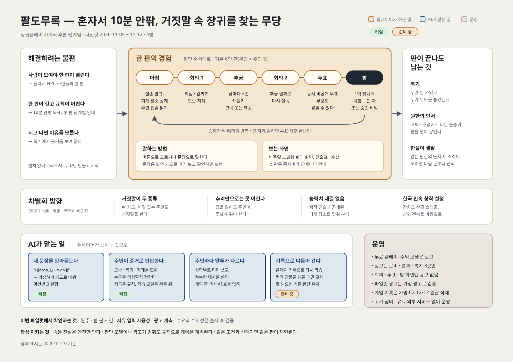
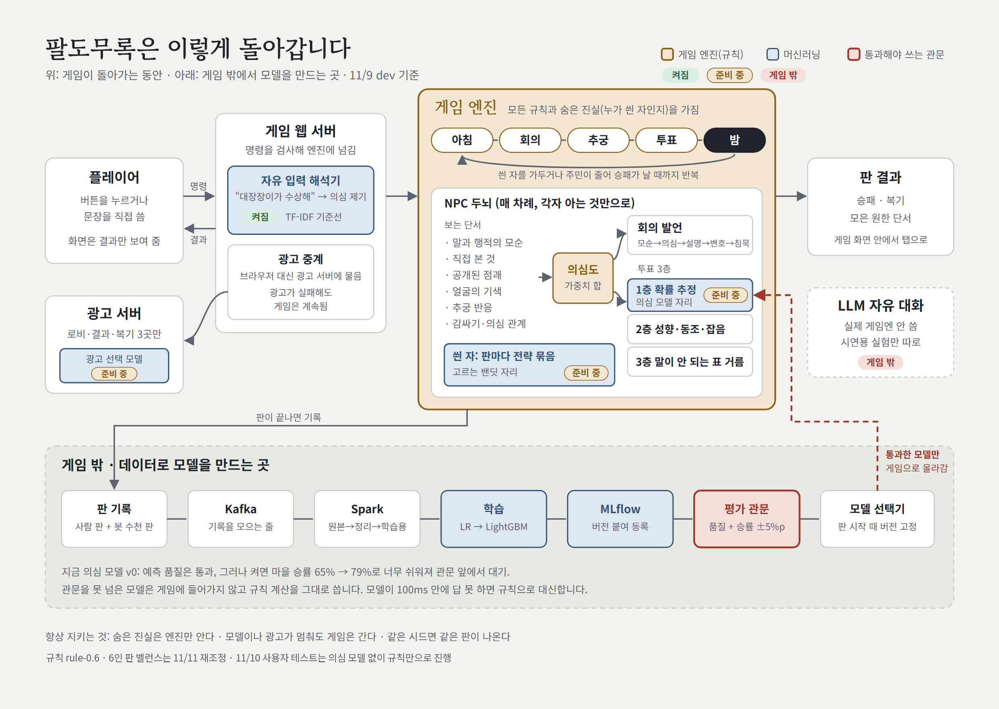

# 팔도무록: 귀신이 숨어든 마을 — 기안서

- 작성일: 2026-11-10
- 작성자: 이여찬

---

## 0. 한 장 요약

팔도무록은 혼자서 10분 안팎에 끝내는 것을 목표로 한 싱글플레이 사회적 추론 웹게임이다. 플레이어는 실종 사건이 난 산골 마을에 온 무당이 되어, 주민들의 행적 진술을 맞춰 보고 점괘와 추궁으로 창귀가 씐 사람을 찾는다. 답을 알아도 주민이 투표해 줘야 가둘 수 있으므로 설득이 필요하다. 판이 끝나면 복기에서 정체와 단서를 확인하고, 판을 넘어 쌓이는 원한의 단서로 새 결말을 연다.

이번 파일럿(2026-11-05~11-12, 4명이 흐름 5개를 나눠 맡음)은 한 판이 성립하는지, 처음 온 사람이 규칙과 입력을 다룰 수 있는지, 무료 플레이에 붙인 광고가 정확히 계측되는지를 확인한다. 이용 수요와 수익성은 출시 후에 검증한다. 평가자에게는 11/12 사업 검토 데모와 이 문서를 보고 출시 준비로 넘어갈지를 판단해 주기를 요청한다. 출시 전에 따로 정해야 할 조건은 부록 B에 모았다.

---

## 1. 제안 배경

### 1.1 해결하려는 불편

| 불편 | 이 서비스의 답 |
|---|---|
| 여럿이 함께하는 사회적 추론 게임(마피아·늑대인간류)은 사람이 모여야 한 판이 열린다 | NPC 주민과 혼자 하는 판. 동시 접속자가 없어도 성립한다 |
| 한 판이 길고, 처음 온 사람은 규칙을 익히기 어렵다 | 한 판 10분 안팎을 목표로 하고, 첫 판에는 단계마다 안내를 띄운다 |
| 지고 나면 왜 졌는지 알기 어렵다 | 판이 끝나면 같은 화면 안에서 복기를 보여 준다(행동 이유 해설은 연결 중, 3.9절) |
| AI를 쓴 대화 게임은 외부 서비스 비용과 사실을 지어내는 문제가 있다 | 사실과 판정은 게임 엔진이 정하고, 대사는 미리 쓰고 검수한 것을 쓴다. 게임 중 외부 유료 서비스를 부르지 않는다 |

위 불편이 실제로 얼마나 큰지(시장 규모, 이용자 수)는 조사 자료가 없어 수치로 쓰지 않는다. 검증할 가정으로 두고 부록 B에 정리했다.

### 1.2 유사 서비스 비교와 차별화 방향

조사일 2026-11-04. 가격은 조사 시점의 스토어 표시값이다.

| 서비스 | 형태 | 가격 | 핵심 구조 |
|---|---|---|---|
| GNOSIA | 싱글플레이 사회적 추론(PC) | 유료 1회 구매 | 토론 → 투표 → 시간 반복. 능력치(설득·거짓말 등)가 대화 결과에 영향 |
| Suck Up! | 싱글플레이 대화형(PC) | 유료 1회 구매 | 음성·텍스트로 AI 이웃을 설득. 외부 생성 AI 서비스에 의존 |
| Wolvesville | 온라인 멀티플레이 늑대인간(모바일·웹) | 무료 + 선택 구매 | 최대 16명, 역할 100종 이상 |
| 팔도무록 | 싱글플레이 사회적 추론(웹) | 무료 + 광고 | 행적 진술 대조, 점괘·추궁, 투표 설득, 원한 결말 |

차별화 방향(시장에서 검증된 우위가 아니라 설계 방향이다):

- **플레이어 역할이 고정이다.** 플레이어는 항상 무당(유일한 점술가)이고 NPC끼리만 역할이 바뀐다. 역할을 사칭하면 바로 지는 구도가 없다.
- **능력치 대결이 없다.** 정보는 아침마다 공개되는 피해 장소와 주민들의 행적 진술을 맞춰 보는 데서 나온다.
- **반복 보상이 이야기다.** 능력치 성장 대신 원한의 단서가 쌓이고, 퇴마와 한풀이 결말이 갈린다.
- **한국 민속 창작 설정이다.** 설화 원전을 인용하지 않고, 비교 게임의 규칙·캐릭터·용어를 쓰지 않는다.

---

## 2. 서비스 개요

### 2.1 콘셉트와 세계관

- 무대는 강원도 산골 마을 "솔뫼골"이다.
- **창귀**는 호랑이에게 잡아먹혀 죽은 사람의 혼이다. 전승에서는 호랑이에게 매여 다음 희생자를 꾀어내는 앞잡이로 전해진다. 게임에서는 창귀가 주민 하나에게 씌어 밤마다 사람을 산으로 홀려 낸다. 호랑이는 게임 장면에 나오지 않는다.
- 창귀의 한 때문에 마을은 같은 사흘을 되풀이하고, 무당만 그 기억을 이어 간다. 판마다 씐 사람, 비밀, 행적이 새로 정해진다.
- 창귀도 피해자다. 그래서 결말은 쫓아내는 **퇴마**와 원한을 밝혀 푸는 **한풀이**로 나뉜다.

| 마피아 게임 | 팔도무록 |
|---|---|
| 마피아 | 창귀가 씐 주민("씐 자") |
| 밤의 제거 | 홀림(실종) |
| 경찰 | 무당(플레이어) |
| 처형 투표 | 금줄 친 광에 가두기 |

### 2.2 재미의 핵심

1. **거짓말이 두 종류다.** 씐 자도, 비밀 있는 주민도 거짓말을 한다. 모순을 찾은 뒤에도 "귀신이라서 숨기는가, 사정이 있어서 숨기는가"를 가려야 한다.
2. **추리만으로는 이길 수 없다.** 답을 알아도 주민들이 투표해 줘야 한다. 무당도 의심받아 갇힐 수 있다.
3. **판이 끝나도 남는 것이 있다.** 고백받은 비밀과 원한의 단서가 쌓여 이야기와 결말이 열린다.

### 2.3 등장인물

| 구분 | 인물 | 쓰임 |
|---|---|---|
| 플레이어 | 무당(여·남 중 선택) | 회의·밤 화면의 주인공 |
| 주민 | 훈장, 주모, 대장장이, 머슴, 약초꾼, 과부 | 기본 6인 판의 등장 주민(무당 외 5명 + 0일째 실종자 1명). 이름과 성격은 고정이고 역할만 판마다 바뀐다 |
| 마스코트 | 까치 | 매일 아침 실종 소식을 알리는 연출 |
| 마스코트 | 족제비 | 첫 판 안내와 도움말에만 나온다 |

그림은 생성형 AI로 미리 만들었고 생성 기록을 남긴다. 파일럿은 비상업 교육 프로젝트 전제로 만들었으므로, 상업 출시 전에 그림의 이용 조건을 다시 확인해야 한다. 그림 안에 글자·실존 인물·상표를 넣지 않고, 그림이 새 게임 정보를 주지 않는다. 7·8인 판용 추가 주민 2명은 11/10 정식 테스트 뒤 반영한다.

---

## 3. 사용자 경험(UX)

### 3.1 플레이 여정

| 단계 | 플레이어가 하는 일 | 설계 의도 |
|---|---|---|
| 가입 | 로그인 ID와 비밀번호만 만든다. 기록 활용 고지에 동의해야 가입된다 | 이름·연락처·이메일을 받지 않는다. 설치 없이 브라우저로 시작한다 |
| 로그인·홈 | 로그인하면 홈에서 "새 게임"으로 시작하거나, 진행 중인 판을 "이어 하기"로 연다 | 중간에 나가도 판이 저장된다 |
| 첫 판 | 족제비가 단계마다 짧게 안내한다. 언제든 건너뛰거나 도움말에서 다시 볼 수 있다 | 규칙 설명서를 먼저 읽히지 않고, 하면서 배우게 한다 |
| 한 판 | 아침 → 회의 1 → 추궁 → 회의 2 → 투표 → 밤을 승패가 날 때까지 되풀이한다 | 10분 안팎에 끝나도록 낮마다 행동 수를 제한한다 |
| 결과·설문 | 승패와 정체 공개를 본 뒤 세 문항 설문(재미·억울함·NPC 그럴듯함)에 답하거나 건너뛴다 | 재미를 대신 재는 지표로 쓴다 |
| 복기 | 같은 게임 화면 안의 복기 탭에서 누가 씐 자였는지, 누구에게 어떤 비밀이 있었는지, 이번 판에서 얻은 단서를 본다. 주민들이 왜 그렇게 행동했는지의 이유·근거 해설은 연결 중이다 | 져도 납득할 수 있게 한다 |
| 판 사이 | 고백과 추궁에서 얻은 원한의 단서가 판을 넘어 쌓인다 | 능력치 대신 이야기로 보상한다 |
| 결말 해금 | 같은 원한 가설의 단서 세 조각(정체·죽음·원한의 대상)이 모이면, 다음 판 시작 때 한풀이 결말을 고를 수 있다 | 결말은 승패에 영향을 주지 않고 종료 연출과 복기 해설만 바꾼다 |

### 3.2 한 판의 흐름

기본 6인 판(무당 + 주민 5명, 그중 씐 자 1명·비밀 있는 주민 2명)을 기준으로 한다. 판은 0일째 밤에 주민 1명이 실종된 아침에 시작한다.

| 순서 | 단계 | 화면에서 일어나는 일 | 플레이어의 선택 |
|---|---|---|---|
| 1 | 아침 | 까치가 실종 소식을 알린다. 실종자의 짚신이 발견된 장소와 시간대(한밤)가 모두에게 공개된다. 주민들이 어젯밤 행적과 본 것을 진술한다 | 진술을 읽고 진술표에 정리한다 |
| 2 | 회의 1 | 무작위 순서로 모두 한 번씩 말한다 | 의심하기, 감싸기, 모순 지적, 해명, 침묵, 점괘 공개 중 하나 |
| 3 | 추궁 | 무당만 하는 단계다 | 낮마다 2번 캐묻기. 주민은 해명·회피·역공·고백으로 반응한다 |
| 4 | 회의 2 | 추궁에서 나온 것을 가지고 다시 한 번씩 말한다 | 회의 1과 같다 |
| 5 | 투표 | 모두 동시에 비공개로 투표하고 한꺼번에 공개한다. 동점이면 동점자만 놓고 결선 투표, 또 동점이면 아무도 가두지 않는다 | 가둘 사람 1명 |
| 6 | 밤 | 씐 자가 홀릴 사람을 정하는 동안 무당은 점을 친다 | 점칠 사람 1명. 결과는 무당만 안다 |

- **승패가 나는 때:** 씐 자를 가두면 마을이 이긴다. 무당이 갇히거나, 씐 자의 수가 남은 마을 주민 수 이상이 되면 창귀가 이긴다. 판정은 감금 직후와 밤 처리 직후에 한다. 그래서 씐 자나 무당이 갇히면 밤 없이 **투표 직후 끝난다.**
- 보통 투표 기회는 2번이고, 아무도 갇히지 않은 날이 있으면 3번째 낮이 온다.

### 3.3 화면 구성

회의와 밤은 비주얼 노벨형 화면이다. 진술표·수첩·투표·결과·복기는 같은 게임 화면 안의 패널이나 탭으로 연다. 페이지를 옮기지 않는다.

| 화면 요소 | 내용 |
|---|---|
| 무대 | 16:9 장면 배경(회의 공통 1장, 밤 공통 1장) 위에 지금 말하는 인물 1명 |
| 대사창 | 무대 아래쪽. 이름표와 대사를 한 줄씩 넘긴다 |
| 선택지 패널 | 그 단계에서 할 수 있는 행동. 대사창 옆, 무대 안에 둔다 |
| 진술표·수첩 | 공개된 진술과 기록, 플레이어가 주민마다 남기는 메모 |
| 발언 카드 | 자유 문장을 해석한 결과를 실행 전에 보여 준다 |
| 결과·복기 | 승패, 정체 공개, 복기 탭, 설문 |
| 밤 | 인물·마스코트 없이 무당의 독백만 대사창에 |

장소별 배경은 만들지 않았다. 배경이 바뀌면 숨은 행적이 드러날 수 있기 때문이다(3.5절).

### 3.4 입력 경험

- 플레이어는 **버튼으로 고르거나(행동 → 대상 → 근거 카드) 문장으로 직접 말한다.** 어느 쪽이든 게임에는 같은 명령이 들어간다.
- 문장으로 말하면 해석 결과를 **발언 카드**(행동, 대상, 근거)로 먼저 보여 준다. 플레이어가 확인해야 실행된다. 빠진 정보는 추가로 고르게 하고, 이때는 행동 횟수를 쓰지 않는다.
- 해석, 카드 수정·취소, 게임이 거절한 명령은 행동 횟수를 쓰지 않는다. 횟수는 명령이 실제로 받아들여졌을 때만 줄어든다.
- 아무 질문에나 답하는 기능은 아니다. 정해진 행동과 캐묻기 유형으로 해석하며, 지원하는 말과 지원하지 않는 말의 예시를 입력창 옆에 보여 준다.
- 투표와 밤의 점 대상은 버튼으로만 고른다. 잘못 해석된 문장이 되돌릴 수 없는 결정으로 이어지지 않게 하기 위해서다.

### 3.5 정보와 공정성

- **숨은 진실은 엔진만 안다.** 누가 씐 자인지, 실제 행적, 거짓 여부, 주민들의 속마음(의심도)은 화면에 보내지 않는다. 배경·인물·표정도 이런 정보로 바꾸지 않는다.
- **표정은 공개된 사건에만 반응한다.** 같은 공개 사건이면 역할과 관계없이 같은 표정을 쓴다. 지금 읽는 사건에만 묶고, 뒤에 올 사건의 표정을 앞당기지 않는다.
- **결과를 읽기 전에는 다음 행동을 잠근다.** 투표 결과 발표를 끝까지 읽기 전에는 결선 투표나 점치기 버튼이 흐려지고 "투표 결과를 먼저 확인하세요"라는 안내가 뜬다. 모두 보기나 연출 건너뛰기를 누르면 풀린다.
- **점괘는 확정 정보가 아니다.** 탁함은 씐 자이거나, 아직 털어놓지 않은 비밀이 있는 주민이라는 뜻이다. 그래서 점괘만으로 답이 나오지 않고 추궁과 진술 대조가 필요하다.
- **같은 조건이면 같은 판이 재현된다.** 시드, 규칙·콘텐츠·모델 버전, 플레이어의 선택, 그리고 모델 호출이 규칙으로 대체됐는지의 기록이 같으면 같은 결과가 나온다. 고정한 조건으로 다시 돌려 같은 결과가 나오는 것은 로컬 재실행으로 확인했다.

### 3.6 첫 판 안내와 도움말

- 계정의 첫 판에는 각 단계 첫머리에 족제비가 짧은 안내를 띄운다. 시작 안내는 실종 발표 앞, 아침 안내는 진술 앞에 나온다.
- `안내 건너뛰기`를 누르면 그 판의 남은 안내를 숨긴다. 도움말의 `안내 다시 보기`로 언제든 글로 다시 볼 수 있다.
- 게임 화면의 버튼에 마우스를 올리면 한 줄 설명이 뜬다.

### 3.7 화면 크기와 접근성

| 화면 | 배치 |
|---|---|
| 폭 900px 이상, 16:9 근처(1366×768, 1920×1080 등) | 무대 안에 대사창과 선택지 패널을 함께 둔다 |
| 옆으로 긴 화면(가로/세로 1.95 이상) | 선택지 패널을 무대 오른쪽 바깥에 붙여 그림을 가리지 않게 한다 |
| 폭 900px 미만(휴대폰) | 무대를 비율대로 줄이고, 대사와 선택지를 무대 바로 아래에 붙인다 |

- 어느 배치든 같은 게임 화면 안에서 처리하고, 페이지 이동이나 새 창을 띄우지 않는다.
- 대사는 한 번에 한 줄만 넘긴다. 저절로 흘러가지 않는다. 글자가 하나씩 나오는 효과를 끄고 바로 표시하는 옵션이 있다.
- 키보드만으로 진행할 수 있다(Space·Enter로 다음 대사). 단, 입력창에 쓰는 중이거나 한글을 조합하는 중에는 넘기지 않는다.
- 화면 낭독기에는 완성된 문장과 화자를 한 번만 전달한다.
- 폭 360px, 확대 200%에서도 무대와 선택지가 가려지지 않아야 한다. 의미를 색·표정·아이콘만으로 전달하지 않는다.

### 3.8 광고 노출 원칙

- 광고는 **몰입을 깨지 않는 3곳**에만 둔다: 로비(판 시작 전), 판 결과 화면, 복기 화면 옆.
- 회의·투표·밤 화면에는 광고를 넣지 않는다. 게임 명령을 처리하는 동안 광고 서버를 부르지 않는다.
- 광고는 승패에 영향을 주지 않는다. 클릭해도 게임에서 얻는 이득이 없다. 화면에 "광고"로 표시한다.
- 광고 칸은 화면을 그린 뒤 따로 불러온다. 광고 서버가 느리거나 멈춰도 게임 화면은 먼저 뜬다.

### 3.9 지금 되는 것과 남은 것

위 경험 중 2026-11-10 기준으로 확인된 것과 남은 것을 나눈다. "로컬 검증"은 개발 PC에서 확인했다는 뜻이고, 사용자 테스트 서버나 실제 사용자 검증과는 다르다.

| 기능 | 상태 |
|---|---|
| 가입·로그인·새 게임·이어 하기, 기본 6인 판 한 판 완주, 판 종료 설문 | 구현. 11/10 정식 사용자 테스트 서버에서 실제 참가자가 쓴다(결과와 배포 버전은 테스트 뒤 증빙으로 붙인다) |
| 회의·밤 비주얼 노벨 화면, 첫 판 안내 | 로컬 검증. 테스트 서버 반영 여부는 배포 버전 기준으로 따로 확인. 전신 컷·공개 사건 표정 등 일부 남음 |
| 복기 | 정체·비밀·단서 표시까지. 행동 이유·근거 해설 연결 남음 |
| 원한 단서·한풀이 결말·선택형 도전 | 엔진·저장소 구현과 시험 통과 |
| 자유 입력 | 기준선 해석기로 동작. 학습 모델(BERT 계열) 연결은 준비 중 |
| 인물별 변형 대사 | 11/11 예정. 지금은 성향별 대사 |
| 밸런스 | 11/9 규칙 수정 뒤 목표 구간을 넘어 11/11 재조정 예정 |
| 7·8인 판, 추가 주민 | 콘텐츠 준비, 11/10 테스트 뒤 반영 |

---

## 4. 게임 규칙 요약

**역할**(기본 6인 판)

| 역할 | 수 | 진영 | 특징 |
|---|---|---|---|
| 무당(플레이어) | 1 | 마을 | 밤마다 1명을 점친다. 밤에 홀려 가지 않는다. 투표로 갇힐 수 있다 |
| 씐 자 | 1 | 창귀 | 밤마다 주민 1명을 홀린다. 그 시간대 행적은 거짓으로 진술한다 |
| 비밀 있는 주민 | 2 | 마을 | 개인 사정(노름, 몰래 만남 등) 때문에 행적 한 구간을 거짓으로 진술한다. 추궁 압박이 쌓이면 고백한다 |
| 평범한 주민 | 2 | 마을 | 사실대로 진술한다 |

주민들은 무당이 씌지 않았다는 사실을 모른다. 외지에서 온 무당이 귀신을 데려왔을 수도 있다고 본다.

**정보**

- **장소와 시간:** 장소는 우물가, 서낭당, 주막, 마을 어귀, 각자 집의 5곳이다. 밤 시간대는 초저녁과 한밤 2개다.
- **목격:** 같은 공공장소, 같은 시간대에 있던 사람끼리는 일정 확률로 서로를 본다.
- **피해 장소 공개:** 아침마다 피해 장소와 시간대를 모두에게 공개한다. 이것과 목격 진술을 맞춰 알리바이를 따진다.
- **점괘:** 맑음 또는 탁함이다. 탁함은 씐 자이거나 비밀을 숨긴 주민이다. 고백한 주민은 다음 점부터 맑다.
- **기색:** 사실 주장이 거짓일 때만 나올 수 있다. 비밀 있는 주민이나 압박받은 무고한 주민에게도 나오므로 확정 정보가 아니다.

**행동**

| 행동 | 효과 |
|---|---|
| 의심하기·감싸기 | 근거(모순, 기색, 점괘, 투표 기록)를 들어 듣는 이들의 의심을 올리거나 내린다 |
| 모순 지적 | 주장 2개를 짚는다. 진짜 모순이면 관련자 의심이 크게 오르고, 아니면 지적한 쪽 신뢰가 떨어진다 |
| 해명하기·침묵 | 자기 의심을 낮추거나 아무것도 하지 않는다 |
| 점괘 공개(무당) | 낮마다 1회. 거짓으로 공개할 수도 있다 |
| 캐묻기(무당) | 낮마다 2회. 행적 확인, 모순 추궁, 의심·투표 이유를 묻는다 |

**인원 프리셋**

엔진은 5·6·7·8인(창귀 1)과 9·11인(창귀 2) 프리셋, 그리고 기본 6인 판에서 한 가지만 바꾼 선택형 도전 3종(점 1회 제한, 비밀 있는 주민 3명, 목격 정보 축소)을 지원한다. 웹에 연 것은 기본 6인 판 하나다. 나머지는 시뮬레이션으로 밸런스를 확인한 것만 연다. 기본 6인 판도 11/9 규칙 수정 뒤 밸런스를 다시 맞추는 중이다(9장).

---

## 5. AI가 바꾸는 경험

AI는 게임의 사실과 승패를 정하지 않는다. 사실과 판정은 규칙 엔진이 정하고, AI는 플레이어의 말을 알아듣고 주민의 판단과 말투를 돕는다. 주민 판단 모델의 호출이 실패하거나 늦으면 규칙 판단으로 대신하고, 자유 입력은 버튼 입력을 늘 함께 제공한다.

| 플레이어가 느끼는 것 | AI가 하는 일 | 실패하면 | 지금 상태 |
|---|---|---|---|
| **내 문장을 알아듣는다** | "대장장이가 수상해" 같은 문장을 의심하기 같은 행동으로 바꾸고, 대상과 근거를 찾는다 | 카드를 고치거나 다시 말할 수 있고, 같은 행동을 버튼으로도 할 수 있다. 해석과 취소는 행동 횟수를 쓰지 않는다 | 기준선 해석기로 동작 중. 정확도 개선을 목표로 하는 학습 모델(BERT 계열)은 연결 준비 중이고, 기준선보다 낫다는 근거는 아직 없다 |
| **주민이 증거로 판단한다** | 주민마다 자기가 아는 것(모순, 목격, 공개된 점괘, 기색, 추궁 반응)만으로 누구를 의심할지, 누구에게 투표할지 정한다 | 학습 모델이 없거나 늦으면(100ms 초과) 그 결정만 규칙 계산으로 대신한다 | 규칙 판단으로 동작 중. 학습 모델은 봇 평가에서 예측 품질은 통과했지만 마을 승률을 크게 바꿔(65% → 79%) 관문 앞에서 대기. 사람 판 평가와 서버 부하 재측정도 남아 있다 |
| **주민마다 말투가 다르다** | 성향별 대사 틀에 엔진이 정한 사실을 끼워 넣는다. 인물별 변형 대사는 미리 써 두고, 사실을 바꾸지 않는지 자동 검사와 사람 검수를 거친 것만 넣는다 | 게임 중 생성 AI를 부르지 않으므로 기다리거나 실패하는 일이 없다 | 성향별 대사로 동작 중. 인물별 변형 대사는 11/11 반영 예정 |
| **기록으로 다듬어 간다** | 사람이 플레이한 문장과 선택으로 해석기와 주민 판단 모델을 다시 학습한다 | 평가 관문(품질, 마을 승률 변화 ±5%p 이내)을 못 넘으면 바꾸지 않고 기존 판단을 유지한다. 거부도 정상 결과로 기록한다 | 관문은 로컬에서 구현·검증 중이고, 실제 교체 사례는 아직 없다 |

- 게임 실행 중 생성 AI(LLM)를 부르지 않기로 한 것은 11/7 결정이다. 이유는 두 가지다. 추궁 답변은 사실 문장에 말투만 입히면 되므로 미리 만들어 둘 수 있다. 또 실시간 생성은 지연과 사실 왜곡 위험이 있다.
- 판이 시작될 때 쓸 모델 버전을 고정한다. 판 도중에 모델이 바뀌지 않는다.

---

## 6. 운영과 수익 모델

| 항목 | 내용 |
|---|---|
| 가격 | 무료 플레이. 파일럿에는 결제 기능이 없다 |
| 수익 모델 | 광고. 광고주가 지면에 입찰하고, 노출·클릭에 따라 과금한다. 예산을 넘겨 과금하지 않고, 무효 노출·클릭에는 과금하지 않으며, 청구 내역이 원장과 건별로 맞아야 한다 |
| 파일럿 범위 | 실제 광고주를 모으기 전이라 가상 광고주의 시범 소재 5개와 합성 트래픽으로 과금·예산·무효 판정이 맞는지만 검증한다. 실제 돈은 오가지 않는다. **파일럿은 수익성을 입증하지 않는다** |
| 개인정보 | 이름·연락처·이메일을 받지 않는다. 게임 기록에는 무작위 가명 ID만 쓰고, 로그인 정보는 따로 보관한다. 자유 입력과 설문 의견은 저장 전에 전화번호 같은 형식을 가린다. 파일럿 기록은 계정과 파생 데이터까지 2026-12-12에 일괄 삭제한다. 그 전이라도 본인이 로그인한 화면으로 확인되면 요청 당일(늦어도 24시간 안) 지운다. |
| 운영비 원칙 | GPU 없이 기존 노트북 위의 VM으로 개발·내부 테스트를 한다. 게임 중 외부 유료 서비스를 부르지 않는다. 필수 검증과 데모는 기존 VM의 실제 구성으로 한다. AWS 배포는 추가 범위(계정별 6만 원 한도)이고, 데모가 끝나면 비용을 차단한다 |
| 향후 검토(범위 밖) | 유료 확장(시나리오 팩 등), 실제 광고주 영업·정산, 여럿이 한 판에 참여하는 웹 멀티플레이 |

---

## 7. 추진 계획

**팀 구성**(흐름 5개 A~E. A와 E는 같은 담당이 맡아 실제 인원은 4명이며 전원 구현한다)

| 흐름 | 맡는 일 |
|---|---|
| A 엔진 | 게임 규칙, 승패, NPC 판단, 시뮬레이션과 밸런스 |
| B 웹·API | 게임 화면(비주얼 노벨 연출), API, 광고 지면 연동, 실제 이미지 에셋 |
| C 인프라·파이프라인 | 서버·배포, 기록 수집과 학습 데이터 파이프라인, 관측, 개인정보 삭제 |
| D ML·광고 | 입력 해석기, 주민 판단 모델, 재학습 관문, 광고 서버 |
| E PM | 시나리오·대사·콘텐츠, 에셋 규격·검수, 사용자 테스트, 통합 |
| S 데모 자료 | 사업 검토 데모 구성 |

**일정**(2026-11-05~11-12)

| 날짜 | 목표 |
|---|---|
| 11/5(목) | 서버 자원 확인, 저장소, 엔진의 판 생성·회의·투표, 회의 화면, 입력 해석 기준선, 광고 서버 골격, 인물·비밀 |
| 11/6(금) | 밤·점괘, 저장소, 봇, 광고 원장·합성 트래픽, 대사 틀·입력 예시, 사용자 테스트 준비 |
| 11/7(토) | NPC 규칙, 자유 입력·설문·광고 지면, 주민 판단 모델 첫 학습, 원한 단서·결말 초안, 사전 테스트, 통합 1 |
| 11/8(일) | 큰 판, 밸런스 1차, 대량 시뮬레이션, 광고 학습 루프, 에셋 검사 도구 |
| 11/9(월) | 결말·선택형 도전, 재학습 관문, 개인정보 삭제, 인물 그림, 통합 2 |
| 11/10(화) | **정식 사용자 테스트**(13:00~18:00), 복기, 재학습 시연, 회의·밤 연출 |
| 11/11(수) | 밸런스 재조정, 인물별 변형 대사, 장애 복구 시험, 이미지 일괄 검수, 최종 재실행 |
| 11/12(목) | 리허설, 사업 검토 데모, 최종 산출물 확정, 비용 차단 |

---

## 8. 성공 기준

아래는 **목표**다. 확인하지 못한 항목은 통과가 아니라 미검증으로 보고한다.

**사용자 경험 기준**

| 기준 | 목표 |
|---|---|
| 한 판 소요 시간 | 사람 판 중앙값 10분 이하. 사전 테스트 측정은 대표성이 부족해 쓰지 않고, 11/10 정식 참가자로 검증한다 |
| 완주 | 11/10 정식 테스트의 완주율, 미종료 판 수를 보고 |
| 자유 입력 | 사람이 쓴 평가 문장에서 명령 전체 일치율 80% 이상이면서 기준선보다 높음. 잘못된 즉시 실행 0 |
| 판 종료 설문 | 재미·억울함·NPC 그럴듯함 5점 척도를 항목별로 보고한다(억울함은 낮을수록 좋다). 주관 품질이라 목표치를 조건으로 두지 않고 수집·보고·원인 분석을 한다 |
| 밸런스 | 기본 6인 판에서 대역 봇("논리 우선") 마을 승률 40~60%(1,000판 이상) |

**서비스 품질 기준**

| 기준 | 목표 |
|---|---|
| 게임 응답 | 게임 API p95 1초 이하(필수), 300ms(목표) |
| 주민 판단 모델 | 예측 오차(로그 손실)가 규칙보다 낮고 보정 오차(ECE) 0.05 이하, 응답 p95 100ms 이하 |
| 재학습 교체 | 기존보다 나쁘지 않을 때만 교체. 거부도 사유를 남기면 성공 |
| 광고 정확성(합성 트래픽) | 예측 클릭률 상대오차 20% 이내, 일 예산 소진 오차 10% 이내, 무효 과금 0건, 대사 불일치 0건 |
| 개인정보 | 게임 데이터에 실명·연락처·로그인 ID 0건, 삭제 요청 처리 시험 |

---

## 9. 위험과 대응

| 위험 | 플레이어에게 미치는 영향 | 대응 |
|---|---|---|
| 규칙이 어렵다 | 첫 판에서 이탈 | 단계별 첫 판 안내, 버튼 설명, 지원·미지원 입력 예시. 정식 테스트의 설문과 완주율로 확인 |
| 한 판이 길거나 반복해서 읽기가 지루하다 | 10분 목표 초과, 재미 저하 | 반복 발언 축약, 실측 후 라운드·행동 수 조정. 큰 판은 회의 축약 규칙을 정한 뒤에만 연다 |
| 입력을 잘못 알아듣는다 | 답답함, 원치 않는 행동 | 실행 전 발언 카드 확인, 버튼 입력 병행, 투표·점은 버튼으로만 |
| 밸런스가 한쪽으로 쏠린다 | 너무 쉽거나 억울하다 | 기본 6인 판은 11/8 규칙에서 논리 우선 봇 마을 승률 49.6%로 목표(40~60%)를 맞췄다. 11/9 첫날 무당이 자주 갇히던 문제를 고친 뒤 별도 200판에서 90.5%로 목표를 넘어, 지금은 미달 상태이고 11/11에 다시 맞춘다. 다른 프리셋은 맞춘 것만 연다 |
| 주민들이 서로 말을 주고받는 느낌이 약하다 | NPC가 그럴듯하지 않다 | 의심 문턱과 발언 변형을 조정했고, 반격·동조는 정식 테스트 뒤 과제로 둔다 |
| 학습 모델이 규칙보다 낫지 않다 | 체감 차이 없음 | 관문을 못 넘으면 규칙 판단을 유지한다. 플레이가 막히지 않는다 |
| 비교 게임(GNOSIA)과 비슷해 보인다 | 신뢰·출시 지연 | 무당 고정, 행적 대조, 능력치 없음, 원한 결말을 유지하고 비교 게임의 규칙·캐릭터·용어를 쓰지 않는다 |
| 실제 참가자가 적다 | 판단 근거 부족 | 소수 반복 관찰과 정성 설문 중심으로 판단하고, 미달 수치를 그대로 보고한다 |

---

## 부록

### A. 시스템 구성

2026-11-09 dev 기준. 위는 게임이 돌아가는 동안의 흐름, 아래는 게임 밖에서 기록으로 모델을 만드는 흐름이다. 관문을 통과한 모델만 게임으로 올라간다.

### B. 이번 파일럿에서 확인하는 것과 출시 후 검증할 것

| 질문 | 이번 파일럿 | 출시 후 |
|---|---|---|
| 혼자 하는 짧은 사회적 추론 게임을 즐길 사람이 있는가 | 완주율, 한 판 시간, 설문을 탐색 근거로만 본다(진행자가 지정한 반복 플레이는 자발적 수요로 보지 않는다) | 재방문율(D1·D7) |
| 한국 민속 창작 설정이 매력이 되는가 | 직접 검증하지 않는다 | 이용자 조사, 유사 서비스 비교 |
| 처음 온 사람이 규칙과 입력을 다룰 수 있는가 | 첫 판 안내, 자유 입력 일치율, 원하는 행동 완료율, 버튼 전환 비율 | 이탈 지점 분석 |
| 이용자가 3곳의 광고를 받아들이는가 | 사람 트래픽의 노출·클릭을 합성 트래픽과 분리해 사용성과 계측만 확인 | 광고 수용성, 광고로 인한 이탈 |
| 광고주가 입찰할 만큼 노출이 나오는가 | 검증하지 않는다(합성 트래픽으로 과금 정확성만) | 노출 수, 채움률, 실현 eCPM, 실제 광고 수익 지표 |
| 목표 이용자와 유입 경로가 있는가 | 내부망 참가자의 대표성 한계를 기록 | 출시 결정 전에 목표 이용자·유입 경로 정의 |
| 플레이 기록이 품질로 돌아오는가 | 재학습 → 관문 → 교체 또는 거부가 기록과 함께 동작하는지 | 실제 이용자 기록으로 개선 폭 측정 |

출시 준비로 넘어가기 전에 따로 정해야 할 것:

| 항목 | 내용 |
|---|---|
| 결정 방식 | 의사결정 역할, 검토 항목, 결정 기록 위치, 미검증 항목이 있을 때의 처리 |
| 목표 이용자와 유입 경로 | 누구에게 어떻게 알릴지, 내부망 참가자와 얼마나 다른지 |
| 운영비와 광고 수입 비교 | 지속 운영비를 광고 수입과 비교하는 방법 |
| 기록 보존 기간 | 재방문율을 재려면 파일럿보다 긴 보존이 필요하다 |
| 그림 이용 조건 | 비상업 전제로 만든 그림의 상업 이용 가능 여부 |
| 공개 가입 남용 | 외부 공개 전에 대량 가입·남의 ID 잠금 대책 재검토 |
