# 창귀: 귀신이 숨어든 마을

  

<strong>모두가 같은 밤을 보냈습니다. 누구의 말을 믿으시겠습니까?</strong>

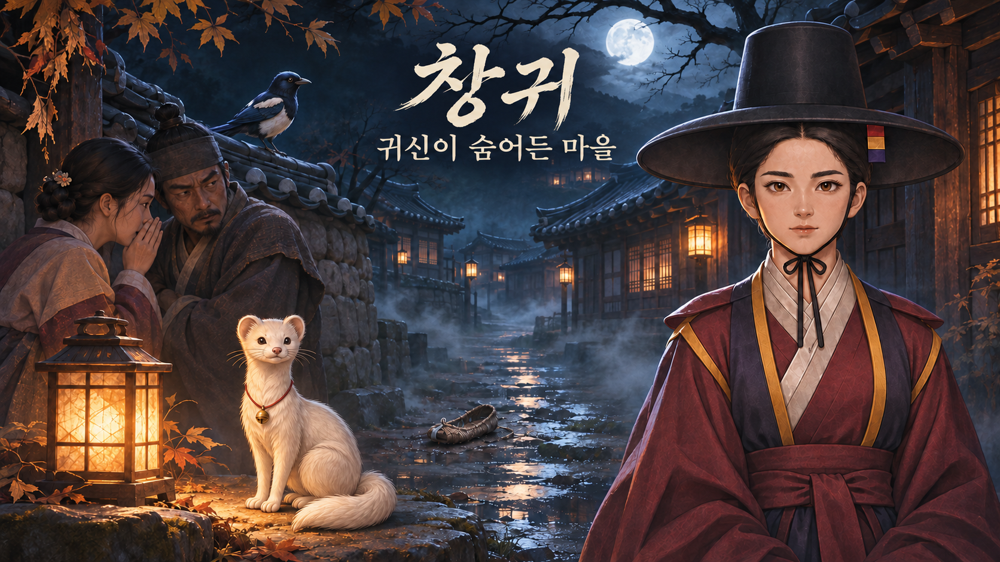

*게임 세계관을 담은 비주얼 노벨 소개 일러스트.*

<!--
이미지 출처: Codex 기본 이미지 생성 도구. 사용자 제공 콘셉트 및 공식 원화 3종을 참고한 제품 소개용 이미지.
생성 프롬프트:
Use case: illustration-story. Create a new landscape 16:9 hero illustration for the product page of the Korean mystery visual novel 창귀: 귀신이 숨어든 마을. Image 1 is composition and mood reference only: dark Joseon-era mountain village at night, glances, whispering villagers, amber lanterns vs indigo moonlight, mist and an abandoned straw shoe. Do not reproduce the typography or photorealistic film look. Images 2, 3, 4 are the game's approved identity references: keep the female shaman's recognizable straight-on youthful face, round wide black hat and burgundy/navy robe with muted gold trim; the ivory weasel with a red cord and tiny brass bell; and the Korean magpie with blue-black feathers and white chest. Scene: female shaman in the right foreground, two period villagers exchanging a suspicious quiet look on the left, wet stone path leading into a misty hanok village beneath the moon. Place the small weasel in the near foreground within a warm lantern pool where it is clearly recognizable as the primary guide mascot, and the magpie on a visible beam or stone wall as the secondary mascot. Both animals naturally fit the scene at believable scale. Make it a polished 2D illustrated visual novel key visual with hand-painted backgrounds, defined stylized character contours, clean semirealistic faces and restrained painterly shading. Moody ink navy, charcoal teal, warm amber and burgundy. Cinematic legible composition, especially when scaled down, a little eerie and no gore. No tiger or tiger motif, no branding mark, no interface or border, no text or typography at all. The game logo and headline appear separately in the document.
제목 추가 프롬프트:
Edit only the typography overlay of this existing Korean visual-novel key art. Preserve the exact existing illustration, framing, female shaman's face and hat, the white weasel, the magpie, the residents, moon, lanterns and straw shoe. Add two lines of precisely spelled Korean typography, centered in the open dark sky and mist above the village street between the magpie on the left and the shaman's hat on the right, below and slightly left of the moon. First line, large cream traditional brush calligraphy: “창귀”. Second line, clearly legible elegant cream Korean serif: “귀신이 숨어든 마을”. The title should read boldly at Markdown page size, with a very subtle dark shadow, no border or plaque. Keep both lines on separate lines and fully visible. Typography is the only change. No other letters, no tiger, no added logo, no watermark, no game UI. Wide 16:9 hero composition.
-->

## 솔뫼골의 안내자

| 족제비 | 까치 |
|---|---|
| 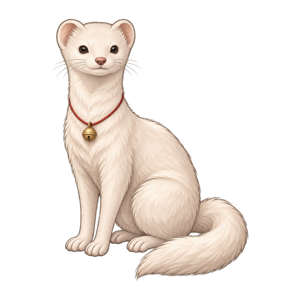 | 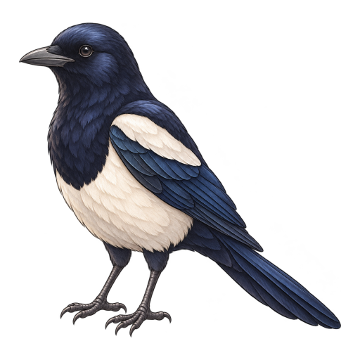 |
| **처음 만나는 길잡이.** 낯선 마을에 들어선 무당 곁에서 주민의 말을 듣는 법, 진술을 비교하는 법, 밤에 점치는 법을 하나씩 알려 줍니다. | **아침을 깨우는 소식꾼.** 밤이 지나면 가장 먼저 나타나 누가 사라졌는지, 마지막 흔적이 어디에 남았는지 전합니다. 까치의 소식으로 그날의 추리가 시작됩니다. |

위의 **호랑이 문장**은 창귀 전승에서 가져온 게임의 상징입니다.

## 게임 소개

**창귀: 귀신이 숨어든 마을**은 한국의 창귀 전승을 바탕으로 만든 싱글플레이 추리 비주얼 노벨입니다. 플레이어는 무당이 되어 실종 사건을 조사하고, 마을 회의에서 주민들을 설득해 숨어 있는 씐 자를 찾아냅니다.

## 되풀이되는 솔뫼골

강원도 산골 마을 솔뫼골에서 주민 한 명이 사라집니다. 까치가 전한 실종 소식을 듣고 사람들을 모으자, 같은 밤을 두고 서로 다른 말이 나옵니다. 주민들 사이에 숨어든 창귀는 밤마다 사람을 산으로 홀려 냅니다. 아침에 밝혀지는 실종 장소와 시간은 무당이 어젯밤을 되짚는 첫 단서입니다.

전승에서 창귀는 호랑이에게 잡아먹힌 뒤 다음 희생자를 꾀어내도록 매인 사람의 혼입니다. 게임에서는 그 혼의 원한으로 마을이 사건이 난 며칠을 되풀이합니다. 기억을 이어 가는 사람은 무당뿐입니다. 판마다 씐 자와 주민들의 비밀, 밤의 행적이 달라지고, 고백으로 얻은 원한 단서는 다음 판에도 남습니다.

## 추리와 설득을 어떻게 플레이하나요?

서로 다른 이야기를 듣고 자기 판단을 세운 뒤, 그 근거로 다른 사람의 마음을 움직이는 경험을 만들고 싶었습니다. 확신했던 추리가 새 증언 하나로 흔들리고, 다시 찾아낸 근거가 회의의 분위기를 바꾸는 순간이 한 판 안에 이어집니다.

**거짓말의 이유를 가려냅니다.** 씐 자는 정체를 감추고, 비밀을 가진 주민도 자기 사정을 숨기기 위해 거짓말합니다. 진술표에서 시간과 장소를 맞춰 보며 어느 이야기가 어긋나는지 찾고, 캐묻기로 그 이유에 접근합니다. 같은 모순도 뒤에 나온 목격이나 고백을 듣고 다시 해석하게 됩니다.

**찾은 근거를 회의에서 씁니다.** 주민들은 각자 본 것과 중요하게 여기는 근거로 판단합니다. 진술의 일관성을 중시하는 훈장과 점괘에 더 귀를 기울이는 머슴을 같은 말로 설득하기는 어렵습니다. 무당도 의심을 받을 수 있으므로 누구를 지목하고 언제 점괘를 공개할지 고민하게 됩니다. 씐 자를 모두 금줄 광에 가두면 마을이 이깁니다.

**승부가 끝나면 이야기가 남습니다.** 처음에는 다음 실종을 막는 데 집중합니다. 여러 판에서 고백과 단서가 이어지면 창귀가 누구였으며 왜 솔뫼골에 머무는지도 궁금해집니다. 플레이를 거듭한 보상은 마을의 이야기를 더 깊이 알게 되고 다른 결말을 열 수 있다는 데 있습니다.

## 회의에서 마주치는 사람들

솔뫼골 사람들이 자기 이야기를 꺼내는 방식은 제각각입니다. 첫 회의에서는 무엇을 믿는지, 어떤 대목에서 말을 아끼는지 들어 보세요.

| 인물 | 첫인상 |
|---|---|
| 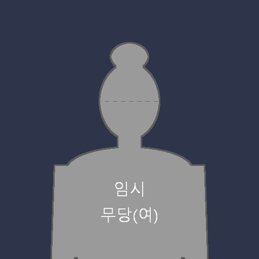 **무당 · 플레이어** | 되풀이되는 사건을 기억하는 사람. 주민의 말과 자신만 아는 점괘를 모아, 회의에서 근거를 내놓습니다. |
|  **훈장** | 옛글을 곁들여 점잖게 말합니다. 앞뒤가 맞지 않는 이야기는 그냥 넘기지 않습니다. |
| 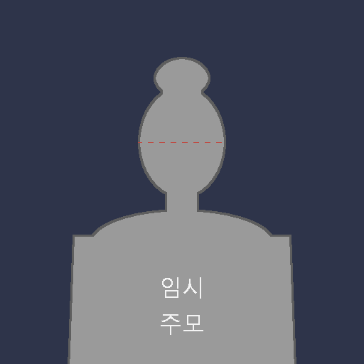 **주모** | 시원시원한 말씨로 사람들 사정을 짚습니다. 누군가 몰리면 자신이 본 일을 근거로 거들기도 합니다. |
| 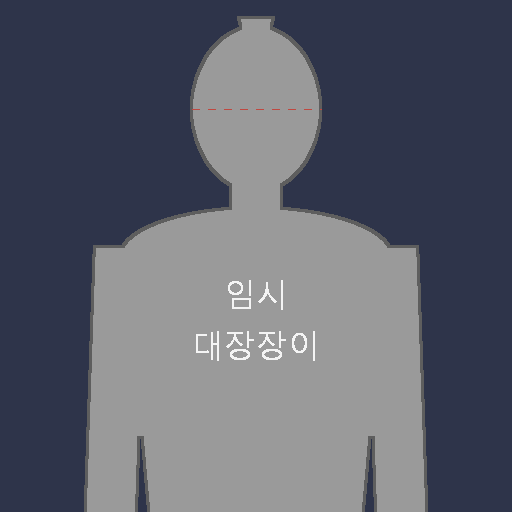 **대장장이** | 말을 짧게 끊고 목소리가 큽니다. 수상한 기색을 느끼면 회의에서 먼저 의심을 꺼냅니다. |
|  **머슴** | 긴장하면 말을 더듬고 묻지 않은 일까지 해명합니다. 무당의 점괘에도 귀를 기울입니다. |
|  **약초꾼** | 산과 풀 이야기로 에둘러 말하지만, 자신이 본 일은 날짜까지 또렷이 기억합니다. |
| 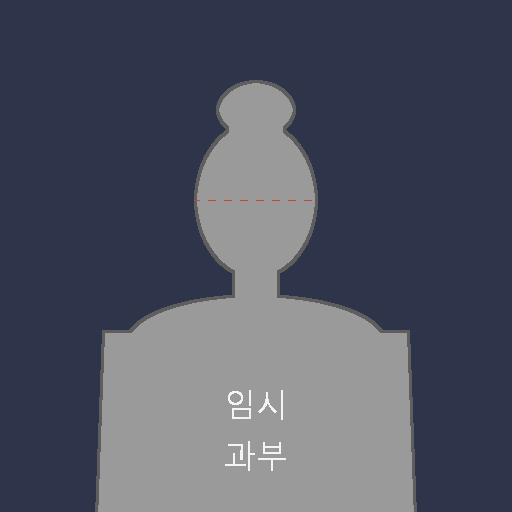 **과부** | 말수가 적고 말씨가 단정합니다. 틀린 이야기를 들으면 낮은 목소리로 하나씩 짚습니다. |

## 처음 마을에 들어간다면

1. **족제비와 연습하기** — 홈의 튜토리얼에서 강조된 버튼을 따라 진술 비교, 캐묻기, 점치기, 투표를 익힙니다. 연습은 플레이 기록과 원한 단서에 남지 않습니다.
2. **일반 게임 시작하기** — 무당의 모습과 이번 판의 결말을 고릅니다. 기본 판은 첫 회의 기준 무당 한 명과 NPC 주민 다섯 명이 함께합니다.
3. **다음에 이어 하기** — 진행 중인 판이 있으면 홈에서 이어서 들어갈 수 있습니다. 모은 원한 단서는 홈의 **모은 원한 단서 보기**에서 확인합니다.

## 한 판의 흐름

| 장면 | 플레이어가 하는 일 |
|---|---|
| 아침 | 까치가 알린 실종 장소와 시간을 확인하고 주민 진술을 듣습니다. |
| 낮 회의 | 진술표와 행적표를 대조하고 수첩에 의심을 남깁니다. 캐묻기, 모순 지적, 변호, 점괘 공개로 근거를 시험합니다. |
| 투표와 밤 | 주민들과 감금 대상을 정합니다. 밤에 한 명을 점친 뒤 다음 아침의 사건을 확인합니다. |
| 판 종료 | 복기와 공개 기록에서 선택의 결과를 살피고, 얻은 원한 단서를 확인합니다. |

## 실제 플레이 장면

아래는 로컬에서 기본 6인 판을 자동 진행하며 캡처한 장면입니다. 첫날의 실종 소식부터 다음날의 점괘 확인과 판 종료까지 같은 판의 흐름을 따라갑니다.

### 까치가 아침의 실종을 알립니다

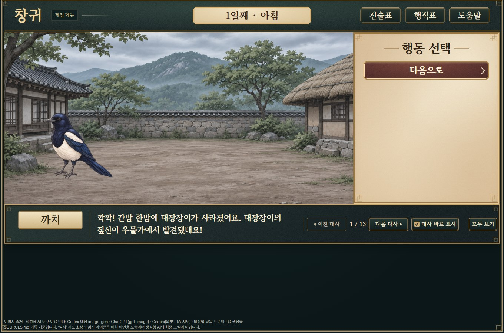

간밤 한밤중에 대장장이가 사라졌고 짚신이 우물가에서 발견됐습니다. 무당은 그 시간에 우물가에 갔거나 누군가를 보았다고 말하는 주민부터 살펴볼 수 있습니다.

### 주민의 말을 듣고 행동을 선택합니다

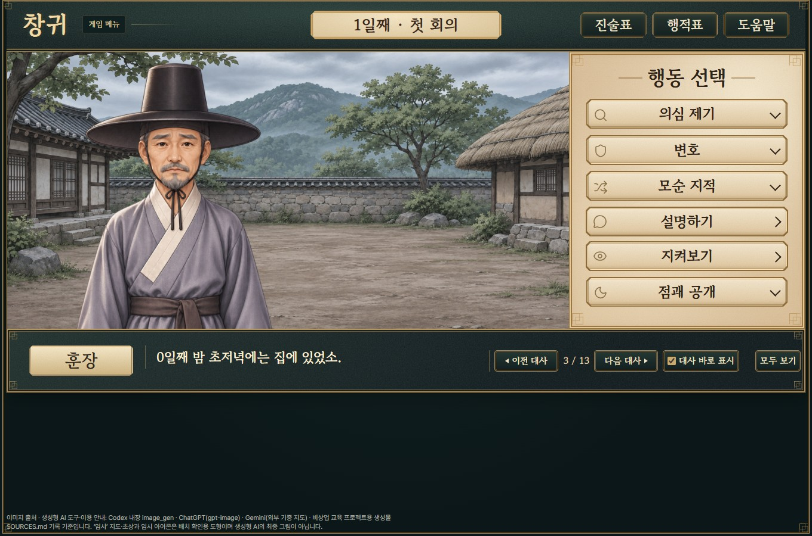

진술을 차례로 읽고 의심을 제기하거나 주민을 변호합니다. 모순을 찾았다면 어떤 진술이 서로 맞지 않는지 지적할 수 있습니다.

### 진술표에서 같은 밤의 이야기를 대조합니다

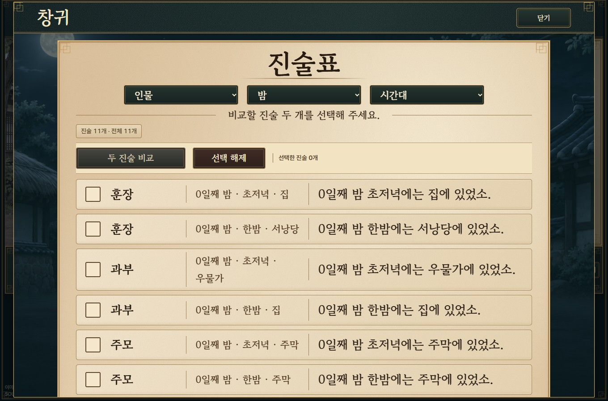

인물·밤·시간대로 진술을 좁힌 뒤 두 개를 고르면 나란히 볼 수 있습니다. 위 화면에서 훈장은 초저녁에 집, 한밤에 서낭당에 있었다고 말합니다. 한밤의 진술을 검토하려면 같은 시간대에 훈장을 봤다고 말한 주민의 진술을 찾아 장소를 대조해 보세요. 확인할 점이 남으면 캐묻기로 시간을 좁히거나, 맞지 않는 두 진술을 골라 회의에서 모순을 지적할 수 있습니다.

### 빈틈이 남은 행적을 캐묻습니다

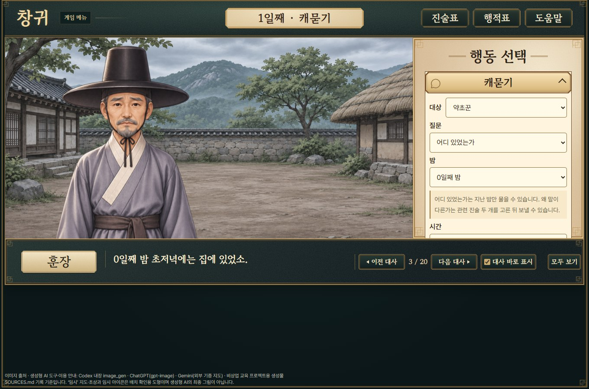

약초꾼을 대상으로 지난밤 한밤중에 어디 있었는지 묻습니다. 서로 다른 진술 두 개가 있다면 그 진술을 근거로 말이 다른 이유를 물을 수도 있습니다. 답을 들은 뒤에는 처음 세운 의심이 여전히 맞는지 다시 판단합니다.

### 투표에서 주민들의 판단을 확인합니다

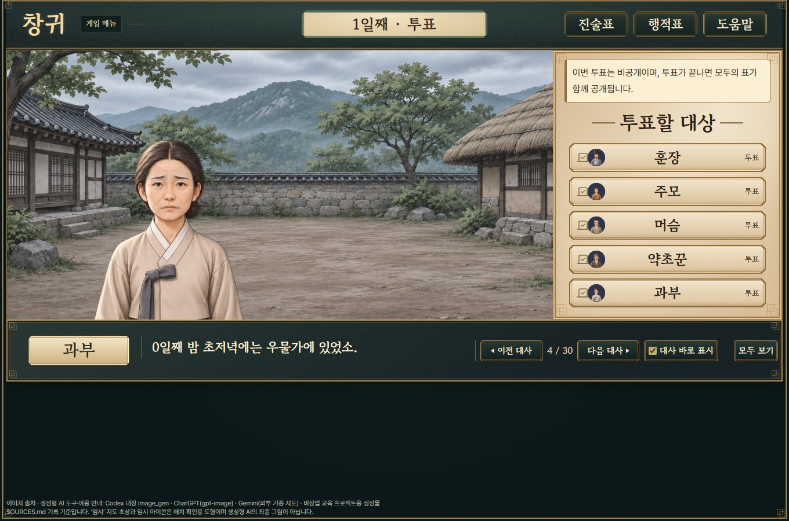

무당은 훈장에게 표를 던졌습니다. 투표를 마치면 주민들이 누구에게 표를 던졌는지 공개됩니다.

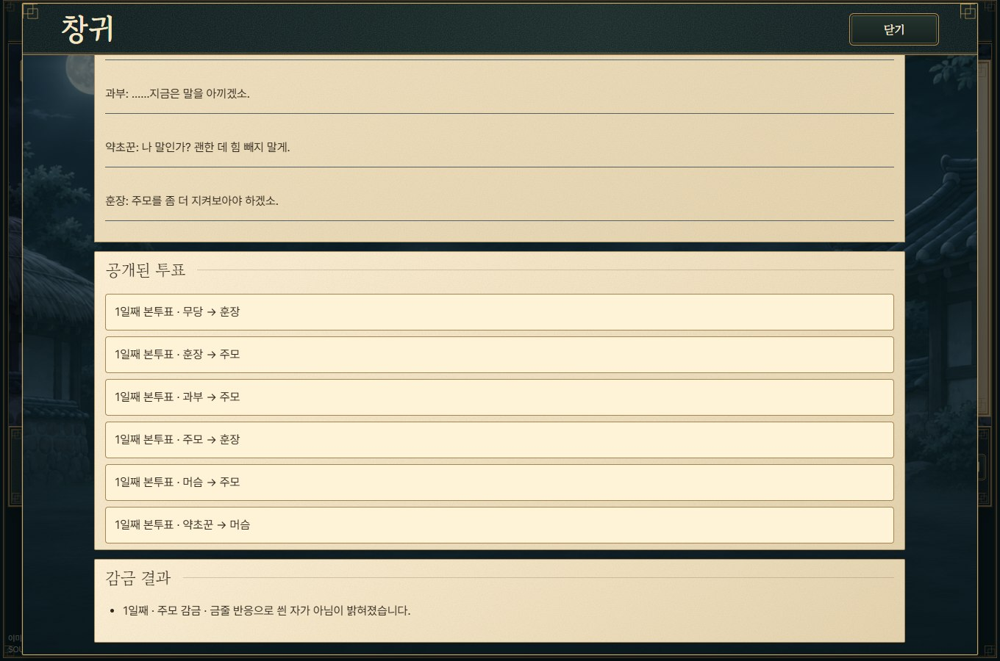

가장 많은 표를 받은 사람은 주모였습니다. 금줄 반응으로 주모가 씐 자가 아님이 드러나면서, 무당은 남은 주민의 행적을 다시 살펴야 합니다.

### 밤에는 의심되는 주민을 점칩니다

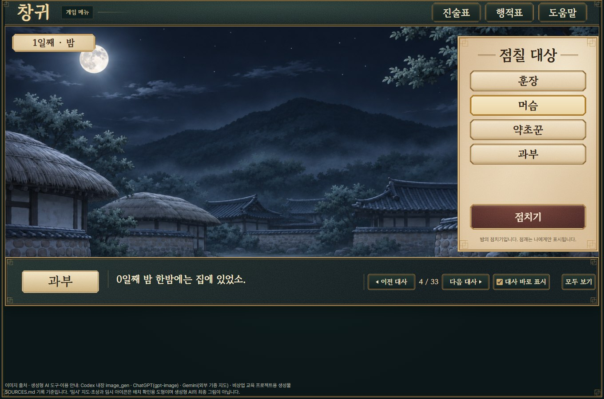

무당은 그날 밤 머슴을 점쳤습니다. 점괘는 **내 점괘**에 남아 무당에게만 보입니다.

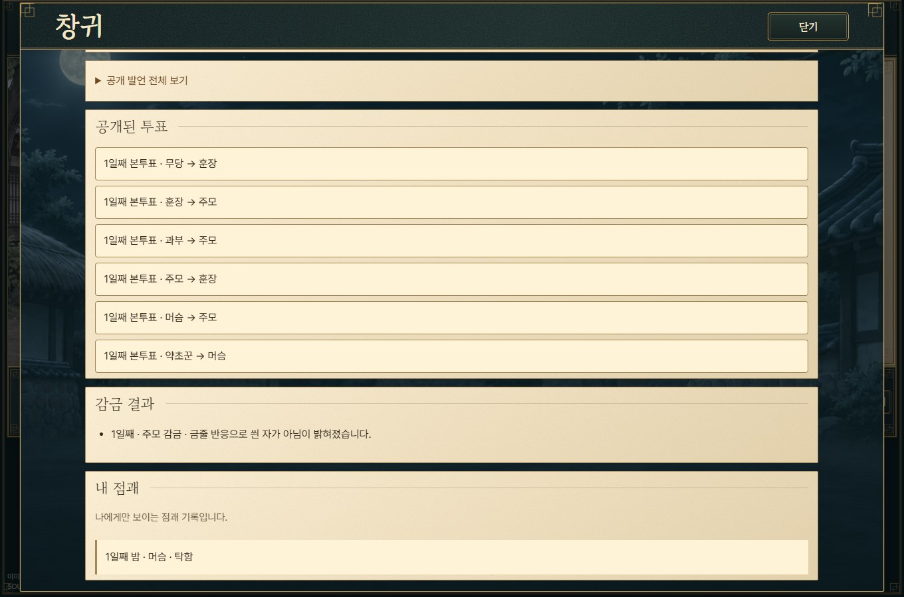

머슴의 점괘는 탁했습니다. 다음날 회의에서 이 정보를 공개할지, 주민들의 발언과 목격 기록을 더 확인할지 결정할 수 있습니다.

### 판이 끝나면 결과와 선택을 돌아봅니다

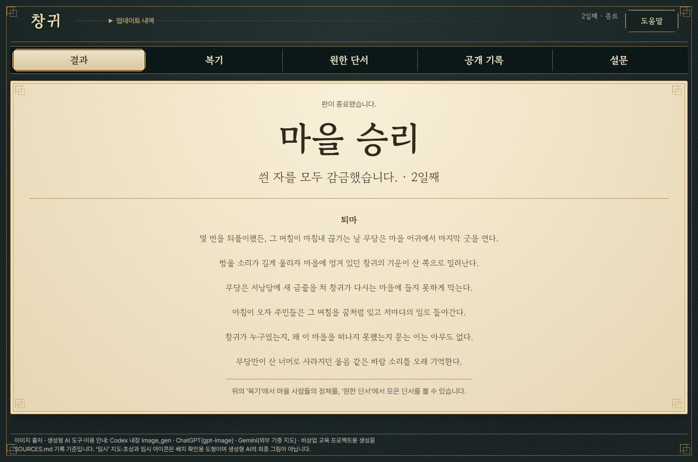

결과를 확인한 뒤 복기에서 선택과 진술을 되짚고, 공개 기록에서 주민들의 행적을 살펴볼 수 있습니다.

## 한 판이 끝난 뒤

복기에서는 그날의 발언과 표를 돌아보며 어느 진술을 놓쳤는지, 어떤 근거가 설득에 영향을 줬는지 살펴볼 수 있습니다. 다음 판에서는 같은 인물이 이번과 다른 비밀을 숨길 수도 있습니다.

**퇴마**는 처음부터 선택할 수 있는 결말입니다. **한풀이**는 창귀의 생전 신원, 죽음의 진상, 원한의 대상을 잇는 세 단서를 모으면 열립니다. 한풀이를 고른 판에서 마을이 이기면 창귀가 품었던 원한을 마주합니다.

게임을 로컬에서 열어 보려면 [실행 안내](README.md#실행)를 참고하세요. 원화 출처는 [게임 이미지 출처](content/images/SOURCES.md)에서 확인할 수 있습니다.
